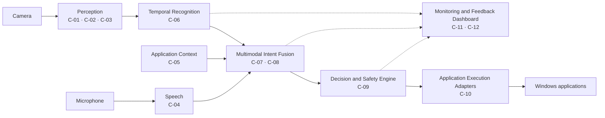

# Gesture-Controlled AI Computer Interface

A real-time desktop system that interprets **hand gestures, speech, and the state of the focused application** as user intent, then performs authorised computer actions — with a deterministic safety gate between decision and execution.

> **Research question:** Does adding temporal information, speech, and application context improve human-computer intent recognition compared with gesture-only interaction?

**Status:** Documentation baseline complete. Implementation begins with Phase 1 per the [Implementation Plan](docs/core/IMPLEMENTATION_PLAN.md).

---

## The Problem

Most gesture interfaces stop at static pose recognition and a hard-coded "gesture → keyboard shortcut" table. That design fails in practice:

- It cannot distinguish **dynamic** motion, so directional gestures are lost.
- It cannot tell **which** application the user is addressing, so the same gesture means one thing everywhere.
- It cannot use **speech** to resolve ambiguity.
- It fires on ordinary hand movement, producing **false activations**.
- It reports classification accuracy but not the **latency** a user actually feels.
- It executes OS automation with **no authorisation layer**, so one mistake can close unsaved work.

The result is a technology demo, not an interface.

## What We Are Building

A layered system in which perception, recognition, fusion, authorisation, and execution are separate stages with explicit contracts:

1. **Perceive** — OpenCV captures frames; MediaPipe extracts 21 hand landmarks; audio and foreground-application state are captured in parallel.
2. **Recognise** — landmarks are normalised and buffered into temporal windows; a swappable classifier produces a labelled gesture with confidence.
3. **Fuse** — gesture, speech, and context are combined with configurable weights and an explicit abstention path.
4. **Decide** — a deterministic thirteen-rule gate applies thresholds, temporal stability, duplicate suppression, cooldown, rate limits, an adapter allowlist, and an emergency stop.
5. **Act** — capability-scoped adapters translate an authorised action into a concrete automation call for PowerPoint, a media player, or an IDE.
6. **Observe** — every stage emits a structured event to a dashboard and a recorded trace.

The contribution is not the classifier. It is the **evidence chain**: temporal modelling for *what*, speech for *which*, context for *where*, and a deterministic gate for *whether*.

## Vision

A user should be able to make a short natural movement, optionally say one word, and have the machine do the right thing **in the application they are actually using** — without guessing, without spurious activations, and without learning a private command language.

## Objectives

| # | Objective |
|---|---|
| 1 | Deliver a real-time dynamic gesture recogniser on commodity hardware |
| 2 | Quantify the contribution of temporal modelling versus frame-level classification |
| 3 | Integrate speech without degrading responsiveness |
| 4 | Disambiguate identical gestures using application context |
| 5 | Drive false activations to a measured, low rate |
| 6 | Guarantee that no unauthorised action executes |
| 7 | Produce a reproducible experiment harness |
| 8 | Demonstrate generalisation to unseen users |

## Scope

### Minor Project — Dynamic Gesture Recognition

A self-contained real-time application:

- OpenCV capture and MediaPipe landmark extraction
- Normalised landmark representation and 30-frame temporal windows
- 12-class vocabulary (6 static, 6 dynamic)
- Five classifier families behind one interface: Random Forest, MLP, LSTM, GRU, Transformer Encoder
- Dataset tooling with subject-disjoint splits
- Subject-independent evaluation and a model comparison report
- PowerPoint actions and a live preview

### Major Project — Multimodal Intent Recognition

Everything above, plus:

- Local speech recognition over a closed command vocabulary
- Foreground-application and adapter-state awareness
- Multimodal fusion with abstention
- Context-dependent intent disambiguation
- Full safety gate: allowlist, dry-run, action classes, emergency stop
- PowerPoint, media player, and IDE adapters
- Backend API and live dashboard with decision traces
- Evaluation of three interaction configurations and ablations

### Out of Scope

Two-hand and body-pose recognition, continuous always-on spotting, runtime personalisation, cloud inference, multi-user sessions, and production packaging. These are documented extension points, not promises.

## System Architecture



Full structural, runtime, deployment, and concurrency views: [System Architecture](docs/architecture/SYSTEM_ARCHITECTURE.md).

**Architectural commitments**

| Commitment | Rationale |
|---|---|
| Modular monolith, one process | Latency budget and single-machine deployment |
| Model proposes, gate disposes | Safety must not depend on model confidence |
| Landmarks only, no raw media stored | Privacy and cross-user generalisation |
| Local-only processing | No network egress during operation |
| Configuration over code | Three research configurations from one binary |
| Adapter pattern for every application | New apps never touch the models |

## Key Capabilities

| Capability | Detail |
|---|---|
| Dynamic gesture recognition | Temporal windows over normalised landmarks |
| Model comparison | Five families, one harness, frozen splits |
| Speech disambiguation | Closed vocabulary plus fuzzy matching, push-to-talk gated |
| Context-aware intent | The same swipe means *next slide*, *next track*, or *next editor* |
| Explainable decisions | Every gate rule evaluated, recorded, and shown |
| Safe execution | Allowlist, action classes, dry-run, cooldown, emergency stop |
| Research instrumentation | Per-stage latency, false activations, cross-user generalisation |
| Live observability | Event stream, decision trace, metrics |

## Development Status

| Stage | State |
|---|---|
| Documentation baseline (`M0`) | **Complete** |
| Phase 1 — Foundation | Next |
| Phase 2 — OpenCV + MediaPipe | Planned |
| Phase 3 — Dataset | Planned |
| Phase 4–6 — Recognition to minor delivery | Planned |
| Phase 7–11 — Multimodal extension | Planned |
| Phase 12 — Evaluation and submission | Planned |

No implementation code exists yet. This repository currently establishes the engineering contract that the implementation must satisfy.

## Documentation

### Core — authoritative

| Document | Owns |
|---|---|
| [Product Requirements](docs/core/PRD.md) | Scope, requirements, user stories, acceptance criteria, success metrics |
| [Technical Requirements](docs/core/TRD.md) | Components, interfaces, runtime model, latency budget, trade-offs |
| [Backend Schema](docs/core/BACKEND_SCHEMA.md) | Entities, keys, constraints, retention, storage classes |
| [Implementation Plan](docs/core/IMPLEMENTATION_PLAN.md) | Phases, ownership, dependencies, milestones |
| [API and Integration](docs/core/API_AND_INTEGRATION.md) | Endpoints, events, payload schemas, internal interfaces |

### Supporting

[Repository Structure](docs/supporting/REPOSITORY_STRUCTURE.md) ·
[Tech Stack](docs/supporting/TECH_STACK.md) ·
[Model Comparison](docs/supporting/MODEL_COMPARISON.md) ·
[Research Methodology](docs/supporting/RESEARCH_METHODOLOGY.md) ·
[Dataset Specification](docs/supporting/DATASET_SPECIFICATION.md) ·
[Testing Strategy](docs/supporting/TESTING_STRATEGY.md) ·
[Security and Privacy](docs/supporting/SECURITY_AND_PRIVACY.md) ·
[Development Guidelines](docs/supporting/DEVELOPMENT_GUIDELINES.md) ·
[Traceability Matrix](docs/supporting/TRACEABILITY_MATRIX.md)

### Architecture and Research

[System Architecture](docs/architecture/SYSTEM_ARCHITECTURE.md) ·
[Architecture Decisions](docs/architecture/adr/) ·
[Experiment Design](docs/research/EXPERIMENT_DESIGN.md) ·
[Evaluation Metrics](docs/research/EVALUATION_METRICS.md) ·
[Experiment Log Template](docs/research/EXPERIMENT_LOG_TEMPLATE.md)

**Reading order for a new contributor:** PRD → TRD → Implementation Plan → the supporting document for your area.

**A note on numbers.** Every performance figure in these documents is a **proposed target**, not a measurement. Measured results will cite an experiment run ID. Where a target and a measurement differ, the measurement is reported and the target is revised.

## Planned Demonstrations

| # | Demonstration | What it shows |
|---|---|---|
| 1 | Arm, swipe, advance a slide | Temporal recognition end to end |
| 2 | The same swipe in a media player | Context-based disambiguation |
| 3 | Gesture plus the spoken word "next" | Multimodal fusion |
| 4 | A deliberately ambiguous motion | Abstention rather than a wrong action |
| 5 | Alt-tab between prediction and dispatch | Focus verification aborting an action |
| 6 | Live decision trace | Explainability |
| 7 | Emergency stop during dispatch | Deterministic safety |
| 8 | Model comparison table | Research evidence |

## Team Contribution

| Member | Ownership |
|---|---|
| **Team Lead** | Architecture, contracts, temporal modelling strategy, multimodal fusion, integration, research coordination |
| **Member 2** | OpenCV, MediaPipe, hand tracking, landmark extraction, preprocessing; speech from Phase 7 |
| **Member 3** | ML/DL models, sequence modelling, training harness, evaluation, dataset protocol |
| **Member 4** | Backend, application adapters, OS integration, execution safety, persistence |
| **Member 5** | Dashboard, monitoring, testing infrastructure, evaluation visualisation, demo rehearsal |

Detailed responsibility assignment: [Implementation Plan §3](docs/core/IMPLEMENTATION_PLAN.md).

## Repository

```
docs/        authoritative specifications
src/         application code (created from Phase 2)
datasets/    research data (gitignored; manifests tracked)
models/      checkpoints and model cards (weights gitignored)
experiments/ configs, notebooks, results
tests/       unit, integration, performance, end-to-end
```

Rationale and creation schedule: [Repository Structure](docs/supporting/REPOSITORY_STRUCTURE.md).

## Contributing

See [CONTRIBUTING.md](CONTRIBUTING.md) and [Development Guidelines](docs/supporting/DEVELOPMENT_GUIDELINES.md).

## License

[MIT](LICENSE) — Copyright (c) 2026 Spandan-2006
