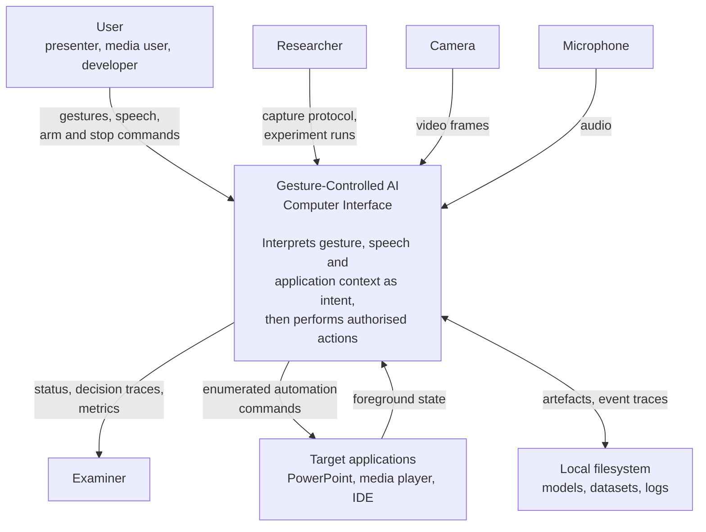
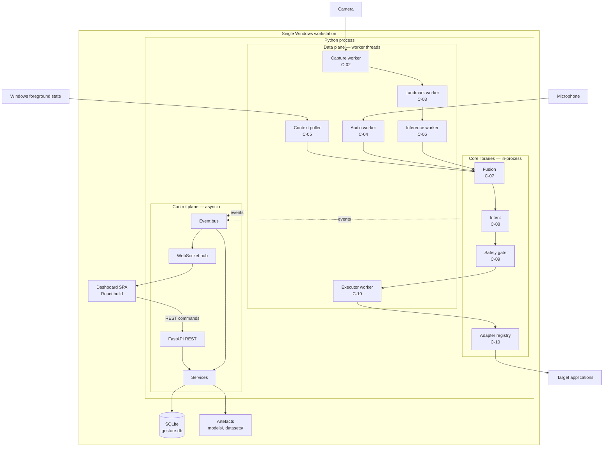
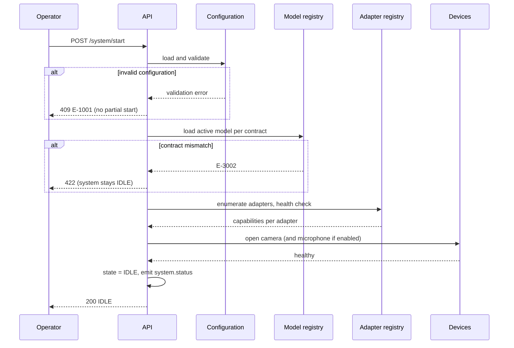
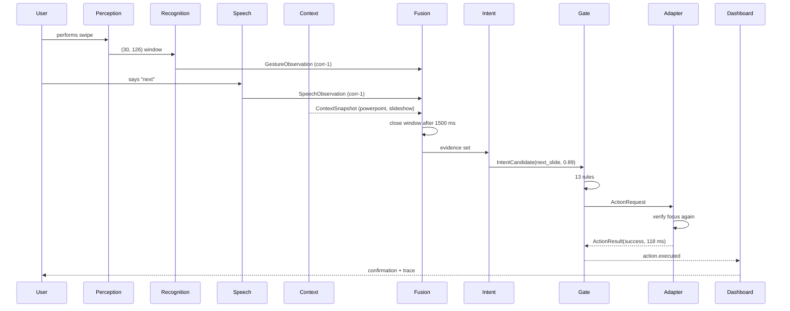
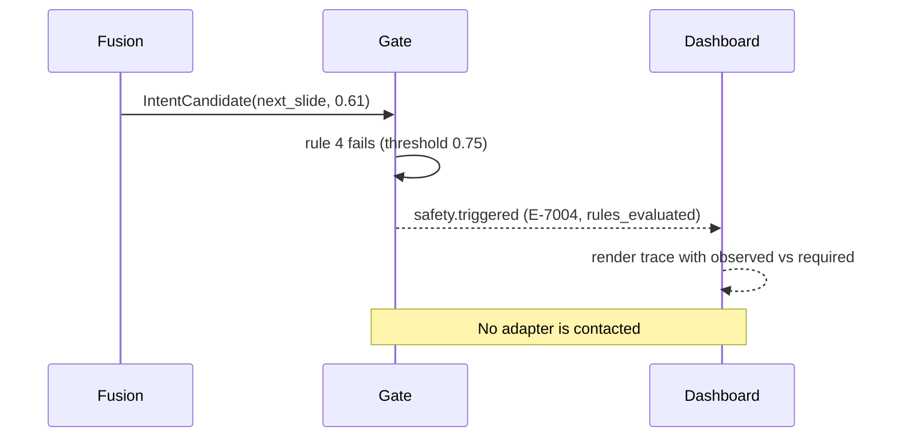
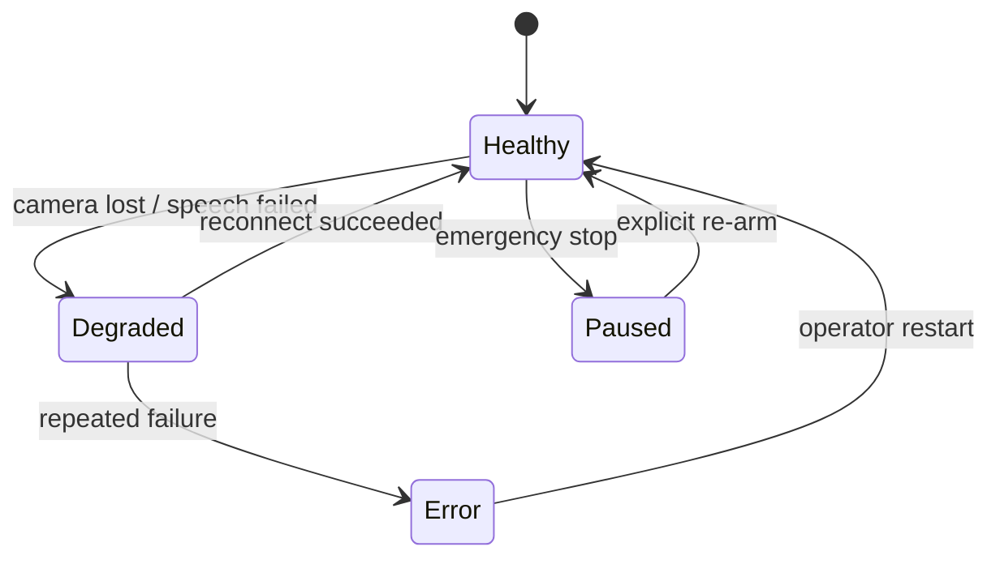
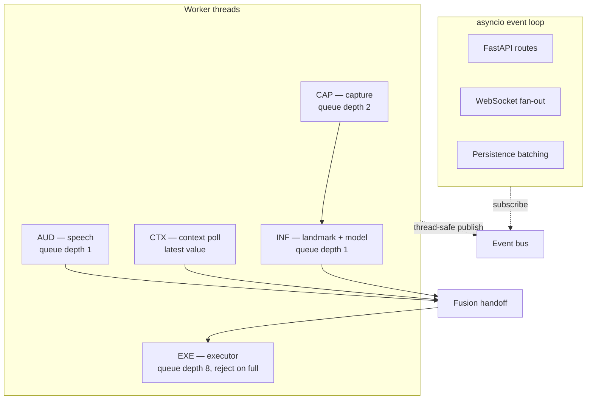
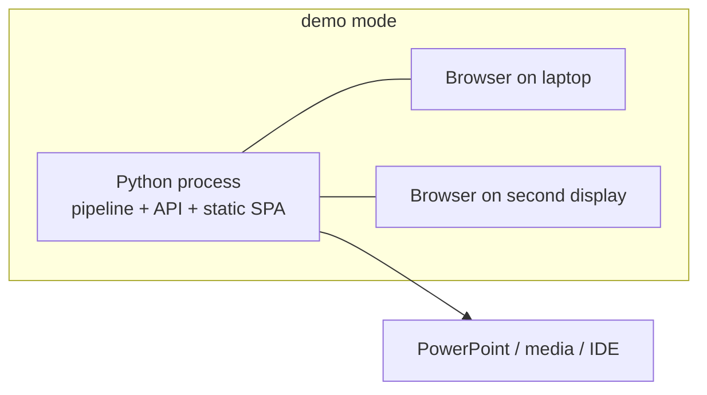
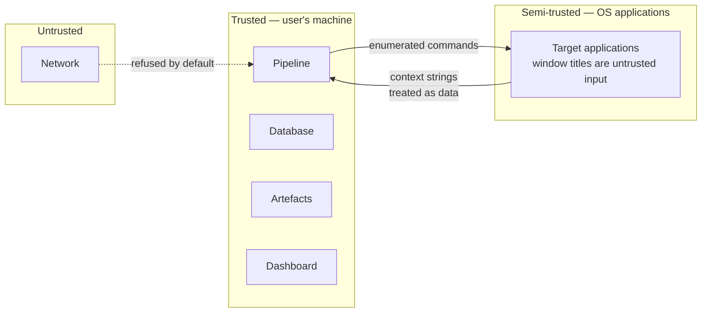

# System Architecture

**Project:** Gesture-Controlled AI Computer Interface
**Document ID:** ARCH-SYS
**Version:** 1.0.0
**Status:** Baseline
**Owner:** Team Lead
**Last Updated:** 2026-11-06

---

## 1. Purpose and Relationship to the TRD

The [TRD](../core/TRD.md) specifies *what* the architecture must satisfy: components, responsibilities, contracts, budgets, and technical requirements. This document specifies *how the parts behave together over time* — the views a developer needs before writing code.

| This document covers | The TRD covers |
|---|---|
| Structural and behavioural views (C4 levels 1–3) | Component responsibilities and interfaces |
| Runtime sequences and concurrency | Threading model and queue policies |
| Deployment topologies | Deployment requirements |
| Evolution path | Trade-off analysis |
| Architecture decision index | Requirement-level technical constraints |

Where the two overlap, the TRD is normative for constraints and this document is normative for behaviour.

---

## 2. Architectural Drivers

The architecture is shaped by five quality attributes, ranked.

| Rank | Attribute | Concrete driver | Consequence |
|---|---|---|---|
| 1 | **Safety** | An unintended action can destroy work | Deterministic gate; fail-closed; emergency stop |
| 2 | **Observability** | Behaviour must be explainable to a user and an examiner | Every stage emits typed events; decision traces |
| 3 | **Responsiveness** | Sub-second perceived response | Bounded queues; inference off the event loop; latency budget per stage |
| 4 | **Reproducibility** | Research claims must be auditable | Versioned artefacts; frozen splits; recorded provenance |
| 5 | **Extensibility** | New apps and models without rework | Adapter pattern; model registry; configuration over code |

**Deliberately not drivers.**

| Attribute | Why not |
|---|---|
| Horizontal scalability | One user, one machine |
| High availability | A crash during a demo is embarrassing, not a service outage |
| Multi-tenancy | No concurrent users |
| Sub-10 ms latency | Not achievable with a 30-frame window, and not required |

---

## 3. C4 Level 1 — System Context

**External dependencies and their criticality.**

| Dependency | Criticality | If unavailable |
|---|---|---|
| Camera | Blocking for gestures | System degrades to speech-only or refuses to start |
| Microphone | Optional | Gesture-only operation |
| Target application | Blocking for that adapter | Its intents are removed from the vocabulary |
| Filesystem | Blocking at startup | No models, no start |

---

## 4. C4 Level 2 — Containers

**Container responsibilities.**

| Container | Technology | State | Failure containment |
|---|---|---|---|
| Python process | CPython 3.11/3.12 | All runtime state | Single point of failure by design |
| Dashboard SPA | React, served statically | No server state | Can fail entirely without affecting the pipeline |
| SQLite | SQLite file | Persistent relational | Event buffer absorbs transient loss |
| Artefacts | Filesystem | Immutable versioned files | Startup failure if model missing |

**Why one process.** A process boundary between pipeline and backend would require serialising landmark-rate data across IPC, adding latency and complexity for no isolation benefit at this scale. The dashboard is separated because it is a browser client and must be.

---

## 5. C4 Level 3 — Pipeline Components

```mermaid
flowchart LR
    subgraph Perception["Perception — C-01"]
        direction TB
        F["FrameSource<br/>IF-001"]
        L["LandmarkExtractor<br/>IF-002"]
        B["Ring buffer<br/>60 frames"]
        FB["Feature builder<br/>IC-FRAME / IC-FLAT / IC-SEQ"]
        SF["Stability filter"]
        F --> L --> B --> FB --> SF
    end

    SF --> GO["GestureObservation"]

    subgraph Fusion["Fusion — C-07"]
        AS["Association<br/>correlation + window"]
        SC["Weighted scoring"]
        AB["Abstention check"]
        AS --> SC --> AB
    end

    GO --> AS
    SO["SpeechObservation<br/>C-04"] --> AS
    CS["ContextSnapshot<br/>C-05"] --> AS

    AB --> IC["IntentCandidate<br/>C-08"]

    subgraph Safety["Safety — C-09"]
        R["13 ordered rules"]
        D["Decision + rule trace"]
        R --> D
    end

    IC --> R
    D -->|"approved"| AR["ActionRequest"]
    D -->|"denied"| DENY["Denial + code"]

    AR --> AD["Adapter<br/>C-10"]
    AD --> RES["ActionResult"]

    GO -.-> EB["Event bus"]
    SO -.-> EB
    CS -.-> EB
    IC -.-> EB
    AR -.-> EB
    RES -.-> EB
    DENY -.-> EB
```

**Component interaction rules.**

| Rule | Rationale |
|---|---|
| Data flows one direction only | Prevents feedback loops and hidden coupling |
| Feedback flows through the event bus | The dashboard observes; it does not participate in control |
| No component both observes and mutates another's state | Except `C-09` reading current configuration |
| Pure functions at decision points | Testability and determinism |

---

## 6. Runtime Views

### 6.1 Startup

**Startup is all-or-nothing for blocking dependencies.** A missing camera prevents `start` with an explicit error. A missing microphone with `enable_speech: true` fails rather than silently degrading, because silent degradation produces confusing behaviour during a demo.

### 6.2 Interaction — Full Multimodal Path

**Timing annotation.**

| Point | Typical | Note |
|---|---|---|
| Window fill | ~1000 ms | Structural cost of temporal modelling |
| Inference | ~10–25 ms | Per model family |
| Association wait | 0–1500 ms | Only when speech is expected |
| Gate | < 1 ms | Pure computation |
| Dispatch | 50–200 ms | Application dependent |

**Design consequence.** In `gesture_only`, association closes immediately and the interaction completes as fast as inference allows. In the multimodal configurations, the association window is the dominant added latency. This is the honest trade-off the research measures.

### 6.3 Denial Path

### 6.4 Failure and Recovery

| Failure | State | Recovery | User-visible |
|---|---|---|---|
| Camera lost | `DEGRADED` | Automatic reconnect, backoff | Health indicator, no gestures |
| Speech engine failed | `DEGRADED` | Retry; stays absent | Speech shown disabled |
| Context query failed | `DEGRADED` | Retry | Execution denied |
| Adapter unhealthy | `DEGRADED` | Health retry | Intents removed from vocabulary |
| Model load failed | `ERROR` | Operator action | Startup refused |
| Database lost | `HEALTHY` | Reconnect | Events buffered, then dropped with counter |
| Dashboard lost | `HEALTHY` | Client reconnect | No pipeline impact |

### 6.5 Shutdown

Ordered to avoid half-executed actions:

1. Disarm; refuse new intents.
2. Drain the executor queue or mark pending actions as aborted.
3. Close devices.
4. Flush the event writer.
5. Emit `system.status` with `IDLE`.
6. Exit.

**Rule.** Shutdown never terminates mid-dispatch. If an action is in flight, shutdown waits up to the adapter timeout.

---

## 7. Concurrency View

**Rules that prevent the classic failures.**

| Failure mode | Rule |
|---|---|
| Capture stalls because inference is slow | Capture queue depth 2, drop oldest. Capture never blocks on inference. |
| Latency grows without bound | Every queue is bounded; overflow is counted, not queued |
| Event loop stalls | No CPU-bound work in routes; all heavy calls off-loop |
| Slow dashboard degrades pipeline | Per-client queues; publishing never blocks |
| Two actions race | Single executor thread; actions serialised |
| Authorised action lost | Executor rejects on full rather than dropping |

---

## 8. Deployment View

| Mode | Processes | Devices | Preview | Use |
|---|---|---|---|---|
| `dev` | Python + Vite | Real | On | Development |
| `demo` | Python (serves static SPA) | Real | On | Live demonstration |
| `headless` | Python | Real | Off | Evaluation runs |
| `replay` | Python | None | Off | CI and deterministic tests |

**Second-display use.** The dashboard is the explanation surface during a demonstration. It must be readable by an audience, which is why the decision trace is a first-class view rather than a debug panel.

---

## 9. Trust Boundaries

**Boundary rules.**

1. Window titles are **data**, never commands. They are hashed in logs and never mapped to keystrokes.
2. Transcripts are **data**, matched to a closed vocabulary, never passed to automation.
3. Model output is **evidence**, never authorisation.
4. The network is outside the trust boundary; the API binds to loopback.

---

## 10. Cross-Cutting Concerns

| Concern | Architectural mechanism | Detail |
|---|---|---|
| Correlation | One `correlation_id` per interaction | [API](../core/API_AND_INTEGRATION.md) §2 |
| Configuration | Layered, validated, versioned | [BACKEND_SCHEMA](../core/BACKEND_SCHEMA.md) §12 |
| Observability | Event per stage, structured logs | [TRD](../core/TRD.md) §19 |
| Error handling | Typed failures at boundaries | [TRD](../core/TRD.md) §19 |
| Safety | Single gate, pure rules | [TRD](../core/TRD.md) §5.9 |
| Privacy | Local-only, no raw media | [SECURITY_AND_PRIVACY](../supporting/SECURITY_AND_PRIVACY.md) |
| Reproducibility | Versioned artefacts and provenance | [TRD](../core/TRD.md) §8.2 |

---

## 11. Evolution Path

The architecture is designed to change in specific, bounded ways.

### 11.1 Minor → Major

| Addition | Structural impact |
|---|---|
| Speech channel | New producer into `C-07`; no change to `C-06` |
| Context channel | New producer into `C-07`; `C-05` new component |
| Adapters | New implementations of `IF-008`; no pipeline change |
| Dashboard | New consumer of the existing event bus |
| Persistence | New subscriber to the bus |

**No component is replaced.** The major system is the minor system with additional producers and consumers.

### 11.2 Documented Extension Points

| Future capability | Extension point | Effort |
|---|---|---|
| Two hands | `max_hands` in `C-03`; widen the feature vector; new `feature_spec_version` | Medium |
| Body pose | New perception component emitting its own observation type | Medium |
| Personalised calibration | Per-user model variants in the registry | Medium |
| Continuous spotting | New segmenter between `C-03` and `C-06` | High |
| Learned fusion | Replace `C-07` scoring with a trained model | Medium |
| Additional speech engines | New `IF-004` implementation | Low |
| GPU acceleration | Inference backend selected by configuration | Low |

**Change rule.** Any extension that alters a contract requires an ADR. Extensions that only add implementations do not.

### 11.3 Architecturally Rejected Futures

| Idea | Why rejected |
|---|---|
| Microservices split | Latency and operational cost with no benefit |
| Client-side inference | Browser cannot access OS automation or the Python CV stack |
| Cloud speech | Violates local-only processing |
| Event sourcing as primary store | Analytical queries would become expensive; the interaction log already serves research |

---

## 12. Architecture Decision Index

| ADR | Decision | Status |
|---|---|---|
| [ADR-0001](./adr/ADR-0001-modular-monolith.md) | Modular monolith over microservices | Accepted |
| [ADR-0002](./adr/ADR-0002-mediapipe-tasks.md) | MediaPipe Tasks for landmarks | Accepted |
| [ADR-0003](./adr/ADR-0003-landmark-only-representation.md) | Landmark-only model input | Accepted |
| [ADR-0004](./adr/ADR-0004-local-only-processing.md) | Local-only processing, no raw media retention | Accepted |
| [ADR-0005](./adr/ADR-0005-sqlite-default.md) | SQLite default, PostgreSQL-portable | Accepted |
| [ADR-0006](./adr/ADR-0006-fastapi-event-bus.md) | FastAPI with in-process event bus | Accepted |
| [ADR-0007](./adr/ADR-0007-adapter-allowlist.md) | Adapter allowlist and enumerated actions | Accepted |
| [ADR-0008](./adr/ADR-0008-activation-gating.md) | Activation gating as false-activation control | Accepted |
| [ADR-0009](./adr/ADR-0009-input-contracts.md) | Three input contracts for fair comparison | Accepted |
| [ADR-0010](./adr/ADR-0010-late-fusion-default.md) | Late fusion as the v1 default | Accepted |

**Status meaning.** `Accepted` records a decision that is binding for v1. `Proposed` would indicate a decision awaiting evidence; none of the current set is proposed.

---

## 13. Diagram Index

Mermaid diagrams are embedded inline in their owning documents, which keeps them from drifting out of sync. See [diagrams/README.md](./diagrams/README.md).

---

## 14. Related Documents

- [TRD](../core/TRD.md) — normative technical requirements
- [API and Integration](../core/API_AND_INTEGRATION.md) — contracts
- [Backend Schema](../core/BACKEND_SCHEMA.md) — persistence
- [Implementation Plan](../core/IMPLEMENTATION_PLAN.md) — delivery order
- [ADRs](./adr/) — decision records
