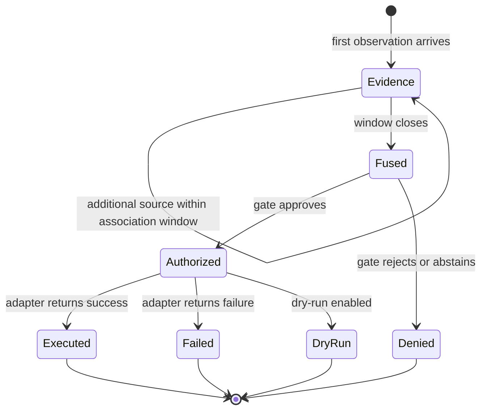
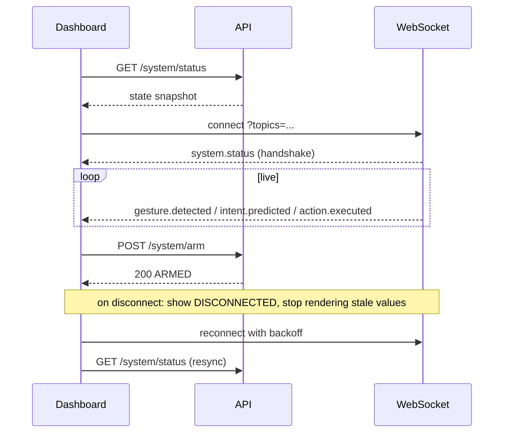

# API and Integration Specification

**Project:** Gesture-Controlled AI Computer Interface
**Document ID:** CORE-API
**Version:** 1.0.0
**Status:** Baseline
**Owner:** Team Lead (Contracts) with Member 4 (Backend)
**Last Updated:** 2026-11-06

---

## Document Control

| Field | Value |
|---|---|
| Source of truth for | HTTP endpoints, WebSocket events, event envelope, payload schemas, error format, internal module interfaces, event lifecycle |
| Does not own | Product requirements ([PRD](./PRD.md)), component responsibilities ([TRD](./TRD.md)), table definitions ([BACKEND_SCHEMA](./BACKEND_SCHEMA.md)) |
| ID namespaces owned | `EP-###` (endpoints), `EV-###` (events), `IF-###` (internal interfaces) |
| Normative language | `SHALL` = required, `SHOULD` = expected, `MAY` = optional |

**Consistency rule.** Every field named here that is persisted must exist in [BACKEND_SCHEMA](./BACKEND_SCHEMA.md) under the same name. Field renames require updates to both documents in the same change.

---

## 1. API Architecture

| Aspect | Decision |
|---|---|
| Style | REST for commands and queries; WebSocket for live events |
| Base path | `/api/v1` |
| Host | `127.0.0.1` default, configurable port (default `8000`) |
| Encoding | JSON, UTF-8, `snake_case` fields |
| Versioning | Path-based major version; additive changes within `v1` |
| Idempotency | `POST` commands accept an optional `Idempotency-Key` header |
| Concurrency | FastAPI on one asyncio loop; blocking work delegated to workers |
| Error model | Single structured error object for every non-2xx response |
| Auth | None by default (loopback); optional bearer token when `bind_public` is enabled |

### 1.1 Why HTTP + WebSocket and Not gRPC

The dashboard is a browser client, the backend is local, and the event rate is bounded by interaction frequency (tens per second at most). WebSocket delivers push semantics without the tooling cost of gRPC-Web, and REST keeps the API inspectable with `curl` during demonstrations. Revisit only if a non-browser client requires streaming RPC.

### 1.2 Layering

```
Router  →  Service  →  Repository  →  Database
   ↓          ↓
Schemas   Domain objects (contracts)
```

Routers SHALL NOT contain business logic. Services SHALL NOT construct HTTP responses. Repositories SHALL NOT import FastAPI.

---

## 2. Standard Event Envelope

Every event — WebSocket payload and internal bus message — SHALL use one envelope. This is the single most important contract in the system: the dashboard, the persistence writer, and the metrics aggregator all consume the same shape.

```json
{
  "event_id": "5f2b1c9e-3a44-4d2e-9f11-0b7c1a2d3e4f",
  "event_type": "gesture.detected",
  "timestamp": "2026-11-06T14:32:07.482Z",
  "correlation_id": "9d1e77aa-2b90-4c31-8a55-6f0e2c4b7d10",
  "schema_version": "1.0",
  "source": "C-06",
  "payload": { }
}
```

| Field | Type | Required | Rules |
|---|---|---|---|
| `event_id` | UUIDv4 string | Yes | Unique per event; generated at emission |
| `event_type` | enum string | Yes | Must be a registered type in §5 |
| `timestamp` | ISO-8601 UTC, millisecond precision, `Z` suffix | Yes | Emission time, not receipt time |
| `correlation_id` | UUIDv4 string | Yes | Shared by all events belonging to one user interaction |
| `schema_version` | `MAJOR.MINOR` | Yes | `1.0` for this baseline |
| `source` | component id (`C-01`…`C-12`) | Yes | Producer of the event |
| `payload` | object | Yes | Type-specific, defined in §5 |

**Rules.**

- `correlation_id` is created when the first evidence for an interaction arrives and is propagated to every downstream event, including denials. An interaction can always be reconstructed from it (`FR-087`).
- `event_id` and `correlation_id` are distinct. One correlation may contain many events.
- `timestamp` SHALL be UTC. Local time is a presentation concern.
- Consumers SHALL ignore unknown fields and unknown `event_type` values rather than failing.
- A payload SHALL NOT contain raw video, raw audio, or landmark arrays (`TR-020`).

---

## 3. Endpoint Catalogue

### 3.1 System Control

| ID | Method | Path | Purpose |
|---|---|---|---|
| `EP-001` | `GET` | `/api/v1/system/status` | Current state, subsystem health, active model, active application |
| `EP-002` | `POST` | `/api/v1/system/start` | Start pipeline and devices |
| `EP-003` | `POST` | `/api/v1/system/stop` | Stop pipeline and release devices |
| `EP-004` | `POST` | `/api/v1/system/arm` | Enter `ARMED` |
| `EP-005` | `POST` | `/api/v1/system/disarm` | Return to `IDLE` |
| `EP-006` | `POST` | `/api/v1/system/emergency-stop` | Engage emergency stop, enter `PAUSED` |
| `EP-007` | `POST` | `/api/v1/system/reset` | Clear emergency stop; requires `confirm: true` |
| `EP-008` | `GET` | `/api/v1/health` | Liveness and readiness, no domain data |

### 3.2 Gestures and Models

| ID | Method | Path | Purpose |
|---|---|---|---|
| `EP-010` | `GET` | `/api/v1/gestures` | Gesture class catalogue |
| `EP-011` | `GET` | `/api/v1/gestures/{class_id}` | One class with statistics |
| `EP-020` | `GET` | `/api/v1/models` | Registered models and versions |
| `EP-021` | `GET` | `/api/v1/models/{model_id}` | Model card and recorded metrics |
| `EP-022` | `POST` | `/api/v1/models/activate` | Activate a model version |

### 3.3 Applications and Context

| ID | Method | Path | Purpose |
|---|---|---|---|
| `EP-030` | `GET` | `/api/v1/applications` | Known applications, adapters, health |
| `EP-031` | `GET` | `/api/v1/applications/{adapter_id}` | Adapter capabilities and action classes |
| `EP-032` | `GET` | `/api/v1/applications/{adapter_id}/state` | Current adapter-reported state |
| `EP-033` | `GET` | `/api/v1/context` | Current `ContextSnapshot` |

### 3.4 Configuration

| ID | Method | Path | Purpose |
|---|---|---|---|
| `EP-040` | `POST` | `/api/v1/configuration` | Apply a configuration patch |
| `EP-041` | `GET` | `/api/v1/configuration` | Effective configuration |
| `EP-042` | `POST` | `/api/v1/configuration/validate` | Validate without applying |
| `EP-043` | `POST` | `/api/v1/configuration/rollback` | Restore last known-good configuration |

### 3.5 Experiments and Metrics

| ID | Method | Path | Purpose |
|---|---|---|---|
| `EP-050` | `GET` | `/api/v1/experiments` | List runs with filters |
| `EP-051` | `GET` | `/api/v1/experiments/{run_id}` | Run detail with results |
| `EP-052` | `GET` | `/api/v1/experiments/{run_id}/export` | Machine-readable export (`json` or `csv`) |
| `EP-060` | `GET` | `/api/v1/metrics` | Aggregate metrics for a time range |
| `EP-061` | `GET` | `/api/v1/metrics/session` | Current session summary |
| `EP-070` | `GET` | `/api/v1/interactions` | Query the interaction log |
| `EP-071` | `GET` | `/api/v1/interactions/{correlation_id}` | Full trace for one interaction |

### 3.6 WebSocket

| ID | Protocol | Path | Purpose |
|---|---|---|---|
| `EP-090` | `WS` | `/api/v1/ws/events` | Stream all registered events |

---

## 4. Request and Response Schemas

### 4.1 Response Wrapper

Successful single-object responses use:

```json
{
  "data": { },
  "meta": { "request_id": "c1a2...", "served_at": "2026-11-06T14:32:07.482Z" }
}
```

Collections use:

```json
{
  "data": [ ],
  "meta": { "count": 12, "next_cursor": null, "served_at": "..." }
}
```

`meta` SHALL NOT carry domain data. Domain data belongs in `data`.

### 4.2 `EP-001` — System Status

**Response `200`:**

```json
{
  "data": {
    "state": "ARMED",
    "state_since": "2026-11-06T14:30:02.000Z",
    "activation_mode": "wake_gesture",
    "dry_run": false,
    "emergency_stop": false,
    "active_model": { "model_id": "lstm", "version": "1.3.0", "family": "lstm" },
    "active_application": { "adapter_id": "powerpoint", "display_name": "PowerPoint" },
    "bus_health": {
      "camera": "healthy",
      "hand_tracking": "healthy",
      "speech": "disabled",
      "context": "healthy",
      "executor": "healthy",
      "database": "healthy"
    },
    "fps": 29.4,
    "queue_depth": { "capture": 0, "inference": 1, "executor": 0 },
    "uptime_s": 412
  },
  "meta": { "request_id": "r-001", "served_at": "2026-11-06T14:32:07.482Z" }
}
```

`state` enum: `IDLE`, `ARMED`, `LISTENING`, `EXECUTING`, `PAUSED`, `ERROR`.
Health enum: `healthy`, `degraded`, `unhealthy`, `disabled`.

### 4.3 `EP-002` — Start

**Request:**

```json
{ "camera_index": 0, "enable_speech": false, "enable_context": true }
```

All fields optional; omitted values use configuration.

**Responses:** `200` status object, `409` invalid state transition, `503` device unavailable.

### 4.4 `EP-006` — Emergency Stop

**Request:** `{ "reason": "user_hotkey" }`
**Response `200`:**

```json
{ "data": { "state": "PAUSED", "emergency_stop": true, "dispatched_actions_halted": 0 }, "meta": {} }
```

The endpoint SHALL return within 100 ms. It does not wait for in-flight adapter work to finish; the executor checks the flag before dispatch (`TR-019`).

### 4.5 `EP-020` — Models

**Response `200`:**

```json
{
  "data": [
    {
      "model_id": "lstm",
      "family": "lstm",
      "input_contract": "IC_SEQ",
      "feature_spec_version": "1.0.0",
      "versions": [
        {
          "version": "1.3.0",
          "created_at": "2026-11-01T10:00:00Z",
          "dataset_version": "ds-2026.10",
          "split_manifest_id": "split-loso-v1",
          "is_active": true
        }
      ]
    }
  ],
  "meta": { "count": 5, "next_cursor": null, "served_at": "..." }
}
```

### 4.6 `EP-022` — Activate Model

**Request:** `{ "model_id": "gru", "version": "1.1.0" }`

**Validation:** model exists, artefact loads, `feature_spec_version` matches runtime, `classes` match the active vocabulary.

**Responses:** `200` activated; `404` not found; `422` contract mismatch (`E-3002`); `409` model load failed (`E-3003`).

### 4.7 `EP-031` — Adapter Capabilities

```json
{
  "data": {
    "adapter_id": "powerpoint",
    "display_name": "Microsoft PowerPoint",
    "available": true,
    "process_names": ["POWERPNT.EXE"],
    "actions": [
      { "action": "next_slide", "class": "safe", "idempotent": false },
      { "action": "previous_slide", "class": "safe", "idempotent": false },
      { "action": "start_slideshow", "class": "safe", "idempotent": false },
      { "action": "end_slideshow", "class": "reversible", "idempotent": false }
    ]
  },
  "meta": {}
}
```

### 4.8 `EP-040` — Configuration Patch

PATCH semantics: provide only the sections to change. Unknown keys are rejected, not ignored.

```json
{
  "gesture": { "window_frames": 30, "stride_frames": 3, "stability_window": 3 },
  "safety": { "min_fused_confidence": 0.75, "cooldown_ms": 500, "max_actions_per_minute": 12 },
  "fusion": { "weights": { "gesture": 0.55, "speech": 0.30, "context": 0.15 } }
}
```

**Responses:**

| Code | Condition |
|---|---|
| `200` | Applied and validated; returns effective config |
| `409` | Validation failed; previous configuration remains active |
| `422` | Schema violation (unknown key, wrong type, out of range) |

**Constraint.** Applying safety configuration during `EXECUTING` is rejected with `409` (`E-1004`).

### 4.9 `EP-050` — Experiments

**Query parameters:** `model_id`, `config`, `dataset_version`, `since`, `until`, `limit` (≤100), `cursor`.

```json
{
  "data": [
    {
      "run_id": "run-20261101-0007",
      "model_id": "gru",
      "interaction_config": "gesture_speech_context",
      "dataset_version": "ds-2026.10",
      "split_manifest_id": "split-loso-v1",
      "status": "completed",
      "started_at": "2026-11-01T09:10:00Z",
      "completed_at": "2026-11-01T09:41:12Z",
      "metrics": { "accuracy": 0.904, "macro_f1": 0.881, "inference_p50_ms": 11.2, "inference_p95_ms": 18.9 }
    }
  ],
  "meta": { "count": 1, "next_cursor": null, "served_at": "..." }
}
```

Metrics appear only after a run completes. A running experiment SHALL NOT expose partial metrics that could be mistaken for results.

### 4.10 `EP-060` — Metrics

**Query parameters:** `from`, `to`, `granularity` (`session` | `minute`), `metric` (repeatable).

```json
{
  "data": {
    "window": { "from": "2026-11-06T14:00:00Z", "to": "2026-11-06T15:00:00Z" },
    "interaction": { "attempts": 84, "executed": 71, "denied": 13, "abstained": 6, "success_rate": 0.986 },
    "latency": {
      "inference_ms": { "p50": 12.4, "p95": 21.7 },
      "end_to_end_ms": { "p50": 318, "p95": 604 }
    },
    "safety": { "false_activations": 3, "false_activations_per_minute": 0.05, "emergency_stops": 0 }
  },
  "meta": {}
}
```

---

## 5. WebSocket Events

### 5.1 Connection

```
WS /api/v1/ws/events?topics=gesture.detected,intent.predicted&token=<optional>
```

| Behaviour | Rule |
|---|---|
| Handshake | Server sends `system.status` immediately after accept |
| Topics | Omitted = all topics; comma-separated filter |
| Server → client frame | One envelope per message |
| Client → server frame | Only `{"type":"ping"}` is accepted; ignored otherwise |
| Heartbeat | Server ping every 15 s; drop after 2 missed pongs |
| Slow client | Per-client queue of 256 events; overflow drops oldest and sends `system.status` with `client_lagged: true` |
| Reconnect | Client backoff 0.5 s → 8 s with jitter; client MUST resync via `EP-001` |
| Ordering | Per-`correlation_id` ordering is preserved; global ordering is not guaranteed across topics |

**No replay buffer in v1.** A reconnecting client reconstructs state from REST. This is a deliberate simplification that keeps the server stateless.

### 5.2 Event Catalogue

| ID | Event type | Source | Payload |
|---|---|---|---|
| `EV-001` | `gesture.detected` | C-06 | Gesture observation |
| `EV-002` | `speech.transcribed` | C-04 | Speech observation |
| `EV-003` | `context.updated` | C-05 | Context snapshot |
| `EV-004` | `intent.predicted` | C-08 | Intent candidate |
| `EV-005` | `action.requested` | C-09 | Action request |
| `EV-006` | `action.executed` | C-10 | Action result |
| `EV-007` | `action.failed` | C-10 | Action result + error |
| `EV-008` | `system.status` | C-01 | State and health |
| `EV-009` | `safety.triggered` | C-09 | Denial or emergency stop |
| `EV-010` | `model.loaded` | C-06 | Model identity and contract |
| `EV-011` | `experiment.started` | Tooling | Run identity |
| `EV-012` | `experiment.completed` | Tooling | Run identity + summary |
| `EV-013` | `metrics.updated` | C-11 | Rolling counters |
| `EV-014` | `system.error` | Any | Error object |

### 5.3 Payload Examples

**`EV-001` `gesture.detected`**

```json
{
  "event_id": "5f2b1c9e-...",
  "event_type": "gesture.detected",
  "timestamp": "2026-11-06T14:32:07.482Z",
  "correlation_id": "9d1e77aa-...",
  "schema_version": "1.0",
  "source": "C-06",
  "payload": {
    "label": "swipe_right",
    "confidence": 0.91,
    "class_scores": { "swipe_right": 0.91, "swipe_left": 0.03, "wave": 0.02 },
    "stable": true,
    "window_start": "2026-11-06T14:32:06.510Z",
    "window_end": "2026-11-06T14:32:07.480Z",
    "model_id": "lstm",
    "model_version": "1.3.0",
    "inference_latency_ms": 12.4,
    "frames_used": 30
  }
}
```

**`EV-002` `speech.transcribed`**

```json
{
  "event_type": "speech.transcribed",
  "source": "C-04",
  "payload": {
    "transcript": "next",
    "normalized_command": "next",
    "match_score": 0.97,
    "confidence": 0.88,
    "engine": "faster-whisper",
    "language": "en",
    "audio_start": "2026-11-06T14:32:07.100Z",
    "audio_end": "2026-11-06T14:32:08.020Z",
    "transcription_latency_ms": 640,
    "in_vocabulary": true
  }
}
```

**`EV-003` `context.updated`**

```json
{
  "event_type": "context.updated",
  "source": "C-05",
  "payload": {
    "app_id": "powerpoint",
    "adapter_id": "powerpoint",
    "process_name": "POWERPNT.EXE",
    "window_title": "[redacted]",
    "state": { "slideshow_active": true, "slide_index": 4, "slide_count": 18 },
    "confidence": 0.99,
    "change_reason": "focus_changed"
  }
}
```

**`EV-004` `intent.predicted`**

```json
{
  "event_type": "intent.predicted",
  "source": "C-08",
  "payload": {
    "intent_id": "next_slide",
    "intent_label": "Next slide",
    "fused_confidence": 0.89,
    "abstained": false,
    "sources_present": ["gesture", "speech", "context"],
    "evidence": {
      "gesture": { "label": "swipe_right", "confidence": 0.91, "weight": 0.55 },
      "speech": { "command": "next", "confidence": 0.88, "weight": 0.30 },
      "context": { "adapter_id": "powerpoint", "slideshow_active": true, "weight": 0.15 }
    },
    "alternatives": [
      { "intent_id": "previous_slide", "confidence": 0.04 },
      { "intent_id": "black_screen", "confidence": 0.02 }
    ],
    "fusion_mode": "gesture_speech_context"
  }
}
```

**`EV-005` `action.requested`**

```json
{
  "event_type": "action.requested",
  "source": "C-09",
  "payload": {
    "action_id": "act-7c1f",
    "intent_id": "next_slide",
    "adapter_id": "powerpoint",
    "command": "next_slide",
    "parameters": {},
    "action_class": "safe",
    "dry_run": false,
    "authorized_by": "gate-rule-13"
  }
}
```

**`EV-006` `action.executed`**

```json
{
  "event_type": "action.executed",
  "source": "C-10",
  "payload": {
    "action_id": "act-7c1f",
    "status": "success",
    "adapter_id": "powerpoint",
    "duration_ms": 118,
    "end_to_end_latency_ms": 318
  }
}
```

**`EV-009` `safety.triggered`**

```json
{
  "event_type": "safety.triggered",
  "source": "C-09",
  "payload": {
    "outcome": "denied",
    "denial_code": "E-7004",
    "reason": "fused confidence 0.61 below threshold 0.75",
    "rules_evaluated": [
      { "order": 1, "rule": "state_active", "result": "pass" },
      { "order": 2, "rule": "estop_clear", "result": "pass" },
      { "order": 3, "rule": "not_abstained", "result": "pass" },
      { "order": 4, "rule": "fused_confidence", "result": "fail", "observed": 0.61, "required": 0.75 }
    ],
    "deciding_rule": "fused_confidence"
  }
}
```

### 5.4 Event Lifecycle



All events in one interaction share one `correlation_id`:

```
gesture.detected ─┐
speech.transcribed ┼─▶ intent.predicted ─▶ action.requested ─▶ action.executed
context.updated ──┘                                              └─▶ safety.triggered (if denied)
```

---

## 6. Error Responses

### 6.1 Format

```json
{
  "error": {
    "code": "E-7004",
    "category": "safety",
    "message": "Intent confidence below threshold",
    "details": { "observed": 0.61, "required": 0.75, "rule": "fused_confidence" },
    "retryable": false,
    "correlation_id": "9d1e77aa-...",
    "request_id": "r-001",
    "timestamp": "2026-11-06T14:32:07.482Z"
  }
}
```

| Field | Required | Rule |
|---|---|---|
| `code` | Yes | Stable identifier from the taxonomy in [TRD](./TRD.md) §19.1 |
| `category` | Yes | `configuration`, `perception`, `model`, `speech`, `context`, `fusion`, `safety`, `execution`, `backend` |
| `message` | Yes | Human-readable, no secrets, no stack traces |
| `details` | No | Structured context for debugging |
| `retryable` | Yes | Whether the same request may succeed on retry |
| `correlation_id` | When applicable | Links to the interaction trace |
| `request_id` | Yes | Per-request identifier for log correlation |

### 6.2 Status Codes

| Code | Meaning | Used for |
|---|---|---|
| `200` | OK | Successful read or synchronous action |
| `201` | Created | Dataset release or experiment record created |
| `202` | Accepted | Long-running operation queued (model load) |
| `204` | No Content | Successful delete (dataset draft discard) |
| `400` | Bad Request | Malformed JSON |
| `401` | Unauthorized | Missing/invalid token when auth enabled |
| `403` | Forbidden | Action disallowed by policy (destructive without confirmation) |
| `404` | Not Found | Unknown model, run, adapter |
| `409` | Conflict | Invalid state transition, validation failure on apply, queue saturated |
| `422` | Unprocessable Entity | Schema or contract violation |
| `429` | Too Many Requests | Rate limit on control endpoints |
| `500` | Internal Error | Unhandled server fault |
| `503` | Service Unavailable | Device missing, subsystem unhealthy |
| `504` | Gateway Timeout | Adapter dispatch exceeded timeout |

### 6.3 Error Code Register

| Code | Name | Category | Retryable |
|---|---|---|---|
| `E-1001` | Invalid configuration value | configuration | No |
| `E-1002` | Unknown configuration key | configuration | No |
| `E-1003` | Configuration path outside allowlist | configuration | No |
| `E-1004` | Configuration locked during execution | configuration | Yes |
| `E-2001` | Camera unavailable | perception | Yes |
| `E-2002` | Camera disconnected during session | perception | Yes |
| `E-2003` | Effective FPS below minimum | perception | No |
| `E-3001` | Model artefact missing | model | No |
| `E-3002` | Feature spec or class mismatch | model | No |
| `E-3003` | Model load failed | model | Yes |
| `E-4001` | Audio device unavailable | speech | Yes |
| `E-4002` | Transcription failed | speech | Yes |
| `E-4003` | Empty or out-of-vocabulary utterance | speech | No |
| `E-5001` | Foreground query failed | context | Yes |
| `E-5002` | Unknown application | context | No |
| `E-6001` | No usable evidence | fusion | No |
| `E-6002` | Association window expired without closure | fusion | No |
| `E-7001` | System not in an execution-capable state | safety | No |
| `E-7002` | Emergency stop engaged | safety | No |
| `E-7003` | Intent abstained | safety | No |
| `E-7004` | Fused confidence below threshold | safety | No |
| `E-7005` | Source confidence below threshold | safety | No |
| `E-7006` | Gesture not temporally stable | safety | No |
| `E-7007` | Duplicate within cooldown | safety | Yes |
| `E-7008` | Action rate limit exceeded | safety | Yes |
| `E-7009` | Adapter not allowlisted | safety | No |
| `E-7010` | Adapter health check failed | safety | Yes |
| `E-7011` | Foreground application mismatch | safety | No |
| `E-7012` | Action class not permitted | safety | No |
| `E-7013` | Executor queue saturated | safety | Yes |
| `E-8001` | Adapter unavailable | execution | Yes |
| `E-8002` | Unsupported action | execution | No |
| `E-8003` | Adapter timeout | execution | Yes |
| `E-8004` | Automation call rejected by OS | execution | No |
| `E-9001` | Request validation failed | backend | No |
| `E-9002` | Database unavailable | backend | Yes |
| `E-9003` | Internal server error | backend | Yes |

---

## 7. Validation Rules

### 7.1 Global Rules

| Rule | Detail |
|---|---|
| Unknown keys | Rejected with `422`, not ignored (except in `payload` of consumed events) |
| Types | Strict; no implicit string→number coercion |
| Enums | Case-sensitive |
| IDs | UUIDv4 where declared as UUID; opaque strings otherwise |
| Ranges | Numeric fields declare inclusive bounds |
| Strings | Trimmed; maximum lengths declared per field |
| Nulls | Only where explicitly optional; `null` is not equivalent to absent for required fields |

### 7.2 Configuration Bounds

| Field | Type | Bounds | Default |
|---|---|---|---|
| `gesture.window_frames` | int | 10–120 | 30 |
| `gesture.stride_frames` | int | 1–10 | 3 |
| `gesture.stability_window` | int | 1–10 | 3 |
| `gesture.min_valid_frames_ratio` | float | 0.5–1.0 | 0.8 |
| `safety.min_fused_confidence` | float | 0.5–0.99 | 0.75 |
| `safety.min_source_confidence.gesture` | float | 0.3–0.99 | 0.70 |
| `safety.min_source_confidence.speech` | float | 0.3–0.99 | 0.65 |
| `safety.cooldown_ms` | int | 0–5000 | 500 |
| `safety.max_actions_per_minute` | int | 1–60 | 12 |
| `safety.dry_run` | bool | — | false |
| `fusion.association_window_ms` | int | 500–5000 | 1500 |
| `fusion.weights.gesture` | float | 0.0–1.0 | 0.55 |
| `fusion.weights.speech` | float | 0.0–1.0 | 0.30 |
| `fusion.weights.context` | float | 0.0–1.0 | 0.15 |
| `context.poll_interval_ms` | int | 100–1000 | 200 |
| `camera.width` / `camera.height` | int | 320–1920, even | 640 / 480 |
| `camera.fps` | int | 10–60 | 30 |

**Cross-field rule.** `fusion.weights` SHALL sum to `1.0 ± 0.001`. A weight of `0.0` disables a source and is how the research configurations are expressed (`FR-056`). Disabling a source that is also disabled at the subsystem level is a validation error.

### 7.3 Speech Command Vocabulary (v1)

| Command | Synonyms | Intents enabled |
|---|---|---|
| `next` | "forward", "advance" | `next_slide`, `next_track`, `next_editor` |
| `previous` | "back", "go back" | `previous_slide`, `previous_track`, `previous_editor` |
| `play` | "resume", "start" | `play`, `start_slideshow`, `run` |
| `pause` | "stop playback" | `pause` |
| `volume` | "louder", "quieter" | `volume_up` / `volume_down` (direction from gesture) |
| `mute` | "silence" | `mute` |
| `save` | "write" | `save` |
| `debug` | "breakpoint" | `start_debug` |
| `command` | "palette" | `open_command_palette` |
| `black` | "blank" | `toggle_black_screen` |

Out-of-vocabulary utterances produce `in_vocabulary: false` and never contribute to fusion (`FR-034`).

---

## 8. Authentication and Authorisation

| Mode | When | Mechanism |
|---|---|---|
| Loopback, no auth | Default | Requests from `127.0.0.1` accepted; no token required |
| Token auth | `bind_public: true` | `Authorization: Bearer <token>`; token from environment |
| Origin check | Default | CORS restricted to the dashboard origin |

**Authorisation is not authentication.** The gate (`C-09`) authorises *actions*; the API authorises *clients*. These are independent mechanisms and neither substitutes for the other.

---

## 9. Internal Module Interfaces

These are Python protocol definitions. They are the contract between packages; implementations may change freely behind them.

### 9.1 `IF-001` `FrameSource`

```python
class FrameSource(Protocol):
    def open(self) -> None: ...
    def read(self, timeout_ms: int) -> FramePacket | None: ...
    def close(self) -> None: ...
    def is_healthy(self) -> bool: ...
    def effective_fps(self) -> float: ...
```

### 9.2 `IF-002` `LandmarkExtractor`

```python
class LandmarkExtractor(Protocol):
    feature_spec_version: str
    def extract(self, frame: FramePacket) -> HandLandmarks | None: ...
    def warmup(self) -> None: ...
```

```python
@dataclass(frozen=True)
class HandLandmarks:
    positions: np.ndarray      # (21, 3) wrist-relative, scale-normalised
    velocities: np.ndarray     # (21, 3)
    handedness: Literal["left", "right"]
    mean_visibility: float
    timestamp_ns: int
```

### 9.3 `IF-003` `GestureClassifier`

```python
class GestureClassifier(Protocol):
    model_id: str
    version: str
    feature_spec_version: str
    input_contract: Literal["IC-FRAME", "IC-FLAT", "IC-SEQ"]
    classes: list[str]
    def warmup(self) -> None: ...
    def predict(self, batch: np.ndarray) -> list[ClassScores]: ...
    def metadata(self) -> ModelMetadata: ...
```

`predict` SHALL accept a batch and return one `ClassScores` per row, in order. It SHALL NOT perform stability filtering.

### 9.4 `IF-004` `SpeechEngine`

```python
class SpeechEngine(Protocol):
    engine_id: str
    def start(self) -> None: ...
    def stop(self) -> None: ...
    def transcribe(self, audio: np.ndarray, sample_rate: int) -> SpeechResult: ...
    def is_available(self) -> bool: ...
```

### 9.5 `IF-005` `ContextProvider`

```python
class ContextProvider(Protocol):
    def snapshot(self) -> ContextSnapshot: ...
    def subscribe(self, callback: Callable[[ContextSnapshot], None]) -> None: ...
    def is_healthy(self) -> bool: ...
    def resolve_adapter(self, process_name: str) -> str: ...
```

### 9.6 `IF-006` `FusionEngine`

```python
class FusionEngine(Protocol):
    def submit(self, evidence: Evidence) -> None: ...
    def poll_ready(self) -> list[IntentCandidate]: ...
    def configure(self, weights: FusionWeights, window_ms: int) -> None: ...
```

`submit` is non-blocking. `poll_ready` returns only interactions whose association window has closed. The engine SHALL be absent-source tolerant.

### 9.7 `IF-007` `DecisionGate`

```python
class DecisionGate(Protocol):
    def evaluate(self, candidate: IntentCandidate) -> Decision: ...
    def engage_emergency_stop(self, reason: str) -> None: ...
    def clear_emergency_stop(self, confirmation: bool) -> None: ...
    def is_stopped(self) -> bool: ...
```

**Purity requirement.** `evaluate` SHALL be a pure function of its arguments plus current configuration and emergency-stop flag. It SHALL NOT perform I/O, call adapters, or read the clock beyond `evaluated_at` metadata (`TR-013`).

### 9.8 `IF-008` `ApplicationAdapter`

```python
class ApplicationAdapter(Protocol):
    adapter_id: str
    display_name: str
    process_names: list[str]
    supported_actions: list[str]
    action_classes: dict[str, Literal["safe", "reversible", "destructive"]]
    def is_available(self) -> HealthStatus: ...
    def get_state(self) -> dict[str, Any]: ...
    def execute(self, command: str, params: dict[str, Any], *, dry_run: bool) -> ActionResult: ...
```

### 9.9 `IF-009` `EventBus`

```python
class EventBus(Protocol):
    def publish(self, event: Envelope) -> None: ...
    def subscribe(self, topics: set[str] | None, queue_size: int) -> Subscription: ...
```

`publish` SHALL be non-blocking. A subscriber whose queue is full loses its oldest event and increments `dropped_events`; the publisher is never slowed down.

### 9.10 Interface Dependency Rules

| Rule | Enforcement |
|---|---|
| `IF-003` implementations SHALL NOT import `src.fusion`, `src.intent`, or `src.execution` | import-graph test |
| `IF-008` implementations SHALL NOT import `src.recognition` | import-graph test |
| Contracts live in `src/contracts/` and SHALL be dependency-free except for stdlib, NumPy, and Pydantic | dependency test |
| No module SHALL import a concrete implementation of another component; only the protocol | review + test |

---

## 10. Dashboard Integration

### 10.1 Session Flow



### 10.2 Client Responsibilities

| Responsibility | Rule |
|---|---|
| Initial state | Fetch `EP-001` before subscribing; never assume defaults |
| Ordering | Render by `timestamp`, not arrival order |
| Correlation | Group events by `correlation_id` for the decision trace |
| Staleness | Mark data stale after 2 s without events while connected |
| Missing events | Do not infer an action from an intent; only `action.executed` confirms |
| Rate limiting | Coalesce table updates to ≤ 10 Hz |
| Control safety | Emergency stop requires no confirmation; re-arm does |

### 10.3 Decision Trace Rendering

The dashboard renders the `rules_evaluated` array from `EV-009` or from `EP-071` in gate order, with the deciding rule highlighted and the observed/required values shown side by side. This is the primary explanation surface for judges and users (`FR-092`).

---

## 11. Integration Examples

### 11.1 Start and Arm

```bash
curl -s -X POST http://127.0.0.1:8000/api/v1/system/start \
  -H "Content-Type: application/json" \
  -d '{"camera_index":0,"enable_speech":false,"enable_context":true}'

curl -s -X POST http://127.0.0.1:8000/api/v1/system/arm
```

### 11.2 Validate Configuration Without Applying

```bash
curl -s -X POST http://127.0.0.1:8000/api/v1/configuration/validate \
  -H "Content-Type: application/json" \
  -d '{"safety":{"min_fused_confidence":0.8},"fusion":{"weights":{"gesture":0.6,"speech":0.25,"context":0.15}}}'
```

### 11.3 Subscribe to Events (Python)

```python
import json, websockets, asyncio

async def main() -> None:
    uri = "ws://127.0.0.1:8000/api/v1/ws/events?topics=intent.predicted,action.executed"
    async with websockets.connect(uri) as ws:
        async for raw in ws:
            event = json.loads(raw)
            if event["event_type"] == "action.executed":
                print(event["correlation_id"], event["payload"]["duration_ms"])

asyncio.run(main())
```

### 11.4 Reconstruct One Interaction

```bash
curl -s "http://127.0.0.1:8000/api/v1/interactions/9d1e77aa-2b90-4c31-8a55-6f0e2c4b7d10"
```

Returns the ordered event chain for that correlation, which is the ground truth for latency and decision analysis.

### 11.5 Add an Adapter (Contract-Only Sketch)

```python
class CalculatorAdapter:
    adapter_id = "calculator"
    display_name = "Calculator"
    process_names = ["CalculatorApp.exe"]
    supported_actions = ["clear"]
    action_classes = {"clear": "safe"}

    def is_available(self) -> str: return "healthy"
    def get_state(self) -> dict: return {"mode": "standard"}
    def execute(self, command, params, *, dry_run):
        if dry_run:
            return ActionResult(status="dry_run", adapter_id=self.adapter_id, duration_ms=0)
        ...
```

The adapter is then registered in configuration. No other module changes.

---

## 12. Compatibility and Versioning Policy

| Change | Allowed in `v1` | Requires `v2` |
|---|---|---|
| Adding an optional request field | Yes | No |
| Adding a response field | Yes | No |
| Adding an event type | Yes | No |
| Adding an enum value | Yes, if consumers tolerate unknown values | No |
| Renaming a field | No | Yes |
| Removing a field | No | Yes |
| Changing a field's type | No | Yes |
| Changing an error code's meaning | No | Yes |

**Envelope versioning.** `schema_version` advances `MINOR` for additive payload changes and `MAJOR` for breaking ones. Consumers SHALL reject a `MAJOR` they do not understand rather than guessing.

---

## 13. Open Contract Questions

| ID | Question | Owner | Blocks |
|---|---|---|---|
| `CQ-01` | Should `EV-001` include a compressed landmark thumbnail for debugging? Currently excluded by `TR-020`. | Team Lead | Dashboard debug view |
| `CQ-02` | Should interaction traces be exportable as a single archive from the API? | Member 5 | Phase 12 reporting |
| `CQ-03` | Is a replay endpoint (`POST /system/replay`) required for demos, or is CLI replay sufficient? | Member 5 | Demo contingency plan |

## Appendix — Related Documents

- [PRD](./PRD.md) · [TRD](./TRD.md) · [Backend Schema](./BACKEND_SCHEMA.md) · [Implementation Plan](./IMPLEMENTATION_PLAN.md)
- [Testing Strategy](../supporting/TESTING_STRATEGY.md) · [Security and Privacy](../supporting/SECURITY_AND_PRIVACY.md)
