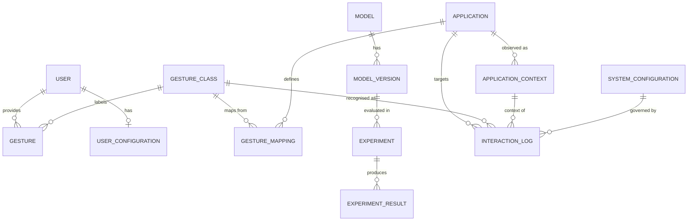
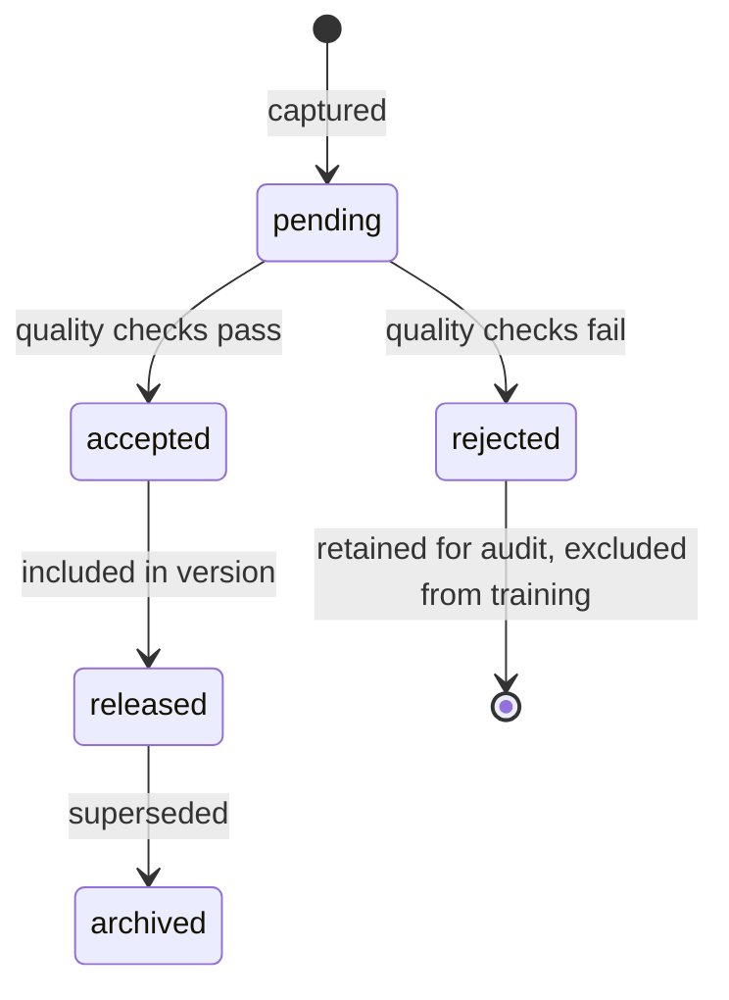
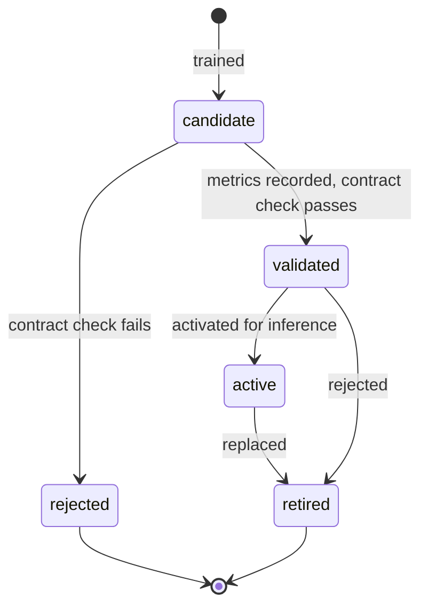
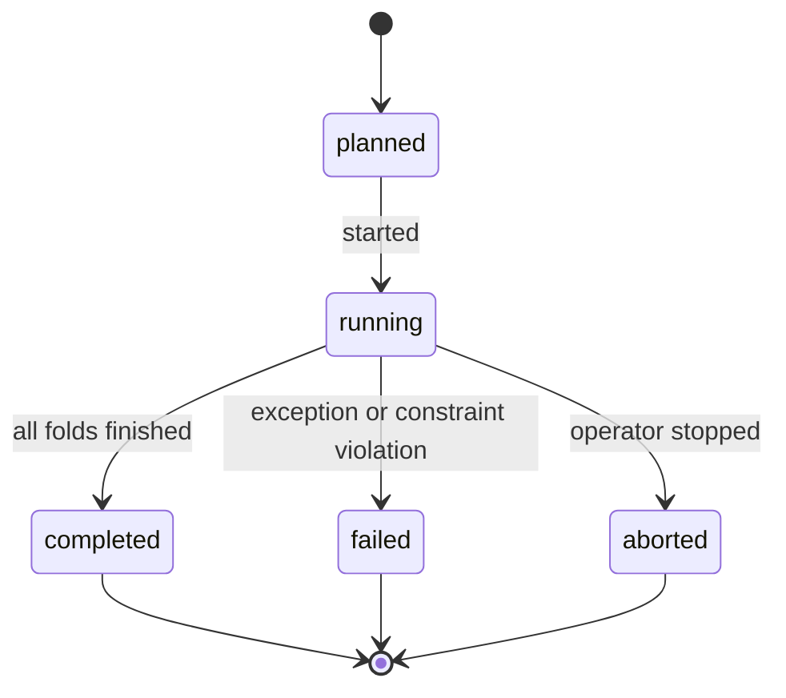

# Backend and Data Architecture Specification

**Project:** Gesture-Controlled AI Computer Interface
**Document ID:** CORE-SCHEMA
**Version:** 1.0.0
**Status:** Baseline
**Owner:** Member 4 (Backend) with Team Lead
**Last Updated:** 2026-11-06

---

## Document Control

| Field | Value |
|---|---|
| Source of truth for | Entities, attributes, keys, constraints, indexes, retention, lifecycle, storage classes, configuration persistence |
| Does not own | API shapes ([API_AND_INTEGRATION](./API_AND_INTEGRATION.md)), component responsibilities ([TRD](./TRD.md)), product requirements ([PRD](./PRD.md)) |
| ID namespaces owned | `ENT-01`–`ENT-13` |
| Portability target | SQLite 3.35+ (default) and PostgreSQL 15+ (optional) through SQLAlchemy 2.x + Alembic |

**Naming rule.** Table names are `snake_case` plural. Column names are `snake_case` singular. Every field referenced in [API_AND_INTEGRATION](./API_AND_INTEGRATION.md) appears here under an identical name.

---

## 1. Backend Responsibilities

The backend (`C-11`) owns four things and deliberately nothing else.

| Responsibility | Detail |
|---|---|
| **Persistence** | Durable records for configuration, models, experiments, applications, interactions |
| **Query surface** | Read models for the dashboard and for research reporting |
| **Configuration authority** | Validate, version, apply, and roll back runtime configuration |
| **Event fan-out** | Bridge the in-process event bus to WebSocket clients and the persistence writer |

| Not a backend responsibility | Owner |
|---|---|
| Gesture inference | `C-06` |
| Intent resolution | `C-08` |
| Authorisation decisions | `C-09` |
| Application automation | `C-10` |
| Dataset file storage | Filesystem under `datasets/` |
| Model binary storage | Filesystem under `models/` |

**Boundary rule.** The database stores metadata and outcomes, never binary artefacts. No dashboard query requires reading a file from disk.

---

## 2. Logical Data Architecture

### 2.1 Five Storage Classes

The single most important distinction in this document. Conflating them is the most common data-architecture failure in research projects.

| Class | Definition | Store | Mutability | Backup |
|---|---|---|---|---|
| **S1 — Persistent relational** | Durable, queryable records: users, models, experiments, mappings, configuration, interaction outcomes | SQLite/PostgreSQL | Mutable rows, append-only event rows | Included |
| **S2 — Temporary runtime state** | Activation state, pending fusion records, queue contents, adapter health | Process memory | Ephemeral | None |
| **S3 — In-memory gesture sequences** | Ring buffer of normalised frames, current window | Process memory | Overwritten continuously | None |
| **S4 — Model checkpoints and binary artefacts** | Weights, tokenizer assets, exported ONNX | `models/checkpoints/<model_id>/<version>/` | Immutable once versioned | Included, content-addressed |
| **S5 — Research datasets** | Landmark arrays, annotation files, manifests | `datasets/raw|processed|annotations/`, versioned releases | Immutable after release | Included, checksummed |

**Rules.**

- S2 and S3 SHALL NOT be written to S1 on a per-frame basis. Only derived outcomes are persisted.
- S4 and S5 SHALL be referenced from S1 by path plus checksum, never stored as blobs.
- A database backup without S4 and S5 is not a reproducible backup. This is recorded in the restore procedure.
- Deleting an S1 row SHALL NOT delete an S4/S5 artefact that is referenced by a released dataset version or a completed experiment.

### 2.2 Entity Map



---

## 3. Database Selection Rationale

| Criterion | SQLite | PostgreSQL | Decision |
|---|---|---|---|
| Setup cost for demo | None | Server install, user, database | SQLite wins |
| Single-user write throughput | Adequate (batched writes, < 50/s) | Overkill | SQLite wins |
| Concurrent writers | One writer at a time (WAL mitigates readers) | Full MVCC | Not required in v1 |
| Analytical queries | Adequate at project data volume | Stronger (window functions, parallel) | Either |
| Portability of schema | High with SQLAlchemy | High with SQLAlchemy | Tie |
| Backup simplicity | Single file copy | `pg_dump` | SQLite wins |
| Institutional deployment | Possible but unusual | Standard | Postgres wins |

**Decision (ADR-0005).** SQLite is the default. The schema is written in portable SQLAlchemy constructs, no SQLite-only types, no PostgreSQL-only defaults, so that switching is a connection-string change plus a migration run.

**Constraints this imposes on the schema.**

- No `ENUM` types — use `VARCHAR` with a `CHECK` constraint.
- No arrays or JSONB-specific operators — JSON stored as `TEXT` with application-level validation. PostgreSQL may use `JSONB` via a dialect variant, but no query may depend on it.
- No `SERIAL`/`AUTOINCREMENT` PKs — UUID strings for portability.
- Timestamps stored as timezone-aware UTC.
- Booleans stored as `INTEGER` in SQLite and `BOOLEAN` in PostgreSQL; SQLAlchemy abstracts this.

**When to revisit.** If more than one process writes concurrently, or interaction volume exceeds ~50 writes/second sustained, migrate to PostgreSQL (recorded as an ADR trigger, not a scheduled task).

---

## 4. Entity Definitions

### 4.1 `ENT-01` User

Represents a person: either a system user with preferences or a research participant who contributed data. One row per person.

| Column | Type | Constraints | Notes |
|---|---|---|---|
| `user_id` | UUID char(36) | PK | |
| `display_name` | varchar(120) | NOT NULL | Pseudonym permitted |
| `role` | varchar(20) | NOT NULL, CHECK in (`operator`,`participant`,`both`) | |
| `is_participant` | boolean | NOT NULL, default false | Gates dataset linkage |
| `dominant_hand` | varchar(6) | CHECK in (`left`,`right`,`unknown`) | Generalisation covariate |
| `experience_level` | varchar(16) | CHECK in (`novice`,`intermediate`,`expert`,`unknown`) | Covariate |
| `consent_granted` | boolean | NOT NULL, default false | Required before capture |
| `consent_version` | varchar(20) | NULL | Which consent text was signed |
| `consent_granted_at` | timestamptz | NULL | |
| `consent_withdrawn_at` | timestamptz | NULL | Withdrawal is honoured, not reversed |
| `created_at` | timestamptz | NOT NULL | |
| `updated_at` | timestamptz | NOT NULL | |

**Design note.** A separate `Participant` table was considered and rejected. Participant attributes are identity attributes of a person; splitting them would duplicate the identity anchor and complicate consent withdrawal. If participant-specific data grows (for example physiological measurements or per-session calibration), a `ParticipantProfile` extension table is the documented split point — see §12.

### 4.2 `ENT-02` GestureClass

The canonical gesture vocabulary. Data, not code, so the vocabulary can evolve without redeployment.

| Column | Type | Constraints | Notes |
|---|---|---|---|
| `gesture_class_id` | UUID char(36) | PK | |
| `label` | varchar(40) | NOT NULL, UNIQUE | `swipe_right`, `open_palm` |
| `display_name` | varchar(80) | NOT NULL | UI text |
| `motion_type` | varchar(10) | NOT NULL, CHECK in (`static`,`dynamic`) | Drives preprocessing expectations |
| `hand` | varchar(6) | NOT NULL, CHECK in (`left`,`right`,`any`) | v1 uses `any` with mirroring |
| `description` | text | NULL | |
| `is_active` | boolean | NOT NULL, default true | Retire without deleting |
| `introduced_in_version` | varchar(20) | NOT NULL | Vocabulary versioning |
| `created_at` | timestamptz | NOT NULL | |

**Integrity rule.** The active label set in this table SHALL equal the `classes` list declared by any loadable model version. Enforced at model activation (`E-3002`).

### 4.3 `ENT-03` Gesture

A dataset sample record. Metadata only — the landmark array lives in S5.

| Column | Type | Constraints | Notes |
|---|---|---|---|
| `gesture_id` | UUID char(36) | PK | |
| `gesture_class_id` | UUID char(36) | FK → `gesture_class`, NOT NULL | |
| `user_id` | UUID char(36) | FK → `user`, NOT NULL | Participant |
| `session_id` | varchar(60) | NOT NULL | Capture session grouping |
| `dataset_version` | varchar(30) | NOT NULL | e.g. `ds-2026.10` |
| `sequence_path` | varchar(500) | NOT NULL, UNIQUE | Relative to allowlisted dataset root |
| `frame_count` | integer | NOT NULL, CHECK 1–600 | |
| `duration_ms` | integer | NOT NULL, CHECK > 0 | |
| `feature_spec_version` | varchar(20) | NOT NULL | Reproducibility |
| `quality_status` | varchar(16) | NOT NULL, CHECK in (`pending`,`accepted`,`rejected`) | |
| `rejection_reason` | varchar(200) | NULL | Required when rejected |
| `capture_device` | varchar(120) | NULL | Camera model string |
| `lighting_condition` | varchar(20) | CHECK in (`bright`,`normal`,`dim`,`unknown`) | Covariate |
| `recorded_at` | timestamptz | NOT NULL | |
| `checksum_sha256` | char(64) | NOT NULL | Integrity of the S5 file |

**Deliberate exclusion.** Raw frames and raw audio are not modelled. They are not collected by default (`NFR-021`), so no column exists to tempt future use without a schema change and a privacy review.

### 4.4 `ENT-04` Model

The model family identity, independent of version.

| Column | Type | Constraints | Notes |
|---|---|---|---|
| `model_id` | UUID char(36) | PK | |
| `name` | varchar(60) | NOT NULL, UNIQUE | `lstm`, `random_forest` |
| `family` | varchar(20) | NOT NULL, CHECK in (`random_forest`,`mlp`,`lstm`,`gru`,`transformer`,`baseline`) | |
| `input_contract` | varchar(10) | NOT NULL, CHECK in (`IC_FRAME`,`IC_FLAT`,`IC_SEQ`) | Must match runtime |
| `task` | varchar(20) | NOT NULL, default `gesture_classification` | Future multi-task |
| `description` | text | NULL | |
| `created_at` | timestamptz | NOT NULL | |

### 4.5 `ENT-05` ModelVersion

An immutable artefact. One row per trained checkpoint that may be activated.

| Column | Type | Constraints | Notes |
|---|---|---|---|
| `model_version_id` | UUID char(36) | PK | |
| `model_id` | UUID char(36) | FK → `model`, NOT NULL | |
| `version` | varchar(20) | NOT NULL | Semver-ish |
| `feature_spec_version` | varchar(20) | NOT NULL | Hard load check |
| `classes_json` | text | NOT NULL | Ordered class list used at training |
| `artefact_path` | varchar(500) | NOT NULL | Under allowlisted `models/` root |
| `artefact_checksum` | char(64) | NOT NULL | |
| `training_dataset_version` | varchar(30) | NOT NULL | |
| `split_manifest_id` | varchar(60) | NOT NULL | Frozen split reference |
| `git_revision` | varchar(40) | NOT NULL | Code provenance |
| `environment_json` | text | NOT NULL | Python, torch, mediapipe versions |
| `is_active` | boolean | NOT NULL, default false | At most one true |
| `is_retired` | boolean | NOT NULL, default false | Cannot be activated |
| `created_at` | timestamptz | NOT NULL | |

**Constraints.** `UNIQUE (model_id, version)`. Partial unique index enforcing at most one active version per `model_id`.

### 4.6 `ENT-06` Experiment

One evaluation run. This is the primary research record.

| Column | Type | Constraints | Notes |
|---|---|---|---|
| `experiment_id` | UUID char(36) | PK | |
| `run_id` | varchar(40) | NOT NULL, UNIQUE | Human-readable, e.g. `run-20261101-0007` |
| `model_version_id` | UUID char(36) | FK → `model_version`, NOT NULL | Exactly what was evaluated |
| `interaction_config` | varchar(30) | NOT NULL, CHECK in (`gesture_only`,`gesture_speech`,`gesture_speech_context`,`frame_level_baseline`) | Research factor |
| `evaluation_protocol` | varchar(30) | NOT NULL, CHECK in (`within_subject`,`leave_one_subject_out`,`cross_session`) | Splitting regime |
| `dataset_version` | varchar(30) | NOT NULL | |
| `split_manifest_id` | varchar(60) | NOT NULL | Immutable manifest |
| `config_json` | text | NOT NULL | Full resolved configuration |
| `seed` | integer | NOT NULL | |
| `status` | varchar(16) | NOT NULL, CHECK in (`planned`,`running`,`completed`,`failed`,`aborted`) | |
| `failure_reason` | varchar(300) | NULL | |
| `started_at` | timestamptz | NULL | |
| `completed_at` | timestamptz | NULL | |
| `git_revision` | varchar(40) | NOT NULL | |
| `operator_user_id` | UUID char(36) | FK → `user`, NULL | Who ran it |

**Integrity rules.**

- `completed_at` SHALL be non-null if and only if `status = completed`.
- `dataset_version` and `split_manifest_id` SHALL match the referenced model version's training records when the run is a *test-set* evaluation; a mismatch is flagged as a leakage warning, not silently accepted (`FR-111`).
- A `completed` experiment row SHALL NOT be updated except to append a result-count reconciliation.

### 4.7 `ENT-07` ExperimentResult

Metrics for one experiment, per fold where applicable. Separated from `Experiment` because folds and per-subject breakdowns are one-to-many.

| Column | Type | Constraints | Notes |
|---|---|---|---|
| `result_id` | UUID char(36) | PK | |
| `experiment_id` | UUID char(36) | FK → `experiment`, NOT NULL, ON DELETE CASCADE | |
| `fold_index` | integer | NOT NULL, default 0 | 0 for aggregate |
| `fold_subject_id` | UUID char(36) | FK → `user`, NULL | Held-out subject for LOSO |
| `sample_count` | integer | NOT NULL | |
| `accuracy` | real | CHECK 0–1 | |
| `macro_precision` | real | CHECK 0–1 | |
| `macro_recall` | real | CHECK 0–1 | |
| `macro_f1` | real | CHECK 0–1 | |
| `inference_p50_ms` | real | CHECK >= 0 | |
| `inference_p95_ms` | real | CHECK >= 0 | |
| `end_to_end_p50_ms` | real | CHECK >= 0 | |
| `end_to_end_p95_ms` | real | CHECK >= 0 | |
| `false_activations_per_minute` | real | CHECK >= 0 | |
| `action_success_rate` | real | CHECK 0–1 | |
| `abstention_rate` | real | CHECK 0–1 | |
| `per_class_json` | text | NOT NULL | Precision/recall/F1 per class |
| `confusion_matrix_json` | text | NOT NULL | Row = true, column = predicted |
| `notes` | text | NULL | |
| `created_at` | timestamptz | NOT NULL | |

**Rule.** No result row may be written for an `experiment` whose status is not `completed` or `failed`. Partial metrics are not research results.

### 4.8 `ENT-08` Application

A target application and its adapter binding.

| Column | Type | Constraints | Notes |
|---|---|---|---|
| `application_id` | UUID char(36) | PK | |
| `adapter_id` | varchar(40) | NOT NULL, UNIQUE | `powerpoint`, `media`, `ide` |
| `display_name` | varchar(80) | NOT NULL | |
| `process_patterns_json` | text | NOT NULL | List of executable name patterns |
| `supported_actions_json` | text | NOT NULL | Mirrors adapter declaration |
| `action_classes_json` | text | NOT NULL | safe/reversible/destructive |
| `is_enabled` | boolean | NOT NULL, default true | Allowlist control |
| `is_healthy` | boolean | NOT NULL, default false | Last health check |
| `health_checked_at` | timestamptz | NULL | |
| `created_at` | timestamptz | NOT NULL | |

### 4.9 `ENT-09` ApplicationContext

Observed context transitions, retained briefly for correlation and debugging.

| Column | Type | Constraints | Notes |
|---|---|---|---|
| `context_id` | UUID char(36) | PK | |
| `application_id` | UUID char(36) | FK → `application`, NULL | NULL when unknown |
| `process_name` | varchar(120) | NOT NULL | |
| `window_title_hash` | char(64) | NULL | Hash, not plaintext (`TR-004`) |
| `state_json` | text | NULL | Adapter-reported state |
| `change_reason` | varchar(30) | NOT NULL, CHECK in (`focus_changed`,`state_changed`,`poll_baseline`,`adapter_recovered`) | |
| `captured_at` | timestamptz | NOT NULL | |

**Why hash the title.** Window titles contain document names and browser tab titles. Storing plaintext would create a privacy liability with no research value. A hash preserves the ability to detect "same window" without retaining content.

### 4.10 `ENT-10` UserConfiguration

Per-user preferences, distinct from system-wide configuration.

| Column | Type | Constraints | Notes |
|---|---|---|---|
| `user_config_id` | UUID char(36) | PK | |
| `user_id` | UUID char(36) | FK → `user`, NOT NULL, UNIQUE | One current row per user |
| `activation_mode` | varchar(20) | NOT NULL, CHECK in (`wake_gesture`,`hold_pose`,`push_to_talk`) | |
| `hold_ms` | integer | NOT NULL, CHECK 200–3000, default 800 | |
| `inactivity_timeout_s` | integer | NOT NULL, CHECK 5–600, default 30 | |
| `preferred_camera_index` | integer | NULL | |
| `preferred_audio_device` | varchar(120) | NULL | |
| `confidence_overrides_json` | text | NULL | Per-user threshold tuning |
| `updated_at` | timestamptz | NOT NULL | |

**Boundary rule.** Preferences may narrow system thresholds but SHALL NOT exceed the system safety limits. The backend clamps and reports clamping; it does not silently accept.

### 4.11 `ENT-11` GestureMapping

The disambiguation table. This is where "the same gesture means different things" is expressed as data (`FR-122`).

| Column | Type | Constraints | Notes |
|---|---|---|---|
| `mapping_id` | UUID char(36) | PK | |
| `application_id` | UUID char(36) | FK → `application`, NOT NULL | |
| `gesture_class_id` | UUID char(36) | FK → `gesture_class`, NOT NULL | |
| `intent_id` | varchar(40) | NOT NULL | Vocabulary key |
| `intent_label` | varchar(80) | NOT NULL | UI text |
| `requires_speech_command` | varchar(30) | NULL | NULL = gesture alone suffices |
| `requires_state_json` | text | NULL | Predicate over adapter state |
| `confidence_override` | real | NULL, CHECK 0.5–0.99 | Per-mapping threshold |
| `priority` | integer | NOT NULL, default 0 | Tie-break when predicates overlap |
| `is_enabled` | boolean | NOT NULL, default true | |
| `created_at` | timestamptz | NOT NULL | |

**Constraints.** `UNIQUE (application_id, gesture_class_id, intent_id, requires_speech_command)`.

**Resolution rule.** More specific mappings win: a mapping with a speech requirement and a state predicate outranks one with neither, regardless of `priority`. `priority` only breaks ties between equally specific mappings. This rule lives in `C-08`, but the schema must support it without schema change.

### 4.12 `ENT-12` InteractionLog

The durable outcome record, one row per completed interaction. This is the primary evidence table for latency and false-activation analysis.

| Column | Type | Constraints | Notes |
|---|---|---|---|
| `interaction_id` | UUID char(36) | PK | |
| `correlation_id` | UUID char(36) | NOT NULL, UNIQUE | Matches event envelope |
| `session_id` | varchar(60) | NOT NULL | Process session |
| `application_id` | UUID char(36) | FK → `application`, NULL | |
| `context_id` | UUID char(36) | FK → `application_context`, NULL | Context at decision time |
| `gesture_class_id` | UUID char(36) | FK → `gesture_class`, NULL | NULL if speech-only |
| `gesture_confidence` | real | CHECK 0–1, NULL | |
| `speech_command` | varchar(30) | NULL | Normalised command |
| `speech_confidence` | real | CHECK 0–1, NULL | |
| `intent_id` | varchar(40) | NULL | NULL when abstained before intent |
| `fused_confidence` | real | CHECK 0–1, NULL | |
| `abstained` | boolean | NOT NULL, default false | |
| `decision` | varchar(12) | NOT NULL, CHECK in (`executed`,`denied`,`dry_run`,`abstained`,`error`) | |
| `denial_code` | varchar(10) | NULL | `E-7004` etc. |
| `deciding_rule` | varchar(40) | NULL | Gate rule name |
| `action_command` | varchar(40) | NULL | Adapter action |
| `action_status` | varchar(20) | NULL | Adapter result status |
| `inference_latency_ms` | real | NULL, CHECK >= 0 | `FR-106` |
| `end_to_end_latency_ms` | real | NULL, CHECK >= 0 | `FR-107` |
| `config_version_id` | UUID char(36) | FK → `system_configuration`, NULL | Which config governed it |
| `occurred_at` | timestamptz | NOT NULL | |

**Why one denormalised row instead of a generic event table.** Research queries are almost always of the form "for interactions where X, what was the latency / denial reason / success rate". A normalised event table would require six joins per question and would still need the outcome denormalised. The full event stream remains available from logs (`NFR-073`) for forensic work; the database stores the analytical unit.

**Partial-row rule.** A row is written only when an interaction reaches a terminal outcome (`executed`, `denied`, `dry_run`, `abstained`, `error`). No row is written per frame.

### 4.13 `ENT-13` SystemConfiguration

Versioned configuration with rollback support (`FR-124`).

| Column | Type | Constraints | Notes |
|---|---|---|---|
| `config_version_id` | UUID char(36) | PK | |
| `version_label` | varchar(30) | NOT NULL, UNIQUE | `cfg-0007` |
| `config_json` | text | NOT NULL | Full resolved configuration |
| `checksum` | char(64) | NOT NULL | Detects tampering |
| `is_active` | boolean | NOT NULL, default false | Exactly one active |
| `applied_by` | varchar(60) | NOT NULL | `system`, `user:<id>`, `api` |
| `applied_at` | timestamptz | NOT NULL | |
| `notes` | varchar(300) | NULL | Why the change was made |

**Constraint.** A partial unique index enforces exactly one `is_active = true` row. Applying a new configuration deactivates the previous one in the same transaction.

---

## 5. Relationships and Cardinality

| Relationship | Cardinality | On delete | Rationale |
|---|---|---|---|
| `user` → `gesture` | 1 : N | RESTRICT | Deleting a participant with samples requires explicit withdrawal procedure |
| `user` → `user_configuration` | 1 : 1 | CASCADE | Preferences are meaningless without the user |
| `gesture_class` → `gesture` | 1 : N | RESTRICT | Vocabulary changes must not orphan data |
| `model` → `model_version` | 1 : N | RESTRICT | Artefacts are immutable and referenced by experiments |
| `model_version` → `experiment` | 1 : N | RESTRICT | Results must remain attributable |
| `experiment` → `experiment_result` | 1 : N | CASCADE | Fold results are owned by the run |
| `application` → `application_context` | 1 : N | SET NULL | History must survive app removal |
| `application` → `gesture_mapping` | 1 : N | CASCADE | Mappings are meaningless without the app |
| `gesture_class` → `gesture_mapping` | 1 : N | RESTRICT | Prevent silent mapping loss |
| `application` → `interaction_log` | 1 : N | SET NULL | Analytics survive app removal |
| `application_context` → `interaction_log` | 1 : N | SET NULL | Analytics survive pruning |
| `system_configuration` → `interaction_log` | 1 : N | SET NULL | Analytics survive config pruning |

**Cascade policy.** `CASCADE` is used only for strict ownership. Anything that could invalidate research evidence uses `RESTRICT` or `SET NULL`. Losing the ability to explain a result is worse than retaining orphan metadata.

---

## 6. SQL Schema (Reference Implementation)

Dialect-neutral SQLAlchemy is authoritative; this DDL documents intent. Examples are SQLite-flavoured. PostgreSQL differences are listed in §6.6.

### 6.1 Users and Vocabulary

```sql
CREATE TABLE users (
    user_id             CHAR(36)    PRIMARY KEY,
    display_name        VARCHAR(120) NOT NULL,
    role                VARCHAR(20) NOT NULL
                        CHECK (role IN ('operator','participant','both')),
    is_participant      BOOLEAN     NOT NULL DEFAULT 0,
    dominant_hand       VARCHAR(6)
                        CHECK (dominant_hand IN ('left','right','unknown')),
    experience_level    VARCHAR(16)
                        CHECK (experience_level IN ('novice','intermediate','expert','unknown')),
    consent_granted     BOOLEAN     NOT NULL DEFAULT 0,
    consent_version     VARCHAR(20),
    consent_granted_at  TIMESTAMP,
    consent_withdrawn_at TIMESTAMP,
    created_at          TIMESTAMP   NOT NULL,
    updated_at          TIMESTAMP   NOT NULL
);

CREATE TABLE gesture_classes (
    gesture_class_id      CHAR(36)    PRIMARY KEY,
    label                 VARCHAR(40) NOT NULL UNIQUE,
    display_name          VARCHAR(80) NOT NULL,
    motion_type           VARCHAR(10) NOT NULL
                          CHECK (motion_type IN ('static','dynamic')),
    hand                  VARCHAR(6)  NOT NULL DEFAULT 'any'
                          CHECK (hand IN ('left','right','any')),
    description           TEXT,
    is_active             BOOLEAN     NOT NULL DEFAULT 1,
    introduced_in_version VARCHAR(20) NOT NULL,
    created_at            TIMESTAMP   NOT NULL
);
```

### 6.2 Dataset Samples

```sql
CREATE TABLE gestures (
    gesture_id            CHAR(36)    PRIMARY KEY,
    gesture_class_id      CHAR(36)    NOT NULL REFERENCES gesture_classes(gesture_class_id) ON DELETE RESTRICT,
    user_id               CHAR(36)    NOT NULL REFERENCES users(user_id) ON DELETE RESTRICT,
    session_id            VARCHAR(60) NOT NULL,
    dataset_version       VARCHAR(30) NOT NULL,
    sequence_path         VARCHAR(500) NOT NULL UNIQUE,
    frame_count           INTEGER     NOT NULL CHECK (frame_count BETWEEN 1 AND 600),
    duration_ms           INTEGER     NOT NULL CHECK (duration_ms > 0),
    feature_spec_version  VARCHAR(20) NOT NULL,
    quality_status        VARCHAR(16) NOT NULL
                          CHECK (quality_status IN ('pending','accepted','rejected')),
    rejection_reason      VARCHAR(200),
    capture_device        VARCHAR(120),
    lighting_condition    VARCHAR(20)
                          CHECK (lighting_condition IN ('bright','normal','dim','unknown')),
    recorded_at           TIMESTAMP   NOT NULL,
    checksum_sha256       CHAR(64)    NOT NULL,
    CHECK (quality_status <> 'rejected' OR rejection_reason IS NOT NULL)
);

CREATE INDEX idx_gestures_class_version ON gestures(gesture_class_id, dataset_version);
CREATE INDEX idx_gestures_user_session  ON gestures(user_id, session_id);
CREATE INDEX idx_gestures_quality       ON gestures(quality_status);
```

### 6.3 Models and Versions

```sql
CREATE TABLE models (
    model_id        CHAR(36)    PRIMARY KEY,
    name            VARCHAR(60) NOT NULL UNIQUE,
    family          VARCHAR(20) NOT NULL
                    CHECK (family IN ('random_forest','mlp','lstm','gru','transformer','baseline')),
    input_contract  VARCHAR(10) NOT NULL
                    CHECK (input_contract IN ('IC_FRAME','IC_FLAT','IC_SEQ')),
    task            VARCHAR(20) NOT NULL DEFAULT 'gesture_classification',
    description     TEXT,
    created_at      TIMESTAMP   NOT NULL
);

CREATE TABLE model_versions (
    model_version_id       CHAR(36)    PRIMARY KEY,
    model_id               CHAR(36)    NOT NULL REFERENCES models(model_id) ON DELETE RESTRICT,
    version                VARCHAR(20) NOT NULL,
    feature_spec_version   VARCHAR(20) NOT NULL,
    classes_json           TEXT        NOT NULL,
    artefact_path          VARCHAR(500) NOT NULL,
    artefact_checksum      CHAR(64)    NOT NULL,
    training_dataset_version VARCHAR(30) NOT NULL,
    split_manifest_id      VARCHAR(60) NOT NULL,
    git_revision           VARCHAR(40) NOT NULL,
    environment_json       TEXT        NOT NULL,
    is_active              BOOLEAN     NOT NULL DEFAULT 0,
    is_retired             BOOLEAN     NOT NULL DEFAULT 0,
    created_at             TIMESTAMP   NOT NULL,
    UNIQUE (model_id, version)
);

CREATE UNIQUE INDEX uq_model_versions_one_active
    ON model_versions(model_id) WHERE is_active = 1;

CREATE INDEX idx_model_versions_lookup ON model_versions(model_id, is_active, is_retired);
```

**Portability note.** The partial unique index is supported by SQLite ≥ 3.8 and PostgreSQL. Alembic emits `sqlite_where` / `postgresql_where` accordingly.

### 6.4 Experiments

```sql
CREATE TABLE experiments (
    experiment_id       CHAR(36)    PRIMARY KEY,
    run_id              VARCHAR(40) NOT NULL UNIQUE,
    model_version_id    CHAR(36)    NOT NULL REFERENCES model_versions(model_version_id) ON DELETE RESTRICT,
    interaction_config  VARCHAR(30) NOT NULL
                        CHECK (interaction_config IN
                        ('gesture_only','gesture_speech','gesture_speech_context','frame_level_baseline')),
    evaluation_protocol VARCHAR(30) NOT NULL
                        CHECK (evaluation_protocol IN
                        ('within_subject','leave_one_subject_out','cross_session')),
    dataset_version     VARCHAR(30) NOT NULL,
    split_manifest_id   VARCHAR(60) NOT NULL,
    config_json         TEXT        NOT NULL,
    seed                INTEGER     NOT NULL,
    status              VARCHAR(16) NOT NULL
                        CHECK (status IN ('planned','running','completed','failed','aborted')),
    failure_reason      VARCHAR(300),
    started_at          TIMESTAMP,
    completed_at        TIMESTAMP,
    git_revision        VARCHAR(40) NOT NULL,
    operator_user_id    CHAR(36) REFERENCES users(user_id) ON DELETE SET NULL,
    CHECK ((status = 'completed') = (completed_at IS NOT NULL))
);

CREATE INDEX idx_experiments_factor ON experiments(interaction_config, evaluation_protocol);
CREATE INDEX idx_experiments_model  ON experiments(model_version_id);
CREATE INDEX idx_experiments_status ON experiments(status, started_at);

CREATE TABLE experiment_results (
    result_id               CHAR(36) PRIMARY KEY,
    experiment_id           CHAR(36) NOT NULL REFERENCES experiments(experiment_id) ON DELETE CASCADE,
    fold_index              INTEGER  NOT NULL DEFAULT 0,
    fold_subject_id         CHAR(36) REFERENCES users(user_id) ON DELETE SET NULL,
    sample_count            INTEGER  NOT NULL,
    accuracy                REAL CHECK (accuracy BETWEEN 0 AND 1),
    macro_precision         REAL CHECK (macro_precision BETWEEN 0 AND 1),
    macro_recall            REAL CHECK (macro_recall BETWEEN 0 AND 1),
    macro_f1                REAL CHECK (macro_f1 BETWEEN 0 AND 1),
    inference_p50_ms        REAL CHECK (inference_p50_ms >= 0),
    inference_p95_ms        REAL CHECK (inference_p95_ms >= 0),
    end_to_end_p50_ms       REAL CHECK (end_to_end_p50_ms >= 0),
    end_to_end_p95_ms       REAL CHECK (end_to_end_p95_ms >= 0),
    false_activations_per_minute REAL CHECK (false_activations_per_minute >= 0),
    action_success_rate     REAL CHECK (action_success_rate BETWEEN 0 AND 1),
    abstention_rate         REAL CHECK (abstention_rate BETWEEN 0 AND 1),
    per_class_json          TEXT NOT NULL,
    confusion_matrix_json   TEXT NOT NULL,
    notes                   TEXT,
    created_at              TIMESTAMP NOT NULL,
    UNIQUE (experiment_id, fold_index, fold_subject_id)
);
```

### 6.5 Applications, Context, Mappings

```sql
CREATE TABLE applications (
    application_id       CHAR(36) PRIMARY KEY,
    adapter_id           VARCHAR(40) NOT NULL UNIQUE,
    display_name         VARCHAR(80) NOT NULL,
    process_patterns_json TEXT   NOT NULL,
    supported_actions_json TEXT  NOT NULL,
    action_classes_json  TEXT     NOT NULL,
    is_enabled           BOOLEAN  NOT NULL DEFAULT 1,
    is_healthy           BOOLEAN  NOT NULL DEFAULT 0,
    health_checked_at    TIMESTAMP,
    created_at           TIMESTAMP NOT NULL
);

CREATE TABLE application_contexts (
    context_id         CHAR(36) PRIMARY KEY,
    application_id     CHAR(36) REFERENCES applications(application_id) ON DELETE SET NULL,
    process_name       VARCHAR(120) NOT NULL,
    window_title_hash  CHAR(64),
    state_json         TEXT,
    change_reason      VARCHAR(30) NOT NULL
                       CHECK (change_reason IN ('focus_changed','state_changed','poll_baseline','adapter_recovered')),
    captured_at        TIMESTAMP NOT NULL
);

CREATE INDEX idx_context_captured ON application_contexts(captured_at);
CREATE INDEX idx_context_app      ON application_contexts(application_id, captured_at);

CREATE TABLE gesture_mappings (
    mapping_id              CHAR(36) PRIMARY KEY,
    application_id          CHAR(36) NOT NULL REFERENCES applications(application_id) ON DELETE CASCADE,
    gesture_class_id        CHAR(36) NOT NULL REFERENCES gesture_classes(gesture_class_id) ON DELETE RESTRICT,
    intent_id               VARCHAR(40) NOT NULL,
    intent_label            VARCHAR(80) NOT NULL,
    requires_speech_command VARCHAR(30),
    requires_state_json     TEXT,
    confidence_override     REAL CHECK (confidence_override BETWEEN 0.5 AND 0.99),
    priority                INTEGER NOT NULL DEFAULT 0,
    is_enabled              BOOLEAN NOT NULL DEFAULT 1,
    created_at              TIMESTAMP NOT NULL,
    UNIQUE (application_id, gesture_class_id, intent_id, requires_speech_command)
);

CREATE INDEX idx_mappings_resolve
    ON gesture_mappings(application_id, gesture_class_id, is_enabled);
```

### 6.6 Interaction Log and Configuration

```sql
CREATE TABLE interaction_logs (
    interaction_id        CHAR(36) PRIMARY KEY,
    correlation_id        CHAR(36) NOT NULL UNIQUE,
    session_id            VARCHAR(60) NOT NULL,
    application_id        CHAR(36) REFERENCES applications(application_id) ON DELETE SET NULL,
    context_id            CHAR(36) REFERENCES application_contexts(context_id) ON DELETE SET NULL,
    gesture_class_id      CHAR(36) REFERENCES gesture_classes(gesture_class_id) ON DELETE SET NULL,
    gesture_confidence    REAL CHECK (gesture_confidence BETWEEN 0 AND 1),
    speech_command        VARCHAR(30),
    speech_confidence     REAL CHECK (speech_confidence BETWEEN 0 AND 1),
    intent_id             VARCHAR(40),
    fused_confidence      REAL CHECK (fused_confidence BETWEEN 0 AND 1),
    abstained             BOOLEAN NOT NULL DEFAULT 0,
    decision              VARCHAR(12) NOT NULL
                          CHECK (decision IN ('executed','denied','dry_run','abstained','error')),
    denial_code           VARCHAR(10),
    deciding_rule         VARCHAR(40),
    action_command        VARCHAR(40),
    action_status         VARCHAR(20),
    inference_latency_ms  REAL CHECK (inference_latency_ms >= 0),
    end_to_end_latency_ms REAL CHECK (end_to_end_latency_ms >= 0),
    config_version_id     CHAR(36) REFERENCES system_configurations(config_version_id) ON DELETE SET NULL,
    occurred_at           TIMESTAMP NOT NULL,
    CHECK (decision <> 'denied' OR denial_code IS NOT NULL)
);

CREATE INDEX idx_interactions_time     ON interaction_logs(occurred_at);
CREATE INDEX idx_interactions_decision ON interaction_logs(decision, occurred_at);
CREATE INDEX idx_interactions_session  ON interaction_logs(session_id);
CREATE INDEX idx_interactions_app      ON interaction_logs(application_id, occurred_at);

CREATE TABLE system_configurations (
    config_version_id CHAR(36) PRIMARY KEY,
    version_label     VARCHAR(30) NOT NULL UNIQUE,
    config_json       TEXT NOT NULL,
    checksum          CHAR(64) NOT NULL,
    is_active         BOOLEAN NOT NULL DEFAULT 0,
    applied_by        VARCHAR(60) NOT NULL,
    applied_at        TIMESTAMP NOT NULL,
    notes             VARCHAR(300)
);

CREATE UNIQUE INDEX uq_system_config_one_active
    ON system_configurations(is_active) WHERE is_active = 1;
```

**Forward-reference note.** `interaction_logs` references `system_configurations`, which is declared after it in this listing. In Alembic, create `system_configurations` first.

### 6.7 PostgreSQL Differences

| Concern | SQLite | PostgreSQL |
|---|---|---|
| UUID | `CHAR(36)` | `UUID` (SQLAlchemy `Uuid` type) |
| Boolean | `BOOLEAN` stored as 0/1 | `BOOLEAN` |
| Timestamp | `TIMESTAMP` (UTC text) | `TIMESTAMPTZ` |
| JSON columns | `TEXT` | `JSONB` permitted; no query may depend on it |
| Partial index | Supported | Supported |
| `ENUM` | Not used | Not used (portability) |

---

## 7. Indexing Considerations

| Index | Serves | Rationale |
|---|---|---|
| `idx_interactions_decision` | Denial-rate and safety dashboards | Most analytics filter by decision |
| `idx_interactions_time` | Session and range queries | Every metrics query is time-bounded |
| `idx_experiments_factor` | Comparison tables | Group by interaction config + protocol |
| `idx_experiments_model` | Per-model rollups | Attribution |
| `idx_gestures_class_version` | Dataset composition checks | Class balance per release |
| `idx_mappings_resolve` | Runtime intent resolution | Called per candidate intent |
| `idx_context_captured` | Retention pruning | Time-range delete |
| `uq_model_versions_one_active` | Correctness | Prevents two active versions |
| `uq_system_config_one_active` | Correctness | Prevents ambiguous config |

**Deliberately unindexed.**

- `per_class_json` and `confusion_matrix_json` — opaque payloads, read whole.
- `window_title_hash` — only used for equality checks in debugging, low volume.
- `config_json` — never queried by content; validated in the application layer.

**Rule.** No index is added without a named query it serves. Speculative indexing on a low-volume dataset is pure write cost.

**Volume estimate (design envelope).**

| Table | Rows per session | Notes |
|---|---|---|
| `interaction_logs` | ≤ 720 | Capped by 12 actions/min for an hour |
| `application_contexts` | ≤ 18 000 | 200 ms polling for an hour, change-only |
| `gestures` | Hundreds per participant | Static across sessions |
| `experiment_results` | Tens per run | |
| Everything else | Tens to hundreds | |

A year of pilot data is well under 1 GB. SQLite is comfortably sufficient.

---

## 8. Constraints Summary

| Type | Count | Examples |
|---|---|---|
| Primary keys | 13 | UUID surrogate on every entity |
| Foreign keys | 14 | All declared with explicit delete behaviour |
| Unique constraints | 9 | `gesture_classes.label`, `(model_id, version)`, `correlation_id` |
| Check constraints | 40+ | Enums, numeric ranges, terminal-state consistency |
| Partial unique indexes | 2 | One active model version, one active config |
| Cross-table invariants | 3 | Active labels = model classes; completed ⇒ timestamp; no test leakage |

### 8.1 Cross-Table Invariants

| ID | Invariant | Enforcement |
|---|---|---|
| `INV-01` | Active `gesture_classes.label` set equals the loadable model's `classes_json` | Application check at activation; nightly validation job |
| `INV-02` | `experiment.status = 'completed'` ⇔ `completed_at IS NOT NULL` | Check constraint |
| `INV-03` | An experiment's `split_manifest_id` never contains a subject that the model version saw in training | Manifest validator + run-time warning |

---

## 9. Data Validation

| Layer | Validates | Failure behaviour |
|---|---|---|
| Pydantic schema | Types, required fields, ranges | `422` with field path |
| Domain rule | Cross-field and cross-entity invariants | `409` with rule id |
| Database constraint | Final backstop | `500` with `E-9003`, logged as a bug |
| Configuration validator | Bounds and cross-field sums | `409 E-1001` |
| Manifest validator | Subject disjointness | Blocks experiment creation |

**Rule.** The database is a backstop, never the primary validator. A constraint violation reaching the database indicates a missing domain check and is treated as a defect.

---

## 10. Data Lifecycle

### 10.1 Dataset Sample



### 10.2 Model Version



### 10.3 Experiment



**Immutability rule.** A `completed` experiment and its results are immutable. Correcting a result requires a new run with a documented reason. This is what makes the reported numbers auditable (`US-020`).

### 10.4 Interaction

Runtime-only until terminal, then a single row. No mutation after insert; corrections create a new interaction.

---

## 11. Retention Policy

| Data | Retention | Rationale |
|---|---|---|
| `interaction_logs` | Session + 90 days, then aggregate and prune | Latency and false-activation analysis needs recent detail only |
| `application_contexts` | 7 days | Debugging aid; high row count |
| `experiment_results` | Permanent | Research evidence |
| `experiments` | Permanent | Research evidence |
| `model_versions` | Permanent unless retired and unreferenced | Reproducibility |
| `gestures` (metadata) | Until dataset withdrawal | Research evidence |
| `system_configurations` | Permanent | Explains historical decisions |
| `users` | Until withdrawal request | Consent obligations |
| Raw audio/video | Never stored | `NFR-021` |
| Landmark arrays (S5) | Until dataset withdrawal | Research evidence |

**Withdrawal procedure.** A participant withdrawal SHALL: delete their S5 files, mark `gestures` rows rejected with reason `consent_withdrawn`, set `consent_withdrawn_at`, and flag every affected `dataset_version` as containing withdrawn data. Affected experiment results are retained but annotated, because deleting them would falsify the record; the annotation states which runs are affected. This policy must be reviewed by the team before any collection begins.

**Aggregation before pruning.** Interactions older than 90 days are reduced to per-day counters (counts, latency percentiles, denial histogram) before deletion, so long-range trends survive.

---

## 12. Configuration Storage

| Layer | Location | Purpose |
|---|---|---|
| Defaults | `config/default.yaml` in the repository | Known-good baseline, reviewable in git |
| Environment overrides | `GESTURE_AI__SECTION__KEY` | Deployment-specific values, secrets |
| Persisted state | `system_configurations` | What is actually running, versioned |
| Rollback target | Previous `system_configurations` row with `is_active = false` | `EP-043` |

**Precedence.** Persisted active configuration wins over file defaults; environment overrides win over both for the keys they set. A configuration diff is logged on every apply with the actor and reason.

**Secrets.** Never stored in `system_configurations`. Tokens and paths to credentials come from the environment only (`NFR-033`).

---

## 13. Model Metadata

Split across three places by design.

| Metadata | Location | Why |
|---|---|---|
| Identity, contract, provenance, activation state | `models`, `model_versions` (S1) | Queryable, joinable to experiments |
| Full model card, including training notes | `model_card.json` next to the artefact (S4) | Travels with the binary; survives database loss |
| Artefact binary | `models/checkpoints/<model_id>/<version>/` (S4) | Never in the database |

**Recovery rule.** If the database is lost, `model_card.json` plus the artefact is sufficient to reconstruct the `models` and `model_versions` rows. This is a stated design goal, not an accident.

---

## 14. Experiment Metadata

An experiment row must be sufficient to reproduce the run without reading the codebase.

| Required field | Purpose |
|---|---|
| `dataset_version` + `split_manifest_id` | Exactly which data, exactly which split |
| `config_json` | Every hyperparameter and pipeline setting |
| `seed` | Determinism |
| `git_revision` | Code state |
| `model_version_id` → `environment_json` | Library versions |
| `interaction_config` + `evaluation_protocol` | The research factors |

**Sufficiency test.** A team member other than the author must be able to reproduce a reported number from these fields alone. This is the acceptance test for `US-020`.

---

## 15. Interaction Event Storage

| Data | Where | Why |
|---|---|---|
| Terminal outcome per interaction | `interaction_logs` | Analytical unit |
| Full ordered event chain | Session log file (`logs/session-<id>.jsonl`), not the database | Forensic detail, no query need, high volume |
| Denial reasons and rule traces | `interaction_logs.deciding_rule` + log file | Explanations |
| Latency samples | `interaction_logs` columns | Percentile computation |

**Rule.** The database stores what is queried; the log file stores what is audited. Duplicating the full event stream into SQL would multiply volume by ~8 with no analytical benefit.

---

## 16. User Preferences and Application Configuration

| Concern | Table | Rule |
|---|---|---|
| Activation mode, hold time, timeout | `user_configurations` | May narrow, never widen, system safety bounds |
| Per-user thresholds | `user_configurations.confidence_overrides_json` | Clamped to system bounds; clamping is reported |
| Per-app mappings | `gesture_mappings` | Must reference an enabled application |
| Allowlist | `applications.is_enabled` | Gate denies non-allowlisted adapters (`E-7009`) |
| Vocabulary | `gesture_classes` | Must match active model |

**Seed data.** The 12 gesture classes, 3 applications, and their default mappings ship as a migration seed, not as hard-coded constants. This keeps configuration reviewable in git and consistent across machines.

---

## 17. Error and Event Logging

| Stream | Destination | Retention | Content |
|---|---|---|---|
| Application log | `logs/app-<date>.log` | 30 days | Level, component, correlation id, message |
| Interaction trace | `logs/session-<session>.jsonl` | 90 days | Full event chain per correlation |
| Audit log | `logs/audit-<date>.log` | Permanent | Configuration changes, activation, emergency stop, dataset releases |
| Database errors | Application log at `ERROR` | 30 days | Never user-facing detail |

**Redaction.** Window titles, transcript text at `INFO`, and file paths outside allowlisted roots are redacted by the logger, not by each call site (`TR-004`).

---

## 18. Migration Strategy

| Concern | Decision |
|---|---|
| Tool | Alembic |
| Baseline | One initial migration creating all 13 tables |
| Seed | Separate idempotent seed command, not part of the migration |
| Downgrade | Required for development migrations; not required for released ones |
| Data migrations | Separate from schema migrations, always reversible or explicitly one-way |
| Drift detection | CI runs `alembic check` against a fresh database |

**Rule.** No manual schema edits. A schema change is a migration, a model update, and a documentation update in this file, in one pull request.

---

## 19. Consistency with Other Documents

| This document | Counterpart | Agreement |
|---|---|---|
| `ENT-01`–`ENT-13` | [API_AND_INTEGRATION](./API_AND_INTEGRATION.md) §4 | Field names identical |
| `interaction_logs` | API `EP-070`, `EP-071` | One row per correlation |
| `system_configurations` | API `EP-040`–`EP-043` | Versioned apply/rollback |
| `gesture_mappings` | PRD `FR-122`, TRD §5.8 | Resolution order encoded as data |
| `model_versions` | TRD §8.2 | Same contract fields |
| `experiments` | [EXPERIMENT_DESIGN](../research/EXPERIMENT_DESIGN.md) | Same factor names |

**Known divergence.** TRD §17 refers to "session traces" as an export; this document specifies them as JSONL files rather than database rows. Both agree that the database is not the event store. No conflict.

## Appendix — Related Documents

- [PRD](./PRD.md) · [TRD](./TRD.md) · [API and Integration](./API_AND_INTEGRATION.md) · [Implementation Plan](./IMPLEMENTATION_PLAN.md)
- [Dataset Specification](../supporting/DATASET_SPECIFICATION.md) · [Security and Privacy](../supporting/SECURITY_AND_PRIVACY.md)
