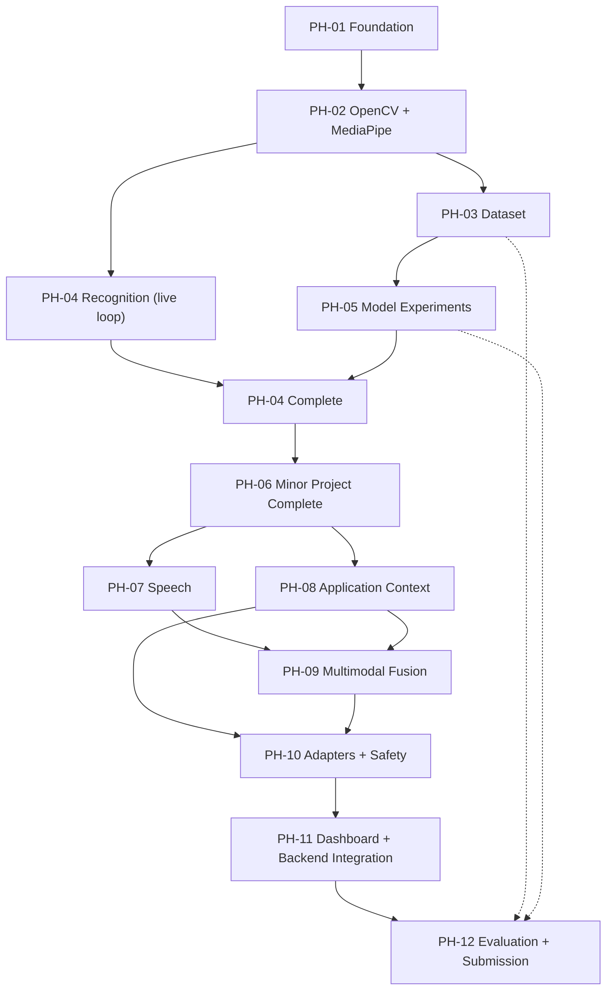
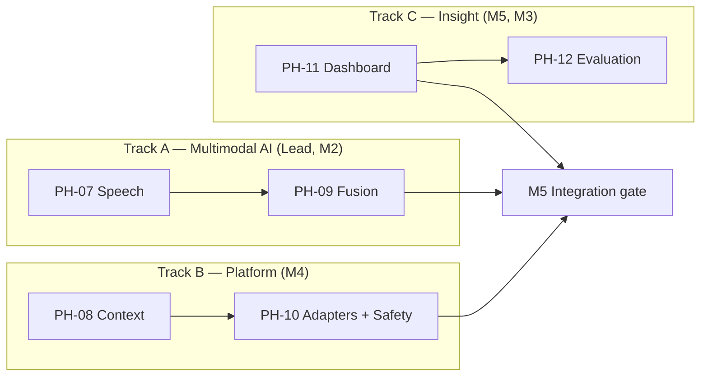

# Implementation Plan

**Project:** Gesture-Controlled AI Computer Interface
**Document ID:** CORE-PLAN
**Version:** 1.0.0
**Status:** Baseline
**Owner:** Team Lead
**Last Updated:** 2026-11-06

---

## Document Control

| Field | Value |
|---|---|
| Source of truth for | Phase decomposition, task ownership, dependencies, deliverables, exit gates, milestone order |
| Does not own | Requirements ([PRD](./PRD.md)), architecture ([TRD](./TRD.md)), contracts ([API_AND_INTEGRATION](./API_AND_INTEGRATION.md)), schema ([BACKEND_SCHEMA](./BACKEND_SCHEMA.md)) |
| ID namespaces owned | `PH-01`–`PH-12` (phases), `M0`–`M6` (milestones), `T-###` (tasks where individually tracked) |
| Scheduling model | **Milestone-based. No calendar dates are assigned.** |

> **Why no dates.** The brief forbids invented deadlines, and the team works a part-time academic schedule whose actual availability is unknown. Phases are ordered by dependency and sized relatively (`S`/`M`/`L`). When real dates are supplied, they attach to milestones `M0`–`M6` without changing this document's structure.

---

## 1. Delivery Model

### 1.1 Principles

| Principle | Consequence |
|---|---|
| Every phase ends in something demonstrable | No phase is "50 % done"; each has an exit gate |
| Vertical slices before horizontal completeness | The MVP (Phase 1–4 subset) runs end to end before models are optimised |
| Contracts freeze before parallel work | Phase 1 freezes interfaces; thereafter members work independently |
| Research artefacts are produced during development, not after | Dataset, splits, and run records accumulate from Phase 3 |
| Safety is built in, not added | The gate exists from Phase 4, even in minimal form |
| Minor project is a strict subset of major | Phase 6 ships; Phases 7–11 extend without rewriting |

### 1.2 Relative Sizing

| Size | Meaning | Guideline |
|---|---|---|
| `S` | Under one person-week | Single owner, low uncertainty |
| `M` | One to two person-weeks | One owner plus review |
| `L` | Two to four person-weeks | Parallelisable, highest uncertainty |

Sizes are effort estimates, not commitments, and are revised at each milestone gate.

### 1.3 Dependency Graph



**Critical path:** `PH-01 → PH-02 → PH-03 → PH-05 → PH-04b → PH-06 → PH-09 → PH-10 → PH-11 → PH-12`.

Dataset collection (PH-03) is the longest-lead item and the most common cause of schedule failure. It starts as early as Phase 2 allows, with a pilot before full collection.

### 1.4 Parallel Tracks After M3



---

## 2. Milestones

| ID | Milestone | Exit condition | Gate owner |
|---|---|---|---|
| `M0` | Documentation baseline | All five core documents and supporting set reviewed; traceability matrix complete; no unresolved contradictions | Lead |
| `M1` | Live perception | Camera → landmarks → preview at ≥ 24 FPS for 10 minutes, no crash (`AC-001`) | M2 |
| `M2` | Dataset v0.1 | ≥ 4 participants, all 12 classes, quality checks pass, split manifest validated (`AC-009`) | M3 |
| `M3` | Minor project demonstration | 12-class live recognition + PowerPoint actions + model comparison report (`AC-002`, `AC-004`, `AC-007`, `AC-010`) | Lead |
| `M4` | Multimodal integration | Speech + context + fusion compose correctly; three configurations runnable (`AC-018`) | Lead |
| `M5` | Full system demonstration | Safety gate, three adapters, dashboard, decision trace (`AC-015`, `AC-017`, `AC-024`) | Lead |
| `M6` | Research completion | Evaluation complete, results exported, report written (`AC-014`, `AC-016`, `AC-019`, `AC-021`) | Lead |

**Gate rule.** A milestone gate requires evidence, not assertion. The gate owner produces an artefact (report, recording, or test output) before the next phase begins. A phase may start early at the owner's risk, but the milestone cannot be declared met.

---

## 3. Team Allocation

### 3.1 Ownership

| Member | Primary ownership | Secondary |
|---|---|---|
| **Team Lead** | Architecture, contracts, temporal modelling strategy, fusion, integration, research coordination | Review of every PR; milestone gates |
| **Member 2** | OpenCV, MediaPipe, hand tracking, landmark extraction, preprocessing | Speech recognition from PH-07 |
| **Member 3** | ML/DL models, sequence modelling, training, evaluation harness, dataset protocol | Statistical analysis in PH-12 |
| **Member 4** | Backend, application adapters, OS integration, execution safety | Persistence and migrations |
| **Member 5** | Dashboard, monitoring, UI, testing infrastructure, evaluation visualisation | Demo rehearsal and hardware |

### 3.2 Why Member 2 Takes Speech

Speech is a perception problem with the same shape as vision: a device stream, a frame/utterance buffer, a model call, and a normalised observation. Member 2 already owns device lifecycle, buffering, and the perception-side error handling. Assigning speech elsewhere would split that knowledge. This is a deliberate reallocation documented here so it is not treated as drift.

### 3.3 RACI per Phase

`R` = responsible, `A` = accountable, `C` = consulted, `I` = informed.

| Phase | Lead | M2 | M3 | M4 | M5 |
|---|---|---|---|---|---|
| `PH-01` | A/R | C | C | C | C |
| `PH-02` | C | A/R | I | I | I |
| `PH-03` | C | R | A | I | C |
| `PH-04` | A | R | C | C | I |
| `PH-05` | C | C | A/R | I | C |
| `PH-06` | A | R | R | C | C |
| `PH-07` | A | R | I | C | I |
| `PH-08` | C | I | I | A/R | I |
| `PH-09` | A/R | C | C | C | C |
| `PH-10` | A | I | I | R | C |
| `PH-11` | C | I | C | R | A/R |
| `PH-12` | A | C | R | C | R |

---

## 4. Phase Specifications

### PH-01 — Research and Project Foundation

| Field | Value |
|---|---|
| Size | `S` |
| Primary | Lead |
| Depends on | — |
| Gate | `M0` |

**Objectives**

- Establish the documentation baseline and freeze the contract spine.
- Validate the toolchain and pin the Python runtime.
- Define the gesture vocabulary, research configurations, and evaluation metrics before any data exists.

**Tasks**

1. Inspect repository state and record it; resolve the git root and remote. *(Lead)*
2. Freeze component IDs, DTOs, event envelope, entity list, and requirement namespaces. *(Lead)*
3. Write the five core documents. *(Lead, with each member reviewing their domain)*
4. Write the supporting document set and architecture decision records. *(All)*
5. Verify MediaPipe wheel availability for the candidate Python version. *(M2)*
6. Define the 12-class vocabulary and capture protocol. *(M3 with Lead)*
7. Define the research design, metrics, and analysis plan. *(Lead with M3)*
8. Set up the repository skeleton: linting, formatting, CI placeholder, branch protection. *(M5)*
9. Produce the traceability matrix. *(Lead)*

**Deliverables**

- `docs/core/*` (5 documents), `docs/supporting/*` (9 documents), `docs/architecture/*`, `docs/research/*`.
- Baseline `README.md`, `CONTRIBUTING.md`, `.gitignore`, `.env.example`.
- Recorded toolchain decision with verified versions.

**Acceptance criteria**

- Every `FR` has a component, a contract, a phase, and at least one acceptance criterion.
- No document contradicts another; recorded conflicts are resolved in `TRD` §30.
- A team member can identify their first task from this document alone.

**Testing requirements**

- Documentation link check passes.
- All Mermaid blocks parse.
- No requirement ID is duplicated or skipped.

**Documentation updates**

- This phase creates the baseline. Subsequent phases update, never silently rewrite.

---

### PH-02 — OpenCV and MediaPipe Integration

| Field | Value |
|---|---|
| Size | `M` |
| Primary | M2 |
| Depends on | `PH-01` |
| Gate | `M1` |

**Objectives**

- Establish a reliable camera → landmark pipeline on the target machine.
- Prove the latency budget's perception segment before committing to a model architecture.

**Tasks**

1. Implement `FrameSource` over OpenCV with timestamping at acquisition. *(M2)*
2. Implement device enumeration, selection, and hot-recovery with backoff. *(M2)*
3. Implement `LandmarkExtractor` over MediaPipe Tasks with confidence configuration. *(M2)*
4. Implement the normalisation pipeline: wrist origin, scale, handedness mirroring, velocity. *(M2)*
5. Implement the ring buffer with validity masking. *(M2)*
6. Build the preview overlay: landmarks, FPS, buffer fill, validity indicator. *(M2 with M5)*
7. Instrument per-stage timings and expose them as metrics. *(M2)*
8. Benchmark on Tier A hardware; record results in the phase log. *(M2)*
9. Verify behaviour at 1 m and 3 m, bright and dim lighting. *(M2)*

**Dependencies**

- A working camera on the development machine.
- Confirmed Python/MediaPipe compatibility (`OQ-01`). If unavailable, pin the interpreter before proceeding — do not work around it.

**Deliverables**

- `src/perception/camera/`, `src/perception/hand_tracking/`, `src/preprocessing/`.
- Perception benchmark table: FPS, per-stage latency, detection rate by distance and lighting.
- Preview application demonstrating tracking quality.

**Acceptance criteria**

- `AC-001`: ≥ 15 FPS sustained for 60 s with stable landmarks. *(Target 24+ FPS.)*
- Landmark normalisation produces identical vectors for the same pose at different camera distances (verified by replay).
- Camera disconnection during a session recovers without process restart.

**Testing requirements**

- Unit: normalisation invariance (translation, scale, handedness) on synthetic landmarks.
- Unit: buffer validity and overflow behaviour.
- Integration: recorded fixture frames replay through the extractor.
- Manual: physical unplug/replug test.

**Documentation updates**

- `TRD` §5.2–5.3 with measured parameters.
- `DATASET_SPECIFICATION` §5 with the confirmed feature contract.
- Phase log entry with benchmark numbers.

---

### PH-03 — Dataset Collection and Preprocessing

| Field | Value |
|---|---|
| Size | `L` |
| Primary | M3, supported by M2 |
| Depends on | `PH-02` |
| Gate | `M2` |

**Objectives**

- Produce a consented, quality-controlled, subject-labelled dataset with frozen splits.
- Prevent the leakage that would invalidate every later claim.

**Tasks**

1. Implement the guided capture tool: class prompt, countdown, repetition, discard. *(M3)*
2. Implement participant onboarding: consent record, metadata, dominant hand, experience. *(M3 with Lead)*
3. Pilot capture with 2 team members; measure per-class separability informally. *(M3)*
4. Revise the protocol based on pilot findings (distance, speed, repetitions). *(M3)*
5. Full collection: ≥ 8 participants, ≥ 20 repetitions per class per participant. *(All)*
6. Implement quality checks: valid-frame ratio, sequence length, outlier rejection, class balance. *(M3)*
7. Build the preprocessing pipeline: resampling, windowing, augmentation, deterministic ordering. *(M3)*
8. Generate split manifests: within-subject and leave-one-subject-out. *(M3)*
9. Implement the manifest validator proving subject disjointness. *(M3 with M5)*
10. Release `ds-v0.1` with checksums and a versioned manifest. *(M3)*

**Dependencies**

- Consenting participants and a quiet capture space.
- Working perception pipeline with stable normalisation.

**Deliverables**

- `datasets/raw/`, `datasets/processed/`, `datasets/annotations/` populated for the release.
- Capture tool and quality report.
- `split-loso-v1` manifest and validator.
- Dataset release notes.

**Acceptance criteria**

- `AC-009`: automated validation proves no subject appears in both train and test.
- All 12 classes present for every participant, or documented gaps with a plan.
- Every sample links to a participant, session, and checksum.
- Class balance within the documented tolerance, or reweighting strategy recorded.

**Testing requirements**

- Unit: quality-check rules on synthetic good/bad sequences.
- Unit: split generator never leaks a subject.
- Integration: full pipeline from raw samples to model-ready tensors.
- Data: duplicate detection by checksum.

**Documentation updates**

- `DATASET_SPECIFICATION` §9 with realised quality thresholds and actual participant counts.
- `RESEARCH_METHODOLOGY` §4 with the final protocol.
- `BACKEND_SCHEMA` if any captured metadata field was missing.

**Risk note.** This phase is the most likely to slip and the hardest to compress. Recruit participants before the pipeline is finished; do not wait for a perfect tool.

---

### PH-04 — Static and Dynamic Gesture Recognition

| Field | Value |
|---|---|
| Size | `M` |
| Primary | M2, with Lead |
| Depends on | `PH-02`; `PH-05` for the full model set |
| Gate | contributes to `M3` |

**Objectives**

- Deliver a live recognition loop with stability filtering and a minimal safety gate.
- Establish the runtime path that all later phases extend.

**Tasks**

1. Implement the feature builder for `IC-FRAME`, `IC-FLAT`, `IC-SEQ`. *(M2)*
2. Implement the `GestureClassifier` protocol and a trivial rule-based classifier for pipeline bring-up. *(Lead)*
3. Implement the inference worker with fixed cadence and backpressure. *(Lead)*
4. Implement temporal stability filtering. *(Lead)*
5. Implement the minimal decision gate: confidence, stability, cooldown, duplicate suppression. *(Lead)*
6. Wire the live loop: camera → landmarks → model → gate → console action. *(M2)*
7. Implement a hard-coded PowerPoint action path as a temporary end-to-end proof. *(M4)*
8. Implement replay mode from recorded sequences. *(M5)*

**Deliverables**

- `src/recognition/` with the protocol and one working implementation.
- `src/execution/safety/` with the minimal gate.
- Live end-to-end demonstration on a laptop.

**Acceptance criteria**

- `AC-004`: a recognised swipe advances exactly one slide.
- `AC-005`: no action while `IDLE`.
- `AC-013`: replaying a sequence twice produces identical output.

**Testing requirements**

- Unit: gate rules in isolation, one test per rule and per denial code.
- Unit: feature builder shapes match the declared contracts exactly.
- Integration: replay → gate → mock adapter.
- Determinism: repeated runs produce identical labels.

**Documentation updates**

- `TRD` §5.6–5.9 with any interface refinement discovered during implementation.
- `API_AND_INTEGRATION` if a DTO gained a required field.

---

### PH-05 — ML/DL Model Experimentation

| Field | Value |
|---|---|
| Size | `L` |
| Primary | M3 |
| Depends on | `PH-03`; `PH-04` for the runtime contract |
| Gate | `M2` → contributes to `M3` |

**Objectives**

- Train and evaluate five classifier families under one harness.
- Produce the comparison evidence required by the research question, part one (H1).

**Tasks**

1. Implement the training harness: config-driven, one command per family. *(M3)*
2. Implement Random Forest and MLP on `IC-FLAT`. *(M3)*
3. Implement LSTM, GRU, and Transformer Encoder on `IC-SEQ`. *(M3)*
4. Implement the frame-level baseline on `IC-FRAME` with majority voting. *(M3)*
5. Implement evaluation: accuracy, macro P/R/F1, per-class metrics, confusion matrices. *(M3)*
6. Implement latency benchmarking separate from accuracy evaluation. *(M3)*
7. Implement run recording: dataset, manifest, config, seed, revision, environment. *(M3 with M4)*
8. Run the full comparison on frozen splits. *(M3)*
9. Write the model comparison report. *(M3 with Lead)*
10. Select the candidate model for interactive use. *(Lead)*

**Deliverables**

- `experiments/configs/` with one config per family.
- `experiments/results/` with per-run outputs.
- Model comparison report with tables and confusion matrices.
- Candidate model versions registered in `models/checkpoints/`.

**Acceptance criteria**

- `AC-008`: all five families train through the same command.
- `AC-010`: comparison report contains every required metric for every family.
- `AC-011`: every run record is complete.
- `AC-012`: frame-level and temporal results are directly comparable.

**Testing requirements**

- Harness: a smoke run on a tiny synthetic dataset completes in CI.
- Metrics: known-answer tests with hand-computed precision/recall/F1.
- Leakage: assert the training loader never sees test subjects.
- Determinism: fixed seed produces reproducible metrics within tolerance.

**Documentation updates**

- `MODEL_COMPARISON` with measured results (replacing proposed expectations).
- `RESEARCH_METHODOLOGY` if the design changed.
- `EXPERIMENT_LOG` entries.

---

### PH-06 — Minor Project Completion

| Field | Value |
|---|---|
| Size | `M` |
| Primary | Lead, with all members |
| Depends on | `PH-04`, `PH-05` |
| Gate | `M3` |

**Objectives**

- Consolidate the minor project into a defensible, demonstrable deliverable.
- Close documentation and testing gaps before multimodal work begins.

**Tasks**

1. Freeze the minor-project feature set and model selection. *(Lead)*
2. Implement the PowerPoint adapter to the MVP three-action scope. *(M4)*
3. Complete configuration loading, validation, and persistence. *(M4)*
4. Implement the minor-scope dashboard surface: status, preview, last N gestures. *(M5)*
5. Run the full test suite and close gaps. *(M5)*
6. Record a demonstration video and a rehearsal log. *(M5)*
7. Write the minor-project report section. *(Lead)*
8. Conduct an internal review against `AC-001`–`AC-013`. *(Lead)*

**Deliverables**

- Minor project package: working application, models, dataset release, comparison report, report section.
- Demonstration recording.

**Acceptance criteria**

- All MVP and minor acceptance criteria met (`AC-001`–`AC-013`).
- A teammate can set up and run the minor project from the README alone.
- No known crash path during a 15-minute demonstration.

**Testing requirements**

- Full unit + integration suite green in CI.
- Soak test: 30 minutes continuous operation.
- Cross-user spot check: one participant not in training data.

**Documentation updates**

- `README` status, capabilities, and demo instructions.
- `IMPLEMENTATION_PLAN` phase log.
- Any ADR superseded during implementation.

---

### PH-07 — Speech Recognition

| Field | Value |
|---|---|
| Size | `M` |
| Primary | M2 |
| Depends on | `PH-06` |
| Gate | contributes to `M4` |

**Objectives**

- Add a second evidence channel without compromising latency or privacy.
- Produce `SpeechObservation` events that fusion can consume.

**Tasks**

1. Implement audio capture with device selection and level metering. *(M2)*
2. Implement energy-based VAD and utterance segmentation. *(M2)*
3. Implement the `SpeechEngine` protocol and the `faster-whisper` implementation. *(M2)*
4. Implement push-to-talk gating integrated with the activation state machine. *(M2)*
5. Implement transcript normalisation and fuzzy matching to the closed vocabulary. *(M2)*
6. Implement confidence mapping and out-of-vocabulary rejection. *(M2)*
7. Benchmark transcription latency on Tier A. *(M2)*
8. Implement audio buffer zeroing. *(M2)*
9. Integrate the `speech.transcribed` event and dashboard display. *(M2 with M5)*

**Deliverables**

- `src/perception/speech/` with engine abstraction.
- Benchmark table: latency by utterance length and model size.
- Vocabulary matching test suite.

**Acceptance criteria**

- In-vocabulary commands are recognised at a rate recorded in the phase log; out-of-vocabulary input never produces an observation.
- Transcription latency meets or misses the proposed target with a recorded measurement.
- No audio is written to disk in default configuration (`TR-006`).

**Testing requirements**

- Unit: fuzzy matcher on misspellings, homophones, and near-misses.
- Unit: VAD segmentation on synthetic silence/speech.
- Integration: audio fixture → observation → fusion input.
- Privacy: assert no file handles opened for writing during transcription.

**Documentation updates**

- `TRD` §9 with measured latency.
- `API_AND_INTEGRATION` §7.3 with the final vocabulary.
- `SECURITY_AND_PRIVACY` with the implemented audio handling.

---

### PH-08 — Application Context Acquisition

| Field | Value |
|---|---|
| Size | `M` |
| Primary | M4 |
| Depends on | `PH-06` |
| Gate | contributes to `M4` |

**Objectives**

- Make the system aware of which application is focused and what state it is in.
- Provide the evidence needed for context-based disambiguation (H3).

**Tasks**

1. Implement foreground window and process name retrieval on Windows. *(M4)*
2. Implement window title hashing and redaction. *(M4)*
3. Implement the application registry and process-pattern mapping. *(M4)*
4. Implement polling at 200 ms with change-only emission. *(M4)*
5. Implement adapter state querying and heartbeat. *(M4)*
6. Implement the `unknown` policy and its conservative gate behaviour. *(M4)*
7. Implement focus-change verification before dispatch. *(M4)*
8. Implement `context.updated` events and dashboard display. *(M4 with M5)*

**Deliverables**

- `src/context/` with the provider and registry.
- Application configuration seed: PowerPoint, media player, IDE.
- Context accuracy test results across focus-switch scenarios.

**Acceptance criteria**

- `FR-042`: focus change detected and emitted within 300 ms.
- `FR-044`: a focus change between prediction and dispatch aborts the action.
- Unknown applications produce `unknown` context and denied execution, never a guess.

**Testing requirements**

- Unit: process-pattern matching and precedence.
- Unit: change-only emission (no event when nothing changed).
- Integration: focus switch during a pending intent aborts dispatch (`UC-06`).
- Manual: alt-tab stress test with 50 switches.

**Documentation updates**

- `TRD` §10 with the confirmed mechanism and permissions.
- `BACKEND_SCHEMA` `ENT-08`, `ENT-09` if fields changed.
- `SECURITY_AND_PRIVACY` with the window-title policy.

---

### PH-09 — Multimodal Intent Fusion

| Field | Value |
|---|---|
| Size | `L` |
| Primary | Lead |
| Depends on | `PH-07`, `PH-08` |
| Gate | `M4` |

**Objectives**

- Combine gesture, speech, and context into ranked intent candidates with an explicit abstention path.
- Make all three research configurations runnable from configuration alone.

**Tasks**

1. Implement the pending-interaction record and association window. *(Lead)*
2. Implement weighted scoring with per-source presence handling. *(Lead)*
3. Implement abstention rules: fused threshold, margin, single-source weakness. *(Lead)*
4. Implement the per-application intent vocabulary and resolution order. *(Lead)*
5. Implement the disambiguation rules: speech narrows, context narrows, specificity wins. *(Lead with M4)*
6. Implement `intent.predicted` with evidence, weights, and alternatives. *(Lead)*
7. Implement configuration-driven fusion modes for the three research configurations. *(Lead)*
8. Implement the fusion ablation switch (disable a source by weight and by subsystem). *(Lead)*
9. Implement determinism and property tests. *(Lead with M5)*

**Deliverables**

- `src/fusion/` and `src/intent/`.
- Intent vocabulary seed for three applications.
- Fusion unit and property test suite.

**Acceptance criteria**

- `AC-017`: identical gesture produces different intents in different applications.
- `AC-018`: three configurations run from configuration without code change.
- Abstention occurs on low evidence rather than defaulting to the top class.
- Identical evidence and configuration produce identical output (`FR-057`).

**Testing requirements**

- Unit: scoring table with hand-computed expected values.
- Property: score is invariant to evidence arrival order.
- Property: disabling a source never increases confidence.
- Integration: three full configurations on replay fixtures.

**Documentation updates**

- `TRD` §11 with the final scoring formula and default weights.
- `API_AND_INTEGRATION` §5.3 with the final intent payload.
- `RESEARCH_METHODOLOGY` §5 with configuration definitions.

---

### PH-10 — Application Adapters and Safe Execution

| Field | Value |
|-------------|---|
| Size | `L` |
| Primary | M4 |
| Depends on | `PH-08` |
| Gate | `M5` |

**Objectives**

- Execute authorised actions reliably across three applications.
- Make the system safe enough to run unattended during a demonstration.

**Tasks**

1. Extend the adapter interface and registry from the MVP subset to full scope. *(M4)*
2. Implement the PowerPoint adapter to full scope. *(M4)*
3. Implement the media adapter. *(M4)*
4. Implement the IDE adapter with focus verification. *(M4)*
5. Implement the full thirteen-rule gate with dry-run, allowlist, and action classes. *(M4)*
6. Implement the single-threaded executor with timeout and serialisation. *(M4)*
7. Implement the emergency stop across hotkey, API, and dashboard. *(M4)*
8. Implement adapter health checks and capability filtering. *(M4)*
9. Implement the adapter contract test harness. *(M5)*
10. Implement destructive-action confirmation. *(M4)*

**Deliverables**

- `src/execution/adapters/` with three adapters.
- `src/execution/safety/` with the complete gate.
- Adapter contract test harness.
- Safety test report.

**Acceptance criteria**

- `AC-015`: no execution outside the gate, under any tested condition.
- `AC-020`: emergency stop halts dispatch within 100 ms.
- `AC-022`: a fourth adapter can be added without touching recognition, fusion, or intent.
- `AC-024`: every decision exposes its rule trace.

**Testing requirements**

- Unit: one test per gate rule and denial code.
- Unit: executor serialisation and timeout.
- Integration: each adapter against a mock and against the real application.
- Safety: adversarial cases — wrong focus, stale context, duplicate burst, queue saturation, estop mid-dispatch.
- Timing: estop latency measured over 100 trials.

**Documentation updates**

- `TRD` §12–14 with the implemented rules.
- `API_AND_INTEGRATION` §4.7 with final action lists.
- `SECURITY_AND_PRIVACY` with the realised threat mitigations.

---

### PH-11 — Dashboard and Backend Integration

| Field | Value |
|---|---|
| Size | `L` |
| Primary | M5, with M4 |
| Depends on | `PH-10` |
| Gate | `M5` |

**Objectives**

- Make the system's behaviour observable, explainable, and controllable.
- Deliver the demonstration surface.

**Tasks**

1. Implement the REST surface per `EP-001`–`EP-071`. *(M4)*
2. Implement the WebSocket hub with topic filtering and slow-client protection. *(M4)*
3. Implement persistence per `BACKEND_SCHEMA` with migrations and seed data. *(M4)*
4. Implement the dashboard shell, status indicator, and connection handling. *(M5)*
5. Implement the live event feed and correlation grouping. *(M5)*
6. Implement the decision-trace view. *(M5)*
7. Implement control surfaces: start, stop, arm, disarm, emergency stop. *(M5)*
8. Implement metrics views: latency percentiles, denial breakdown, false activations. *(M5)*
9. Implement configuration and mapping editors with validation feedback. *(M5)*
10. Implement experiment result views. *(M5)*
11. Implement the demo layout for a second display. *(M5)*

**Deliverables**

- `src/backend/` and `src/dashboard/`.
- Seeded database and migration baseline.
- Dashboard user guide.

**Acceptance criteria**

- `FR-090`–`FR-096` met.
- Dashboard shows `DISCONNECTED` rather than stale data on backend loss.
- Decision trace displays every evaluated rule with observed and required values.
- Emergency stop is always reachable without navigation.

**Testing requirements**

- API contract tests against the OpenAPI schema.
- WebSocket integration test with multiple clients and one slow client.
- UI component tests for state rendering and non-colour encoding.
- End-to-end: arm → gesture → action → trace visible in dashboard.

**Documentation updates**

- `API_AND_INTEGRATION` reconciled with the implemented routes.
- `README` with setup and demo instructions.
- `BACKEND_SCHEMA` with any migration that diverged.

---

### PH-12 — Testing, Research Evaluation, and Final Submission

| Field | Value |
|---|---|
| Size | `L` |
| Primary | M5 and M3, accountable to Lead |
| Depends on | `PH-11` |
| Gate | `M6` |

**Objectives**

- Produce the evidence that answers the research question.
- Close every open quality gap before submission.

**Tasks**

1. Complete the false-activation protocol: 10 minutes per participant, no commands intended. *(M5)*
2. Complete end-to-end latency measurement across all configurations. *(M5)*
3. Complete leave-one-subject-out evaluation for all model × configuration cells. *(M3)*
4. Complete ablation: evidence channels and window length. *(Lead with M3)*
5. Complete action success rate measurement per adapter. *(M4)*
6. Run the full regression suite and fix defects. *(M5)*
7. Run the demonstration rehearsal three times; record failures. *(M5)*
8. Export results to the report format. *(M3)*
9. Write the final report: method, results, limitations, threats to validity. *(Lead)*
10. Reconcile documentation with the delivered system; close or escalate open questions. *(Lead)*
11. Prepare the live demonstration script and fallback plan. *(M5)*

**Deliverables**

- Results dataset and analysis notebook.
- Final report.
- Demonstration script and rehearsal log.
- Reconciled documentation set.

**Acceptance criteria**

- `AC-014`, `AC-016`, `AC-019`, `AC-021` met.
- Every reported figure cites a run ID.
- No metric appears as a target where a measurement exists, and no measurement is presented as a target.
- Demonstration completes three times consecutively without manual recovery.

**Testing requirements**

- Full suite green: unit, integration, performance, end-to-end.
- Cross-user validation on at least one held-out participant.
- Demonstration environment tested on the actual demo machine.

**Documentation updates**

- All documents reconciled; `README` status set to delivered.
- `MODEL_COMPARISON` and research documents contain measured values.
- Open questions either closed or explicitly carried forward with impact stated.

---

## 5. Definition of Done

A task is complete only when all six conditions hold.

| # | Condition |
|---|---|
| 1 | Code merged to `main` through a reviewed pull request |
| 2 | Unit tests cover the new behaviour and pass |
| 3 | No new lint or type errors |
| 4 | Interfaces changed are reflected in `API_AND_INTEGRATION` or `BACKEND_SCHEMA` |
| 5 | A log entry exists in the phase log with what was done and what was learned |
| 6 | If the change affects behaviour visible to a user or examiner, `README` is updated |

**Phase completion** additionally requires the exit gate artefact.

---

## 6. Phase Log Template

Maintained in `docs/reports/` and appended at each phase close.

```markdown
## PH-XX — <name>
- Period: <relative, e.g. "after M2">
- Owners: <names>
- Objectives met: <yes/partial/no + explanation>
- Artefacts produced: <paths>
- Measurements: <metric: value, method>
- Deviations from plan: <what changed and why>
- Open issues: <list with owners>
- Gate decision: <met / not met / waived by Lead with reason>
```

**Rule.** A phase without a log entry is not complete, regardless of code state.

---

## 7. Change Control

| Change | Approval |
|---|---|
| Task reordering within a phase | Phase owner |
| Adding a task within a phase | Phase owner + Lead notified |
| Moving a task across phases | Lead |
| Adding or removing a requirement | Lead + PRD update |
| Changing a component boundary | ADR + Lead |
| Changing the research design | Lead + `RESEARCH_METHODOLOGY` update |
| Dropping a milestone deliverable | Lead + documented scope reduction |

**Scope reduction rule.** If a milestone is at risk, reduce *breadth* (fewer adapters, fewer model families) before reducing *rigour* (evaluation, safety, reproducibility). A smaller honest study is a valid outcome; an unreproducible larger one is not.

---

## 8. Risk-Weighted Schedule Notes

| Risk | Phase most exposed | Schedule mitigation |
|---|---|---|
| Participant recruitment (`RSK-02`) | `PH-03` | Start recruiting during `PH-02`; accept 8 participants rather than delay |
| MediaPipe performance (`RSK-03`) | `PH-02` | Measure before building models; have a downscale path |
| Automation permissions (`RSK-05`) | `PH-10` | Prototype the PowerPoint call in `PH-04` as a throwaway spike |
| Fusion shows no benefit (`RSK-07`) | `PH-09` | This is a valid finding; the plan does not depend on a positive result |
| Latency misses target (`RSK-10`) | `PH-04`, `PH-09` | Instrument from `PH-02`; treat the budget as a design constraint, not a hope |
| Demo environment differs (`RSK-12`) | `PH-12` | Rehearse on demo hardware from `PH-11` onward |

**Buffer policy.** `PH-12` is the only phase with slack by design. If earlier phases consume it, the response is scope reduction under §7, not compressing evaluation.

---

## 9. Traceability to Requirements

| Phase | PRD requirements satisfied | Acceptance criteria |
|---|---|---|
| `PH-01` | — (documentation and contract baseline; `NFR-033`, `NFR-054`) | — |
| `PH-02` | `FR-010`–`FR-017` | `AC-001` |
| `PH-03` | `FR-100`–`FR-102` | `AC-009` |
| `PH-04` | `FR-001`, `FR-003`–`FR-005`, `FR-009`, `FR-020`, `FR-021`, `FR-027`–`FR-030`, `FR-120` | `AC-002`–`AC-005`, `AC-013` |
| `PH-05` | `FR-022`–`FR-026`, `FR-103`–`FR-105`, `FR-111` | `AC-007`, `AC-008`, `AC-010`–`AC-012` |
| `PH-06` | `FR-070`–`FR-071`, `FR-084` | `AC-001`–`AC-013` |
| `PH-07` | `FR-031`–`FR-038` | — |
| `PH-08` | `FR-040`–`FR-045` | `AC-017` (partial) |
| `PH-09` | `FR-050`–`FR-058` | `AC-017`, `AC-018` |
| `PH-10` | `FR-006`–`FR-008`, `FR-060`–`FR-068`, `FR-072`–`FR-078` | `AC-015`, `AC-020`, `AC-022`, `AC-024` |
| `PH-11` | `FR-002`, `FR-080`–`FR-083`, `FR-085`–`FR-088`, `FR-090`–`FR-096`, `FR-121`–`FR-124` | `AC-023`, `AC-024` |
| `PH-12` | `FR-106`–`FR-110` | `AC-006`, `AC-014`, `AC-016`, `AC-019`, `AC-021` |

**Reading rule.** Each requirement appears in exactly one phase — the phase in which it is *completed*. Early partial delivery is recorded in the phase task list, not by listing the requirement twice. This table and [TRACEABILITY_MATRIX](../supporting/TRACEABILITY_MATRIX.md) §7 use the same assignment.

**MVP adapter exception.** `FR-070` and the three-action MVP subset of `FR-071` complete in `PH-06`; the full adapter registry and the remaining `FR-071` actions are extensions delivered in `PH-10`. They are listed once, in `PH-06`, and the `PH-10` task list records the extension. This keeps the phase column single-valued while preserving the MVP subset rule in [PRD](../core/PRD.md) §10.13.

The full requirement → component → contract → phase → test mapping is in [TRACEABILITY_MATRIX](../supporting/TRACEABILITY_MATRIX.md).

## Appendix — Related Documents

- [PRD](./PRD.md) · [TRD](./TRD.md) · [Backend Schema](./BACKEND_SCHEMA.md) · [API and Integration](./API_AND_INTEGRATION.md)
- [Research Methodology](../supporting/RESEARCH_METHODOLOGY.md) · [Testing Strategy](../supporting/TESTING_STRATEGY.md) · [Repository Structure](../supporting/REPOSITORY_STRUCTURE.md)
