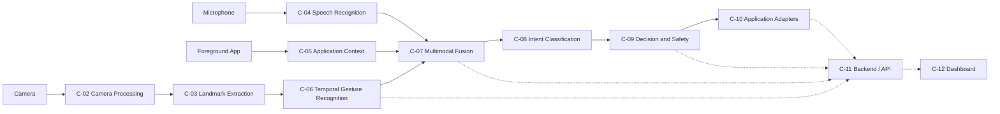
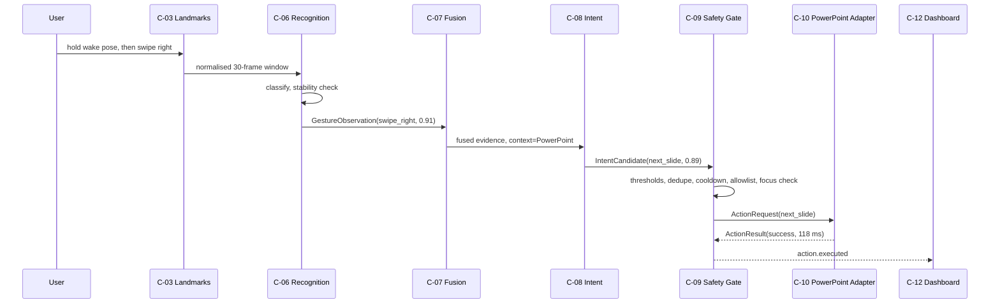
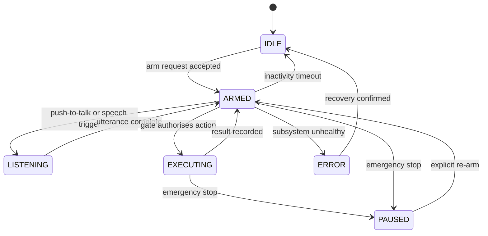

# Product Requirements Document (PRD)

**Project:** Gesture-Controlled AI Computer Interface
**Document ID:** CORE-PRD
**Version:** 1.0.0
**Status:** Baseline
**Owner:** Team Lead (Product & Architecture)
**Contributors:** All team members
**Last Updated:** 2026-11-06

---

## Document Control

| Field | Value |
|---|---|
| Source of truth for | Product scope, functional requirements, non-functional requirements, user stories, acceptance criteria, success metrics |
| Does not own | Technical architecture (see [TRD](./TRD.md)), data model (see [BACKEND_SCHEMA](./BACKEND_SCHEMA.md)), sequencing (see [IMPLEMENTATION_PLAN](./IMPLEMENTATION_PLAN.md)), communication contracts (see [API_AND_INTEGRATION](./API_AND_INTEGRATION.md)) |
| Requirement ID namespaces owned | `FR-###`, `NFR-###`, `US-###`, `AC-###`, `UC-##`, `RSK-###`, `SM-###` |
| Change process | See [DEVELOPMENT_GUIDELINES](../supporting/DEVELOPMENT_GUIDELINES.md) §Documentation Changes |

> **Reading rule.** This document states *what* the product must do and *how we know it works*. It deliberately does not state *how it is built*. Any statement here that implies an implementation is a constraint, not a design.

---

## 1. Executive Summary

The Gesture-Controlled AI Computer Interface is a research-oriented desktop system that interprets human intent from three independent evidence sources — hand gestures over time, spoken commands, and the state of the application currently in focus — and converts that intent into authorised computer actions.

Conventional gesture interfaces map one static hand pose to one keyboard shortcut. That model breaks down as soon as a user makes an unintended movement, changes application, or performs a gesture that is ambiguous without context. This project treats gesture recognition as the *perception* problem and intent recognition as the *decision* problem, and studies whether temporal modelling, speech, and application context measurably improve the second.

The project is delivered in two stages. The **minor project** is a self-contained real-time dynamic gesture recognition application. The **major project** extends it into a context-aware multimodal intent system with safe execution against PowerPoint, media players, and IDEs, plus an experiment harness that produces the evidence needed to answer the research question.

**Primary research question:** Does adding temporal information, speech, and application context improve human-computer intent recognition compared with gesture-only interaction?

This document defines the product baseline. It contains no experimental results; all quantitative targets are explicitly labelled **proposed** until measured.

---

## 2. Project Vision

A user should be able to walk up to a machine, perform a short natural movement, optionally say a word, and have the machine do the right thing *in the application they are actually using* — without the system guessing, without spurious activations, and without the user needing to learn a private command language.

The long-term vision is an interaction layer that is:

- **Intent-first** — the system reasons about goals, not key codes.
- **Context-aware** — the same movement means different things in PowerPoint, a media player, and an IDE.
- **Safe by construction** — no action executes without passing a deterministic authorisation gate.
- **Measurable** — every claim about accuracy or latency is backed by a reproducible experiment.
- **Extensible** — new applications are added by writing an adapter, never by retraining the gesture model.

---

## 3. Problem Statement

Traditional human-computer interaction depends on physical input devices: keyboard, mouse, touchscreen. These are precise and fast but require physical contact, fine motor control, and learned mappings between intent and device manipulation.

Gesture-based interfaces promise to remove that indirection. In practice, most deployed implementations are shallow:

1. **Static-only recognition.** A classifier labels a single frame or a short averaged window, discarding motion. Directional and continuous gestures — the ones users actually want — are indistinguishable.
2. **One-to-one command mapping.** Each gesture is hard-wired to a shortcut. The mapping cannot express "the same gesture means different things in different contexts", so the vocabulary either explodes or stays uselessly small.
3. **No context awareness.** The system does not know which application is focused, so it cannot disambiguate intent and cannot avoid sending a keystroke to the wrong window.
4. **No multimodal evidence.** Speech is a high-precision, low-ambiguity channel for *which* action; gesture is a good channel for *when* and *how much*. Using only one discards complementary evidence.
5. **Uncontrolled false activations.** Without activation gating, confidence thresholds, temporal stability, and cooldowns, ordinary hand movement around a keyboard triggers commands.
6. **Poor generalisation.** Models trained on a handful of subjects and one lighting condition fail for new users, new cameras, and new rooms — and this failure is usually discovered only at demonstration time.
7. **No latency accountability.** Systems report classification accuracy but not the time between a user's movement ending and an action happening, which is what determines whether interaction feels usable.
8. **Unsafe execution.** Direct OS automation with no allowlist, no dry-run mode, and no emergency stop can close unsaved work or send destructive keystrokes.

---

## 4. Existing System Limitations

| Limitation | Consequence for the user | Addressed by |
|---|---|---|
| Frame-level classification | Dynamic gestures misclassified; direction lost | `FR-020`–`FR-030` |
| Hard-coded gesture→shortcut table | Cannot reuse a gesture across applications | `FR-054`, `FR-122`, `ENT-11` |
| No foreground-application awareness | Commands land in the wrong window | `FR-040`–`FR-045` |
| Single-modality input | Ambiguous commands cannot be resolved | `FR-050`–`FR-058` |
| No activation gate | Constant false activations | `FR-001`–`FR-005` |
| Subject-dependent evaluation | Optimistic accuracy; fails on new users | `FR-102`, `FR-111` |
| No latency instrumentation | Unusable responsiveness discovered late | `NFR-001`–`NFR-006`, `FR-106`–`FR-107` |
| Unrestricted OS automation | Destructive actions, no recovery | `FR-060`–`FR-068` |

---

## 5. Proposed Solution

A layered system in which perception, recognition, fusion, authorisation, and execution are **separate stages with explicit contracts**.

1. **Perception.** OpenCV captures frames; MediaPipe extracts 21 hand landmarks per hand. Audio is captured in parallel. The foreground application and window title are polled.
2. **Temporal recognition.** Landmarks are normalised into a translation-, scale-, and handedness-invariant representation and buffered into fixed-length sequences. A swappable classifier (Random Forest, MLP, LSTM, GRU, Transformer Encoder) produces a labelled gesture observation with a calibrated confidence.
3. **Multimodal fusion.** Gesture, speech, and context evidence are combined — initially by configurable late fusion with per-source weights and an abstention path; a learned fusion model is studied as an experiment, not assumed.
4. **Intent classification.** The fused evidence is resolved against a per-application intent vocabulary.
5. **Decision and safety.** A deterministic gate applies confidence thresholds, temporal stability, duplicate suppression, per-action cooldown, rate limiting, adapter allowlisting, dry-run mode, and emergency stop. The gate — not the model — decides whether anything executes.
6. **Execution.** A capability-based adapter translates an authorised action into a concrete automation call for PowerPoint, a media player, or an IDE.
7. **Observation.** Every stage emits a structured event on one event bus, consumed by a React dashboard and persisted for research analysis.

The novel contribution is not the classifier. It is the **evidence chain**: temporal modelling for *what*, speech for *which*, context for *where*, and a deterministic gate for *whether*.

---

## 6. Product Objectives

| ID | Objective | Verified by |
|---|---|---|
| `OBJ-01` | Deliver a real-time dynamic gesture recogniser that runs on commodity hardware | `AC-004`, `AC-006` |
| `OBJ-02` | Quantify the contribution of temporal modelling versus frame-level classification | `AC-012`, `FR-092` |
| `OBJ-03` | Integrate speech as a second evidence channel without degrading responsiveness | `AC-009`, `NFR-004` |
| `OBJ-04` | Disambiguate identical gestures using application context | `AC-010`, `FR-063` |
| `OBJ-05` | Drive false activations to a measurable, low rate | `AC-014`, `NFR-007` |
| `OBJ-06` | Guarantee no unauthorised action executes | `AC-015`, `FR-081` |
| `OBJ-07` | Produce a reproducible experiment harness and evidence set | `AC-018`, `FR-091` |
| `OBJ-08` | Demonstrate generalisation to unseen users | `AC-016`, `FR-095` |

---

## 7. Scope

### 7.1 Scope Model

| Stage | Definition | Exit criterion |
|---|---|---|
| **MVP** | Thinnest end-to-end vertical slice proving the interaction concept | Camera → landmark → 6 dynamic gestures → PowerPoint action, with activation gate |
| **Minor Project** | Complete dynamic gesture recognition product with model comparison | All MVP requirements plus offline evaluation of 5 classifier families and a live application |
| **Major Project** | Context-aware multimodal intent system with safe execution and research evidence | All minor requirements plus speech, context, fusion, adapters, safety, dashboard, and evaluation |

Every requirement below carries a `Scope` value of `MVP`, `Minor`, or `Major`. `MVP ⊂ Minor ⊂ Major`.

### 7.2 MVP Scope

- Camera capture at ≥ 15 FPS with automatic recovery from device loss.
- MediaPipe hand landmark extraction, single hand, 21 landmarks.
- Normalised landmark representation and a 30-frame (≈1 s at 30 FPS) sliding window.
- One temporal classifier (LSTM) over **6 dynamic gestures**: `swipe_left`, `swipe_right`, `swipe_up`, `swipe_down`, `circle_clockwise`, `wave`.
- Explicit activation via a held wake pose; deactivation after inactivity.
- PowerPoint adapter with three actions: next slide, previous slide, start/stop slideshow.
- Structured logging of every recognised gesture and executed action.
- A live preview window showing landmarks, window fill state, current label, and confidence.

### 7.3 Minor Project Scope

Everything in the MVP, plus:

- **12-class vocabulary**: 6 static (`open_palm`, `closed_fist`, `thumbs_up`, `peace`, `pinch`, `point`) and 6 dynamic classes.
- **Five classifier families** behind one interface: Random Forest, MLP, LSTM, GRU, Transformer Encoder.
- **Dataset tooling**: guided capture, annotation, versioned release, subject metadata, quality checks.
- **Subject-independent evaluation**: leave-one-subject-out splits, per-class metrics, confusion matrices.
- **Comparison harness** producing a reproducible model-comparison report.
- **Model registry** with versioned artefacts and configuration-driven selection.
- **Real-time application** with configurable gesture→action mappings, persisted locally.
- **Latency instrumentation** distinguishing model inference latency from end-to-end interaction latency.

### 7.4 Major Project Scope

Everything in the minor project, plus:

- **Speech recognition** (local, streaming) with a push-to-talk activation path and a normalised command vocabulary.
- **Application context acquisition**: foreground process, window title, and adapter-reported application state, refreshed at ≥ 5 Hz.
- **Multimodal fusion** of gesture, speech, and context with configurable weights, per-source confidence, and an explicit abstention path.
- **Intent disambiguation**: the same gesture resolves to different intents per application and per spoken modifier.
- **Deterministic safety gate**: thresholds, stability, dedupe, cooldown, rate limit, allowlist, dry-run, emergency stop.
- **Adapter framework** with PowerPoint, media player, and IDE adapters, plus a capability model that lets an adapter declare what it supports.
- **Backend/API and dashboard** with live event streaming and experiment inspection.
- **Three interaction configurations** (gesture-only, gesture+speech, gesture+speech+context) evaluated against one another.
- **Ablation studies** isolating the contribution of each evidence channel.

### 7.5 Out of Scope

| Excluded | Rationale |
|---|---|
| Two-hand and body-pose recognition | Extension point only; see §21 |
| Continuous/always-on gesture spotting without activation | Deliberately excluded to keep false-activation control tractable |
| Custom model training on the user's own data at runtime | Personalisation is documented as future work, not delivered |
| Mobile or webcam-in-browser deployment | Desktop-first; the dashboard is a local client |
| Cloud inference or cloud speech | Local-only processing is a privacy and latency constraint |
| Multi-user concurrent sessions | Single active user per machine |
| Production packaging, installers, auto-update | Research prototype, not a shipped product |
| Cross-platform automation parity | Windows is the reference target; others are abstracted, not guaranteed |
| Accessibility certification | Accessibility is a design consideration, not a certified deliverable |
| Learned end-to-end multimodal fusion as a shipped default | Studied as an experiment; the shipped default is configurable late fusion |

---

## 8. Target Users and Personas

### 8.1 Persona P1 — The Presenter

**Profile:** Lecturer, conference speaker, or student presenting with a laptop.
**Environment:** Dim room, projector, standing 1–3 m from the camera.
**Goals:** Advance slides without returning to the keyboard; keep attention on the audience.
**Frustrations:** Clickers are single-purpose; voice assistants misfire on audience noise; touching the laptop breaks flow.
**Critical needs:** Reliable activation, obvious feedback that the system is listening, zero accidental slide skips.
**Success looks like:** "I raised my hand, swiped, the slide advanced, and nothing happened when I gestured while talking."

### 8.2 Persona P2 — The Media Controller

**Profile:** User watching or reviewing media while away from the keyboard.
**Environment:** Living-room lighting, variable distance, background audio.
**Goals:** Play/pause, skip, and adjust volume with gross motor movement.
**Frustrations:** Commands firing during ordinary movement; no confirmation that a command was understood.
**Critical needs:** Robustness to poor lighting; a clear distinction between "recognised" and "executed".

### 8.3 Persona P3 — The Developer

**Profile:** Programmer using an IDE with a keyboard-centric workflow.
**Environment:** Desk, close camera, short deliberate movements.
**Goals:** Navigate editor tabs, run tests, toggle debug, open the command palette without leaving the home row.
**Frustrations:** Latency; commands landing in the wrong window; modal dialogs swallowing keystrokes.
**Critical needs:** Low end-to-end latency, strict foreground-application verification, and a hard guarantee that destructive actions require confirmation.

### 8.4 Persona P4 — The Researcher / Evaluator

**Profile:** Team member or examiner running the experiment protocol.
**Environment:** Controlled capture sessions plus analysis on a workstation.
**Goals:** Collect clean, consented, subject-labelled data; reproduce every reported number; compare configurations fairly.
**Frustrations:** Silent data leakage between train and test subjects; undocumented preprocessing; irreproducible runs.
**Critical needs:** Dataset versioning, frozen splits, recorded configuration per run, and exported metrics.

### 8.5 Persona P5 — The Instructor / Examiner

**Profile:** Academic supervisor assessing scope, rigour, and demonstration quality.
**Goals:** See a working system, understand the research question, and judge whether claims are supported.
**Critical needs:** A live demonstration that does not depend on lucky conditions, plus documentation that separates proposed targets from measured results.

---

## 9. User Stories

| ID | As a… | I want to… | So that… | Scope | Priority |
|---|---|---|---|---|---|
| `US-001` | Presenter | activate the system with a deliberate gesture | it never triggers by accident | MVP | Must |
| `US-002` | Presenter | advance and reverse slides with directional swipes | I can present untethered | MVP | Must |
| `US-003` | Presenter | see confirmation that a command was recognised and executed | I trust the system during a talk | Minor | Must |
| `US-004` | Presenter | stop all gesture control instantly | I can recover from any misfire | Major | Must |
| `US-005` | Media user | pause and resume with one gesture | I do not hunt for a remote | Major | Should |
| `US-006` | Media user | have the same gesture mean "skip track" in a player but "next slide" in PowerPoint | one vocabulary serves every app | Major | Must |
| `US-007` | Developer | navigate editor tabs with a swipe | I keep my hands on the desk | Major | Should |
| `US-008` | Developer | require explicit confirmation for destructive actions | an error cannot cost me work | Major | Must |
| `US-009` | Any user | combine a gesture with a spoken word to disambiguate | ambiguous movements resolve correctly | Major | Must |
| `US-010` | Any user | know whether the system is idle, listening, or executing | I am never confused about state | Major | Must |
| `US-011` | Any user | disable the camera and microphone at any time | I control when I am observed | Major | Must |
| `US-012` | Researcher | record labelled gesture samples with subject metadata | I can train and evaluate models | Minor | Must |
| `US-013` | Researcher | run the same evaluation across five model families | I can compare architectures fairly | Minor | Must |
| `US-014` | Researcher | evaluate on subjects never seen in training | I can report generalisation honestly | Minor | Must |
| `US-015` | Researcher | inspect per-class errors and confusion matrices | I can explain failures | Minor | Must |
| `US-016` | Researcher | measure inference and end-to-end latency separately | I can attribute responsiveness problems | Major | Must |
| `US-017` | Researcher | compare gesture-only, gesture+speech, and gesture+speech+context | I can answer the research question | Major | Must |
| `US-018` | Examiner | watch a live demonstration with a visible decision trace | I can judge the system's behaviour | Major | Should |
| `US-019` | Team member | add support for a new application without touching models | the system stays extensible | Major | Should |
| `US-020` | Team member | reproduce a reported number from its recorded configuration | results are auditable | Major | Must |

---

## 10. Functional Requirements

Requirements are grouped by capability. `Scope` uses the model in §7.1. `Component` references the architecture component in [TRD](./TRD.md) §6.

### 10.1 System Control and Activation

| ID | Requirement | Scope | Component | Priority |
|---|---|---|---|---|
| `FR-001` | The system shall start in an `IDLE` state with gesture execution disabled. | MVP | C-01 | Must |
| `FR-002` | The system shall support explicit start and stop through the API and the dashboard. | MVP | C-11, C-12 | Must |
| `FR-003` | The system shall expose a single status value from the set `IDLE`, `ARMED`, `LISTENING`, `EXECUTING`, `PAUSED`, `ERROR`. | MVP | C-01 | Must |
| `FR-004` | The system shall support three activation modes: `wake_gesture`, `hold_pose`, and `push_to_talk`; the default shall be `wake_gesture`. | MVP | C-01 | Must |
| `FR-005` | The system shall automatically return to `IDLE` after a configurable inactivity timeout, default 30 s. | MVP | C-01 | Must |
| `FR-006` | The system shall provide an emergency stop that halts execution within 100 ms of invocation. | Major | C-09 | Must |
| `FR-007` | The emergency stop shall be reachable by a global hotkey, an API call, and a dashboard control. | Major | C-09, C-11, C-12 | Must |
| `FR-008` | The system shall enter `PAUSED` rather than `IDLE` when the emergency stop is triggered, and shall require explicit re-arming. | Major | C-01, C-09 | Must |
| `FR-009` | The system shall record a timestamped reason for every state transition. | Major | C-01 | Should |

### 10.2 Camera and Hand Landmark Perception

| ID | Requirement | Scope | Component | Priority |
|---|---|---|---|---|
| `FR-010` | The system shall capture video from a configurable camera index at a requested resolution and frame rate. | MVP | C-02 | Must |
| `FR-011` | The system shall detect and recover from camera disconnection by retrying with exponential backoff, without terminating the process. | MVP | C-02 | Must |
| `FR-012` | The system shall extract 21 hand landmarks plus handedness and per-landmark visibility from each frame containing a hand. | MVP | C-03 | Must |
| `FR-013` | The system shall support at least one hand and shall expose a configuration flag for a future two-hand mode. | MVP | C-03 | Must |
| `FR-014` | The system shall normalise landmarks for translation, scale, and handedness before classification. | MVP | C-03 | Must |
| `FR-015` | The system shall maintain a timestamped ring buffer of at least 60 normalised frames. | MVP | C-03 | Must |
| `FR-016` | The system shall expose frame-drop counts and effective FPS as runtime metrics. | Minor | C-02 | Must |
| `FR-017` | The system shall not persist raw video frames by default. | Major | C-02 | Must |

### 10.3 Dynamic Gesture Recognition

| ID | Requirement | Scope | Component | Priority |
|---|---|---|---|---|
| `FR-020` | The system shall classify a gesture only when the sequence window is sufficiently filled; partial windows shall produce no label. | MVP | C-06 | Must |
| `FR-021` | The system shall produce, for each inference, a label, a confidence in `[0,1]`, and a full score vector over known classes. | MVP | C-06 | Must |
| `FR-022` | The system shall implement the 12-class vocabulary defined in [DATASET_SPECIFICATION](../supporting/DATASET_SPECIFICATION.md) §3. | Minor | C-06 | Must |
| `FR-023` | The system shall load classifier artefacts and preprocessing configuration exclusively through the model registry. | Minor | C-06 | Must |
| `FR-024` | The system shall support at least five classifier families behind one inference interface: Random Forest, MLP, LSTM, GRU, and Transformer Encoder. | Minor | C-06 | Must |
| `FR-025` | The system shall select the active model by configuration without code changes. | Minor | C-06 | Must |
| `FR-026` | The system shall reject a model whose declared input feature contract does not match the runtime feature builder, and report the mismatch. | Minor | C-06 | Must |
| `FR-027` | The system shall require a label to persist across a configurable temporal stability window, default 3 consecutive inferences, before emitting a stable gesture. | Major | C-06, C-09 | Must |
| `FR-028` | The system shall suppress duplicate emissions of the same label within a configurable cooldown, default 500 ms. | Major | C-09 | Must |
| `FR-029` | The system shall emit a `gesture.detected` event for every stable gesture with its correlation identifier and latency. | Minor | C-11 | Must |
| `FR-030` | The system shall support single-hand gestures only in v1 and shall document two-hand support as a structural extension point. | Minor | C-06 | Must |

### 10.4 Speech Recognition (Major)

| ID | Requirement | Scope | Component | Priority |
|---|---|---|---|---|
| `FR-031` | The system shall capture audio from a configurable input device and transcribe speech locally. | Major | C-04 | Must |
| `FR-032` | Speech capture shall be gated by push-to-talk or by an active gesture window; it shall not transcribe continuously by default. | Major | C-04 | Must |
| `FR-033` | The system shall emit a transcript with a confidence value and timestamps for audio start and end. | Major | C-04 | Must |
| `FR-034` | The system shall normalise transcripts against a closed command vocabulary using fuzzy matching with a configurable threshold. | Major | C-04 | Must |
| `FR-035` | The system shall support a configurable maximum speech window, default 5 s, after which capture stops and is discarded. | Major | C-04 | Must |
| `FR-036` | The system shall not persist raw audio by default. | Major | C-04 | Must |
| `FR-037` | The speech engine shall be replaceable through a single interface without changes to fusion or intent logic. | Major | C-04 | Should |
| `FR-038` | The system shall report the speech engine identifier and model size in every `speech.transcribed` event. | Major | C-04, C-11 | Must |

### 10.5 Application Context (Major)

| ID | Requirement | Scope | Component | Priority |
|---|---|---|---|---|
| `FR-040` | The system shall identify the foreground application's process name and window title at ≥ 5 Hz. | Major | C-05 | Must |
| `FR-041` | The system shall map the foreground application to a known adapter identifier, or to `unknown`. | Major | C-05 | Must |
| `FR-042` | The system shall detect application focus changes and emit a `context.updated` event within 300 ms. | Major | C-05 | Must |
| `FR-043` | The system shall request adapter-reported application state (such as slideshow active or media playing) where the adapter supports it. | Major | C-05, C-10 | Should |
| `FR-044` | The system shall verify, immediately before execution, that the target application is still in the foreground, and shall abort if it is not. | Major | C-09, C-10 | Must |
| `FR-045` | The system shall treat unclear application state as `unknown` rather than guessing, and shall apply a conservative policy for `unknown`. | Major | C-05 | Must |

### 10.6 Multimodal Fusion and Intent (Major)

| ID | Requirement | Scope | Component | Priority |
|---|---|---|---|---|
| `FR-050` | The system shall fuse gesture, speech, and context evidence within a configurable temporal association window, default 1500 ms. | Major | C-07 | Must |
| `FR-051` | The fusion engine shall accept evidence from any subset of sources and record which sources were present. | Major | C-07 | Must |
| `FR-052` | The fusion engine shall expose an explicit `abstain` outcome when combined evidence is insufficient. | Major | C-07 | Must |
| `FR-053` | The fusion engine shall apply configurable per-source weights and shall record the weights used in the resulting intent event. | Major | C-07 | Must |
| `FR-054` | Intent resolution shall consult a per-application intent vocabulary rather than a global mapping. | Major | C-08 | Must |
| `FR-055` | The system shall produce ranked alternative intents with confidences for every prediction. | Major | C-08 | Should |
| `FR-056` | The system shall support the configuration combinations `gesture_only`, `gesture_speech`, and `gesture_speech_context` for evaluation. | Major | C-07 | Must |
| `FR-057` | The fusion engine shall be deterministic for identical evidence and configuration. | Major | C-07 | Must |
| `FR-058` | The system shall emit `intent.predicted` for every resolved intent, including abstentions, with the evidence that produced it. | Major | C-11 | Must |

### 10.7 Decision, Safety, and Authorisation

| ID | Requirement | Scope | Component | Priority |
|---|---|---|---|---|
| `FR-060` | No action shall execute unless it has passed the decision gate. | Major | C-09 | Must |
| `FR-061` | The gate shall enforce a configurable minimum confidence, default 0.75, separately per evidence source. | Major | C-09 | Must |
| `FR-062` | The gate shall enforce a maximum action rate, default 12 actions per minute. | Major | C-09 | Must |
| `FR-063` | The gate shall reject any action whose target adapter is not on the configured allowlist. | Major | C-09 | Must |
| `FR-064` | The gate shall support a dry-run mode in which actions are authorised and logged but not executed. | Major | C-09 | Must |
| `FR-065` | The gate shall classify actions as `safe`, `reversible`, or `destructive`, and shall require explicit confirmation for `destructive`. | Major | C-09 | Must |
| `FR-066` | The gate shall record, for every decision, all rules evaluated and the rule that determined the outcome. | Major | C-09 | Must |
| `FR-067` | The gate shall deny execution when the foreground application verification in `FR-044` fails. | Major | C-09 | Must |
| `FR-068` | The gate shall refuse to operate if its configuration is invalid, and surface the validation error. | Major | C-09 | Must |

### 10.8 Application Adapters and Execution

| ID | Requirement | Scope | Component | Priority |
|---|---|---|---|---|
| `FR-070` | The adapter layer shall expose a common interface for capability discovery, state query, execution, and health check. | MVP | C-10 | Must |
| `FR-071` | The PowerPoint adapter shall support next slide, previous slide, start slideshow, end slideshow, and toggle black screen. | Minor | C-10 | Must |
| `FR-072` | The media adapter shall support play/pause, next track, previous track, volume up, volume down, and mute. | Major | C-10 | Should |
| `FR-073` | The IDE adapter shall support next editor, previous editor, save, run, toggle debug, and open command palette. | Major | C-10 | Should |
| `FR-074` | The system shall report an unsupported capability as an explicit failure, never as silent success. | Major | C-10 | Must |
| `FR-075` | Adding a new application adapter shall require no change to recognition, fusion, or intent code. | Major | C-10 | Must |
| `FR-076` | Every execution shall return a result containing status, duration, adapter identifier, and error code where applicable. | Major | C-10 | Must |
| `FR-077` | The system shall not execute an action against an application whose adapter health check has failed. | Major | C-10 | Must |
| `FR-078` | Adapter execution shall occur off the perception and inference threads. | Major | C-10 | Must |

### 10.9 Backend, API, and Persistence

| ID | Requirement | Scope | Component | Priority |
|---|---|---|---|---|
| `FR-080` | The backend shall expose a versioned HTTP API under `/api/v1` as specified in [API_AND_INTEGRATION](./API_AND_INTEGRATION.md). | Minor | C-11 | Must |
| `FR-081` | The backend shall stream pipeline events over WebSocket using the standard event envelope. | Major | C-11 | Must |
| `FR-082` | The backend shall persist interaction events, configuration, model metadata, and experiment results according to [BACKEND_SCHEMA](./BACKEND_SCHEMA.md). | Major | C-11 | Must |
| `FR-083` | The backend shall validate every request body against its declared schema and reject invalid input with a structured error. | Minor | C-11 | Must |
| `FR-084` | The backend shall expose system status, including each subsystem's health. | MVP | C-11 | Must |
| `FR-085` | The backend shall allow configuration updates at runtime without restarting the process, and shall validate them before applying. | Major | C-11 | Must |
| `FR-086` | The backend shall serve model and experiment metadata read-only to the dashboard. | Major | C-11 | Should |
| `FR-087` | The backend shall record a correlation identifier linking perception, intent, and execution for each interaction. | Major | C-11 | Must |
| `FR-088` | The backend shall expose aggregated metrics suitable for the research reports. | Major | C-11 | Must |

### 10.10 Dashboard and Feedback

| ID | Requirement | Scope | Component | Priority |
|---|---|---|---|---|
| `FR-090` | The dashboard shall display current system status, active application, and active model version. | Major | C-12 | Must |
| `FR-091` | The dashboard shall display live gesture, speech, and intent events with their confidences. | Major | C-12 | Must |
| `FR-092` | The dashboard shall display the decision trace for the most recent action, including the rule that determined the outcome. | Major | C-12 | Must |
| `FR-093` | The dashboard shall provide start, stop, arm, disarm, and emergency-stop controls. | Major | C-12 | Must |
| `FR-094` | The dashboard shall display latency percentiles and false-activation counts for the current session. | Major | C-12 | Should |
| `FR-095` | The dashboard shall allow editing of gesture-to-intent mappings and safety thresholds, with validation feedback. | Major | C-12 | Should |
| `FR-096` | The dashboard shall present experiment results as tables and charts sourced from persisted data. | Major | C-12 | Should |

### 10.11 Research and Experiment Tooling

| ID | Requirement | Scope | Component | Priority |
|---|---|---|---|---|
| `FR-100` | The system shall provide a guided capture workflow that records labelled samples with subject and session metadata. | Minor | Tooling | Must |
| `FR-101` | The system shall validate captured samples against the quality rules in [DATASET_SPECIFICATION](../supporting/DATASET_SPECIFICATION.md) §9 and reject non-conforming samples. | Minor | Tooling | Must |
| `FR-102` | The system shall produce train, validation, and test splits that are subject-disjoint and recorded as immutable manifests. | Minor | Tooling | Must |
| `FR-103` | The system shall train and evaluate all five classifier families from one configuration-driven harness. | Minor | Tooling | Must |
| `FR-104` | The system shall report accuracy, macro precision, macro recall, macro F1, per-class metrics, and a confusion matrix per run. | Minor | Tooling | Must |
| `FR-105` | The system shall record, for every run, the dataset version, split manifest, configuration, code revision, and environment. | Minor | Tooling | Must |
| `FR-106` | The system shall measure and report inference latency at p50 and p95, excluding camera capture and window fill. | Major | Tooling | Must |
| `FR-107` | The system shall measure and report end-to-end interaction latency at p50 and p95, with the measurement start and end points documented. | Major | Tooling | Must |
| `FR-108` | The system shall measure false activations per minute during a scripted non-command activity protocol. | Major | Tooling | Must |
| `FR-109` | The system shall support ablation runs over evidence channels and over temporal context length. | Major | Tooling | Must |
| `FR-110` | The system shall export experiment results in a machine-readable format suitable for external analysis. | Major | Tooling | Should |
| `FR-111` | The system shall prevent test-set data from influencing training, threshold selection, or model selection, and shall record the guard in the run metadata. | Major | Tooling | Must |

### 10.12 Configuration and Personalisation

| ID | Requirement | Scope | Component | Priority |
|---|---|---|---|---|
| `FR-120` | The system shall load configuration from a versioned file with environment-variable overrides. | MVP | C-11 | Must |
| `FR-121` | The system shall validate configuration on load and refuse to start with an invalid configuration. | Major | C-11 | Must |
| `FR-122` | The system shall support per-application gesture-to-intent mappings stored separately from code. | Major | C-11 | Must |
| `FR-123` | The system shall allow a user to adjust confidence thresholds and cooldowns without editing code. | Major | C-09 | Should |
| `FR-124` | The system shall retain the last known-good configuration and offer rollback after a failed update. | Major | C-11 | Should |

### 10.13 Scope Allocation Summary

| Scope | Requirement IDs |
|---|---|
| MVP | `FR-001`–`FR-005`, `FR-010`–`FR-015`, `FR-020`, `FR-021`, `FR-070`, `FR-071` (three-action subset), `FR-084`, `FR-120` |
| Minor | `FR-016`, `FR-022`–`FR-026`, `FR-029`, `FR-030`, `FR-071` (remaining actions), `FR-080`, `FR-083`, `FR-100`–`FR-105` |
| Major | `FR-006`–`FR-009`, `FR-017`, `FR-027`, `FR-028`, `FR-031`–`FR-038`, `FR-040`–`FR-045`, `FR-050`–`FR-058`, `FR-060`–`FR-068`, `FR-072`–`FR-078`, `FR-081`, `FR-082`, `FR-085`–`FR-088`, `FR-090`–`FR-096`, `FR-106`–`FR-111`, `FR-121`–`FR-124` |

**MVP subset rule.** The MVP ships the `FR-070` adapter interface and a three-action subset of `FR-071`: next slide, previous slide, and start/stop slideshow. The remaining `FR-071` actions — end slideshow and toggle black screen — complete in the minor project. `FR-071` therefore appears in both scopes, and the MVP entry is explicitly partial rather than a separate requirement.

---

## 11. Non-Functional Requirements

All numeric values are **proposed targets** pending measurement on the documented hardware tiers ([TRD](./TRD.md) §22). They are requirements to design against, not observed results.

### 11.1 Performance

| ID | Requirement | Target (proposed) | Verified by |
|---|---|---|---|
| `NFR-001` | Camera-to-landmark processing time per frame on Tier A hardware | ≤ 15 ms at 640×480 | Benchmark |
| `NFR-002` | Model inference latency, single sample, Tier A CPU | p50 ≤ 15 ms, p95 ≤ 30 ms across supported families | `FR-106` |
| `NFR-003` | End-to-end interaction latency from gesture completion to action result | p50 ≤ 400 ms, p95 ≤ 700 ms | `FR-107` |
| `NFR-004` | Speech transcription latency for a 2 s utterance on Tier A | p50 ≤ 900 ms | Benchmark |
| `NFR-005` | Context refresh interval | ≤ 200 ms | `FR-040` |
| `NFR-006` | UI event propagation from emission to dashboard render | ≤ 150 ms | Instrumentation |
| `NFR-007` | Sustained end-to-end frame throughput | ≥ 24 FPS at 30 FPS capture, single hand | `FR-016` |

### 11.2 Reliability

| ID | Requirement |
|---|---|
| `NFR-010` | A failing subsystem shall not crash the process; it shall degrade to a documented state and report unhealthy status. |
| `NFR-011` | The system shall run for 60 minutes of continuous operation without unbounded memory growth, verified by RSS sampling. |
| `NFR-012` | Queues between stages shall be bounded, and overflow shall drop the oldest item and increment a counter rather than block the capture thread. |
| `NFR-013` | Every action shall be either executed and logged, or rejected and logged; no action shall be silently dropped. |
| `NFR-014` | Recovery from camera or audio device loss shall be automatic and shall not require a restart. |

### 11.3 Safety and Privacy

| ID | Requirement |
|---|---|
| `NFR-020` | No computer action shall execute without passing the decision gate. |
| `NFR-021` | No raw video, audio, or full-frame imagery shall be written to persistent storage in default configuration. |
| `NFR-022` | Camera and microphone access shall be explicitly user-initiated per session. |
| `NFR-023` | The system shall provide a visible indicator whenever camera or microphone capture is active. |
| `NFR-024` | Destruction-capable actions shall require confirmation and shall be excluded from the default mapping set. |
| `NFR-025` | All processing shall be local; the system shall make no network egress for inference by default. |
| `NFR-026` | Dataset participation shall require documented informed consent recorded per participant. |

### 11.4 Security

| ID | Requirement |
|---|---|
| `NFR-030` | The local API shall bind to loopback by default and shall not be reachable from the LAN unless explicitly configured. |
| `NFR-031` | Configuration and dataset paths shall be validated against directory traversal. |
| `NFR-032` | The system shall not execute shell strings constructed from user or model input; adapters shall use enumerated commands only. |
| `NFR-033` | Credentials shall never be stored in the repository; environment variables or OS keyring only. |

### 11.5 Usability and Accessibility

| ID | Requirement |
|---|---|
| `NFR-040` | The system shall make its state visible at all times through a persistent indicator. |
| `NFR-041` | Every rejected action shall produce a human-readable reason in the dashboard. |
| `NFR-042` | Interaction shall be operable at 1–3 m from the camera in a typical indoor lighting range, as defined in the evaluation protocol. |
| `NFR-043` | The interface shall not rely on colour alone to convey state. |
| `NFR-044` | Onboarding shall require no more than a documented three-step setup performed from the README. |

### 11.6 Maintainability and Extensibility

| ID | Requirement |
|---|---|
| `NFR-050` | Adding an application adapter shall require changes only within the adapter package and its configuration entry. |
| `NFR-051` | Adding a model family shall require implementing one documented interface and registering its configuration. |
| `NFR-052` | All public modules shall expose type-annotated interfaces as defined in [DEVELOPMENT_GUIDELINES](../supporting/DEVELOPMENT_GUIDELINES.md). |
| `NFR-053` | Every module shall be independently unit-testable without a camera, microphone, or GUI. |
| `NFR-054` | Documentation shall remain the single source of truth; code comments shall not restate architectural decisions. |

### 11.7 Portability and Testability

| ID | Requirement |
|---|---|
| `NFR-060` | The system shall run on Windows 11 as the reference platform; non-Windows execution shall be supported for non-adapter modules. |
| `NFR-061` | The system shall run without a discrete GPU on Tier A hardware. |
| `NFR-062` | Test suites shall be executable in CI without hardware, using recorded landmark fixtures. |
| `NFR-063` | The system shall expose a deterministic replay mode that feeds recorded landmark sequences through the pipeline. |

### 11.8 Observability

| ID | Requirement |
|---|---|
| `NFR-070` | Every pipeline stage shall emit structured events conforming to the standard envelope. |
| `NFR-071` | Every log record shall carry timestamp, level, component, correlation identifier, and message. |
| `NFR-072` | Latency shall be recorded per stage, not only in aggregate. |
| `NFR-073` | The system shall be able to export a session trace for post-hoc analysis. |

---

## 12. Use Cases

| ID | Name | Actor | Preconditions | Main flow | Postconditions |
|---|---|---|---|---|---|
| `UC-01` | Arm and present | Presenter | System `IDLE`, PowerPoint open | Hold wake pose → `ARMED` → swipe right → intent `next_slide` → gate authorises → adapter advances slide → `EXECUTING` → `ARMED` | Slide advanced; interaction logged |
| `UC-02` | Disambiguate by speech | Presenter | System `ARMED`, camera sees hand | Gesture `swipe_right` + speech "next" → fusion combines → intent `next_slide` with higher confidence | Action executed with two-source evidence |
| `UC-03` | Context switch | Media user | System `ARMED`, media player focused | Same `swipe_right` gesture → context maps to media adapter → intent `next_track` | Correct per-application action |
| `UC-04` | Reject low confidence | Any user | System `ARMED` | Ambiguous motion → confidence 0.52 → gate rejects → `intent.predicted` with `abstain` | No action; reason surfaced |
| `UC-05` | Emergency stop | Any user | Any active state | Hotkey pressed → gate halts dispatch → `PAUSED` | All execution stopped; re-arm required |
| `UC-06` | Wrong window | Developer | System `ARMED`, focus changed after prediction | Gate re-checks foreground → mismatch → abort | No keystroke leaked to wrong app |
| `UC-07` | Dry run | Researcher | Dry-run enabled | Full pipeline runs, action authorised but not dispatched | Trace recorded without side effects |
| `UC-08` | Capture dataset | Researcher | Consent recorded, camera available | Guided capture per class/subject → quality validation → manifest written | Versioned dataset increment |
| `UC-09` | Compare models | Researcher | Dataset release available | Configure five families → train → evaluate on frozen splits → export | Experiment results persisted |
| `UC-10` | Add adapter | Team member | Adapter interface understood | Implement interface → declare capabilities → register config → test | New application supported without model change |

### 12.1 UC-01 Sequence

---

## 13. User Interaction Workflows

### 13.1 First-Run Workflow

1. User starts the backend and dashboard.
2. System reports `IDLE`; dashboard shows camera and microphone as **not yet authorised**.
3. User selects a camera and grants camera access; a preview with landmarks confirms tracking quality.
4. User optionally enables speech; the system requests microphone access and shows an input level meter.
5. User selects an activation mode and confirms.
6. System reports `ARMED` only after a successful self-check of camera, model load, and adapter health.

### 13.2 Command Workflow

### 13.3 Feedback Rules

| Situation | Feedback | Rationale |
|---|---|---|
| Hand detected, window filling | Progress ring around the hand bounding box | User learns the window requirement |
| Gesture below confidence | Label shown in muted state, no action | Distinguishes "seen" from "accepted" |
| Gate rejection | One-line reason in the activity feed | Prevents silent failure frustration |
| Action executed | Confirmation row with adapter and duration | Closes the loop |
| Emergency stop | Persistent banner until re-armed | Prevents accidental resumption |

### 13.4 Demonstration Workflow

1. Presenter arms the system in front of the audience.
2. Dashboard shows the live decision trace on a secondary display.
3. Presenter performs a scripted sequence: arm → next slide ×2 → previous → black screen → end slideshow.
4. Presenter performs one deliberate ambiguous gesture to show the abstain path.
5. Presenter shows the same gesture producing a different action in the media player.
6. Optional: push-to-talk disambiguation demonstrated side by side.

---

## 14. Feature Prioritization

MoSCoW applied per stage. `Won't` items are explicitly deferred and appear in §21.

| Feature | Stage | Priority | Justification |
|---|---|---|---|
| Camera + landmark pipeline | MVP | Must | No product without perception |
| 6 dynamic gestures | MVP | Must | Demonstrates temporal modelling |
| Activation gate | MVP | Must | Otherwise unusable in a real room |
| PowerPoint adapter (3 actions) | MVP | Must | Minimum demonstrable effect |
| 12-class vocabulary | Minor | Must | Research comparability |
| Five classifier families | Minor | Must | Core research comparison |
| Dataset + LOSO evaluation | Minor | Must | Answers generalisation hypothesis |
| Model registry + config selection | Minor | Must | Reproducibility |
| Speech channel | Major | Must | Central to research question |
| Context channel | Major | Must | Central to research question |
| Fusion + abstention | Major | Must | Core contribution |
| Safety gate | Major | Must | Prevents harm; differentiator |
| Three adapters | Major | Must | Cross-application demonstration |
| Dashboard | Major | Must | Observability and demo value |
| Experiment export | Major | Must | Research deliverable |
| Media adapter full command set | Major | Should | Value beyond demo |
| IDE adapter | Major | Should | Developer persona |
| Learned fusion model | Major | Should | Research depth |
| Personalised calibration | Future | Won't (v1) | Scope control |
| Two-hand gestures | Future | Won't (v1) | Scope control |
| Continuous spotting | Future | Won't (v1) | False-activation risk |

---

## 15. Product Constraints

| ID | Constraint | Type | Implication |
|---|---|---|---|
| `CON-01` | Commodity webcam and microphone only | Hardware | Landmark-based, not depth-based, recognition |
| `CON-02` | Must run without a discrete GPU | Hardware | CPU-friendly models required |
| `CON-03` | Windows is the automation target | Platform | OS-specific adapter implementations |
| `CON-04` | Local-only inference | Privacy | No cloud fallback for accuracy |
| `CON-05` | Five-person team, part-time academic schedule | Resource | Strict scope boundaries; milestone-based planning |
| `CON-06` | Academic submission requires reproducible evidence | Research | Frozen splits, recorded runs |
| `CON-07` | Live demonstration must be reliable | Product | Dry-run and fallback paths required |
| `CON-08` | No budget for licensed software or paid APIs | Resource | Open-source stack only |

---

## 16. Assumptions

Each assumption is a risk if false. Owner is responsible for validating it.

| ID | Assumption | Impact if false | Validation point |
|---|---|---|---|
| `ASM-01` | A 30-frame window at 30 FPS is sufficient to separate the six dynamic gestures. | Vocabulary or window must change | Phase 3 pilot capture |
| `ASM-02` | MediaPipe provides usable landmarks at 1–3 m in indoor lighting. | Distance/lighting protocol must narrow | Phase 2 |
| `ASM-03` | Five classifier families can be trained on a dataset collected within the project's time budget. | Reduce to three families | Phase 5 |
| `ASM-04` | Local speech transcription is accurate enough for a closed command vocabulary. | Rely on gesture+context, demote speech | Phase 7 |
| `ASM-05` | Foreground application detection is reliable on Windows 11 without elevated privileges. | Require elevated helper process | Phase 8 |
| `ASM-06` | PowerPoint automation is available without a paid licence dependency. | Substitute LibreOffice Impress adapter | Phase 10 |
| `ASM-07` | At least 8 consenting participants can be recruited. | Weaken generalisation claims | Phase 3 |
| `ASM-08` | Python 3.11/3.12 is the supported runtime for MediaPipe. | Pin older interpreter | Phase 2 |
| `ASM-09` | A single machine can run perception, inference, backend, and dashboard concurrently. | Split deployment across two machines | Phase 11 |
| `ASM-10` | Users will accept an explicit activation step. | Redesign activation gating | Phase 12 usability check |

---

## 17. Dependencies

### 17.1 Internal Phase Dependencies

| Consumer | Depends on | Nature |
|---|---|---|
| Intent fusion (`FR-050`) | Gesture pipeline (`FR-020`) | Evidence source |
| Context disambiguation (`FR-054`) | Adapter capability model (`FR-070`) | Application vocabulary |
| Safety gate (`FR-060`) | Intent output (`FR-058`) | Authorisation input |
| Dashboard (`FR-090`) | Event envelope (`FR-081`) | Transport |
| Experiment harness (`FR-103`) | Dataset release (`FR-102`) | Input data |
| Ablation study (`FR-109`) | All three evidence channels | Comparison baseline |
| Cross-user evaluation (`FR-102`) | Participant metadata (`FR-100`) | Split integrity |

### 17.2 External Dependencies

| Dependency | Required by | Risk level | Mitigation |
|---|---|---|---|
| MediaPipe hand landmark model | `FR-012` | Medium | Pin version; abstraction layer over extractor |
| OpenCV camera backend | `FR-010` | Low | DirectShow fallback |
| PyTorch runtime | `FR-024` | Medium | CPU-only path verified |
| scikit-learn | `FR-024` | Low | Stable API |
| faster-whisper + model weights | `FR-031` | Medium | Smaller model fallback; engine interface |
| Windows UI automation API | `FR-040` | Medium | Polling fallback; permission documentation |
| PowerPoint COM interface | `FR-071` | High | LibreOffice adapter alternative |
| PostgreSQL (optional) | Deployment | Low | SQLite default |

---

## 18. Acceptance Criteria

Each criterion states an observable condition and the verification method. `AC` items are the contract between requirements and tests; the traceability matrix in [TRACEABILITY_MATRIX](../supporting/TRACEABILITY_MATRIX.md) maps them to test cases.

### 18.1 MVP Acceptance

| ID | Criterion | Verification |
|---|---|---|
| `AC-001` | With a supported camera connected, the system reports healthy and produces landmarks at ≥ 15 FPS for 60 s. | Manual + metric sample |
| `AC-002` | All six MVP dynamic gestures are recognised correctly in 9 of 10 attempts by a trained user in the standard protocol. | Scripted capture session |
| `AC-003` | Holding the wake pose for the configured hold duration arms the system; no other gesture arms it. | Negative test across all non-wake classes |
| `AC-004` | A recognised `swipe_right` in PowerPoint advances exactly one slide. | End-to-end test |
| `AC-005` | With the system `IDLE`, no gesture produces any action. | 100-trial idle protocol |
| `AC-006` | A 10-minute session completes without crash or unbounded memory growth. | Soak test with RSS sampling |

### 18.2 Minor Project Acceptance

| ID | Criterion | Verification |
|---|---|---|
| `AC-007` | Twelve classes are trainable, evaluable, and loadable through the registry without code edits. | Configuration swap test |
| `AC-008` | All five model families train and evaluate on one dataset release through the same harness command. | Harness run |
| `AC-009` | A subject-disjoint split manifest exists, and automated validation proves no subject appears in both train and test. | Manifest validator |
| `AC-010` | A model comparison report is generated containing accuracy, macro F1, per-class metrics, and confusion matrices for every family. | Report inspection |
| `AC-011` | Every run record contains dataset version, split manifest, configuration, and code revision. | Schema validation |
| `AC-012` | A frame-level baseline and a temporal model are both evaluated on the same split, producing comparable metrics. | Ablation run |
| `AC-013` | Replaying a recorded landmark sequence twice produces identical labels and confidences. | Determinism test |

### 18.3 Major Project Acceptance

| ID | Criterion | Verification |
|---|---|---|
| `AC-014` | False activations during a 10-minute non-command protocol are below the configured budget and are reported per minute. | False-activation protocol |
| `AC-015` | No action executes when intent confidence is below threshold, when the adapter is not allowlisted, or when dry-run is enabled. | Safety test suite |
| `AC-016` | Leave-one-subject-out evaluation completes for all configurations and reports per-subject results. | Experiment run |
| `AC-017` | The same gesture produces different actions in PowerPoint, media player, and IDE under context disambiguation. | End-to-end demo test |
| `AC-018` | The three interaction configurations are evaluated on identical splits and reported in one comparison table. | Experiment report |
| `AC-019` | Speech and context evidence each show an attributable effect in the ablation table, or the report states that no measurable effect was found. | Ablation report |
| `AC-020` | Emergency stop halts dispatch within 100 ms, verified by timestamped log analysis. | Timing test |
| `AC-021` | End-to-end latency p50 and p95 are reported with documented measurement boundaries. | `FR-107` output |
| `AC-022` | A new adapter can be added and tested without modifying recognition, fusion, or intent modules, verified by diff review. | Code review + integration test |
| `AC-023` | Invalid configuration is rejected at startup with a precise error, and the previous configuration remains active. | Configuration test |
| `AC-024` | The dashboard shows a decision trace containing every evaluated rule for the last action. | UI test |

---

## 19. Product Success Metrics

All targets are **proposed** and must be replaced by measured values. No value in this section is a result.

| ID | Metric | Unit | Proposed target | Measurement |
|---|---|---|---|---|
| `SM-001` | Dynamic gesture accuracy (12 classes, within-subject) | % | ≥ 90 | `FR-104` |
| `SM-002` | Dynamic gesture macro F1 (12 classes, within-subject) | ratio | ≥ 0.88 | `FR-104` |
| `SM-003` | Cross-user macro F1 (leave-one-subject-out) | ratio | ≥ 0.75 | `FR-102` |
| `SM-004` | Intent accuracy, gesture-only | % | Baseline | Experiment A |
| `SM-005` | Intent accuracy, gesture+speech | % | Improvement over `SM-004` | Experiment B |
| `SM-006` | Intent accuracy, gesture+speech+context | % | Improvement over `SM-005` | Experiment C |
| `SM-007` | Model inference latency, p50 / p95 | ms | ≤ 15 / ≤ 30 | `FR-106` |
| `SM-008` | End-to-end interaction latency, p50 / p95 | ms | ≤ 400 / ≤ 700 | `FR-107` |
| `SM-009` | False activations during non-command protocol | per minute | ≤ 0.5 | `FR-108` |
| `SM-010` | Action execution success rate | % | ≥ 98 | `FR-076` |
| `SM-011` | Demonstration sequence completion without manual recovery | % | 100 | Demo rehearsal log |
| `SM-012` | System uptime during a 60-minute session | % | 100 | Soak test |

**Reporting rule.** Any metric reported in a report or presentation must cite the experiment run identifier that produced it. Metrics without a run identifier are treated as unverified.

---

## 20. Risks and Mitigation Strategies

| ID | Risk | Likelihood | Impact | Mitigation | Owner |
|---|---|---|---|---|---|
| `RSK-01` | Scope creep toward two-hand, body pose, or continuous recognition | High | High | Explicit out-of-scope list; changes require an ADR | Team Lead |
| `RSK-02` | Dataset collection yields too few participants for credible LOSO claims | High | High | Recruit early; define minimum N; report limitations honestly | Member 3 |
| `RSK-03` | MediaPipe performance insufficient on Tier A hardware | Medium | High | Downscale frames; reduce landmark model complexity; measure in Phase 2 | Member 2 |
| `RSK-04` | False activations make the live demo unusable | High | High | Activation gate, stability window, high threshold, dry-run rehearsal | Team Lead |
| `RSK-05` | Windows automation blocked by permissions or app updates | Medium | High | Adapter interface with fallback; document privilege requirements | Member 4 |
| `RSK-06` | Speech transcription quality too low in the demo room | Medium | Medium | Closed vocabulary + fuzzy matching; push-to-talk; gesture remains primary | Member 2 |
| `RSK-07` | Multimodal fusion shows no measurable benefit | Medium | High | Pre-register metrics; report negative findings as a valid outcome | Team Lead |
| `RSK-08` | Subject leakage inflates reported accuracy | Medium | Critical | Automated manifest validation; frozen splits; independent review | Member 3 |
| `RSK-09` | Integration drift between modules and contracts | High | Medium | Contract-first interfaces; contract tests in CI | Team Lead |
| `RSK-10` | Latency unacceptable in end-to-end use | Medium | High | Per-stage instrumentation from Phase 2; latency budget reviewed each phase | Member 5 |
| `RSK-11` | Team member unavailability | Medium | Medium | Documented module ownership; interfaces allow reassignment | Team Lead |
| `RSK-12` | Demo machine differs from development machine | Medium | High | Pinned environment; rehearsal on demo hardware | Member 5 |

---

## 21. Future Enhancements

Deferred by design. None are promised for v1, and none may be implemented without a new ADR and a scope revision.

| Enhancement | Why it is deferred | Architectural readiness |
|---|---|---|
| Two-hand gestures | Doubles landmark dimensionality and dataset burden | Landmark extractor declares hand count; feature builder parameterised |
| Body pose recognition | Different model class, different dataset | Perception layer is a peer-component extension |
| Personalised calibration | Requires per-user data and consent workflow | Model registry supports per-user variants |
| Continuous gesture spotting | High false-activation risk without a spotting model | Window buffers and event bus already exist |
| Multi-user sessions | Identity resolution and privacy complexity | `User` entity exists; session isolation not built |
| Offline-first packaging | Not needed for research prototype | Local-only processing is already the default |
| Alternative speech engines | Interface exists; only one implementation needed | `FR-037` |
| Additional application adapters | Value without risk | `FR-075` |
| Model benchmarking dashboard | Nice-to-have reporting | Experiment results already persisted |
| Configuration-driven command disambiguation | Partially delivered by `FR-122` | Intent vocabulary is data-driven |
| Learned multimodal fusion | Research variant, not a shipped default | Fusion stage is swappable |
| Accessibility-focused interaction | Requires user research and certification | Input abstraction supports alternative modalities |
| Adaptive thresholds from user feedback | Needs usage data | Interaction log records outcomes |
| GPU acceleration | Not required for Tier A target | Inference backend is selected by configuration |
| Quantisation and optimisation | Only relevant after model selection | Artefact format is versioned |

---

## Appendix A — Requirement Index

| Prefix | Range used | Owner document |
|---|---|---|
| `FR` | `FR-001`–`FR-124` | This document |
| `NFR` | `NFR-001`–`NFR-073` | This document |
| `US` | `US-001`–`US-020` | This document |
| `AC` | `AC-001`–`AC-024` | This document |
| `UC` | `UC-01`–`UC-10` | This document |
| `RSK` | `RSK-01`–`RSK-12` | This document |
| `SM` | `SM-001`–`SM-012` | This document |
| `OBJ` | `OBJ-01`–`OBJ-08` | This document |
| `ASM` | `ASM-01`–`ASM-10` | This document |
| `CON` | `CON-01`–`CON-08` | This document |
| `C` | `C-01`–`C-12` | [TRD](./TRD.md) |
| `TR` | `TR-001`–`TR-030` | [TRD](./TRD.md) |
| `EP` / `EV` | see API document | [API_AND_INTEGRATION](./API_AND_INTEGRATION.md) |
| `ENT` | `ENT-01`–`ENT-13` | [BACKEND_SCHEMA](./BACKEND_SCHEMA.md) |
| `PH` | `PH-01`–`PH-12` | [IMPLEMENTATION_PLAN](./IMPLEMENTATION_PLAN.md) |
| `ADR` | `ADR-0001`–`ADR-0010` | [docs/architecture/adr](../architecture/adr/) |

**Numbering rule.** Requirement identifiers are allocated in thematic blocks, not densely. Gaps at block boundaries are intentional and reserve space for future requirements without renumbering existing ones; they are not missing requirements. `FR-071` is the only identifier allocated to two scopes, under the MVP subset rule in §10.13.

## Appendix B — Open Questions

These require team confirmation and are tracked as documentation debt. They do not block the baseline.

| ID | Question | Owner | Blocks |
|---|---|---|---|
| `OQ-01` | Confirm MediaPipe wheel availability for the Python runtime chosen in Phase 2. | Member 2 | Phase 2 start |
| `OQ-02` | Confirm minimum participant count for the generalisation claim. | Team Lead + Member 3 | Phase 3 protocol |
| `OQ-03` | Confirm whether PowerPoint or LibreOffice Impress is the demonstration target. | Member 4 | Phase 10 |
| `OQ-04` | Confirm demonstration hardware tier. | Member 5 | Phase 12 |
| `OQ-05` | Confirm whether speech is evaluated with a closed or open vocabulary. | Team Lead | Phase 7 |

## Appendix C — Related Documents

- [Technical Requirements Document](./TRD.md)
- [Backend Schema](./BACKEND_SCHEMA.md)
- [Implementation Plan](./IMPLEMENTATION_PLAN.md)
- [API and Integration](./API_AND_INTEGRATION.md)
- [Traceability Matrix](../supporting/TRACEABILITY_MATRIX.md)
- [Research Methodology](../supporting/RESEARCH_METHODOLOGY.md)
