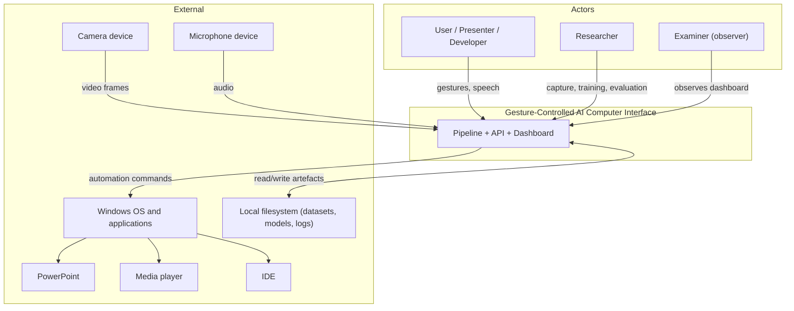
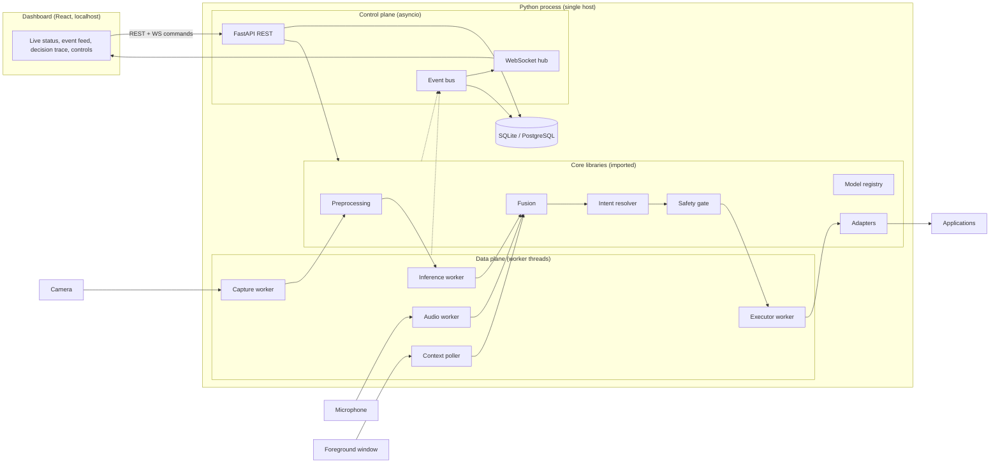
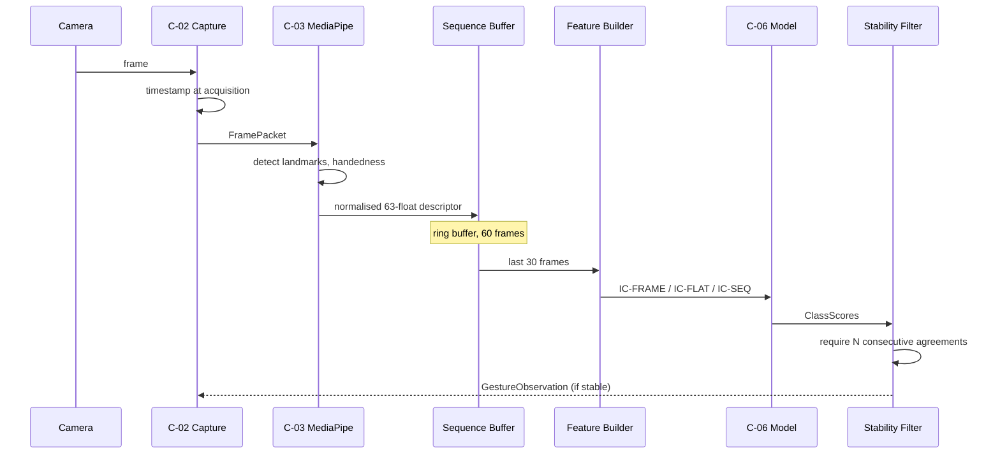
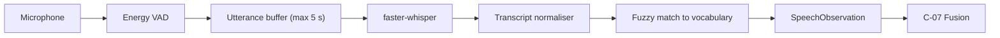
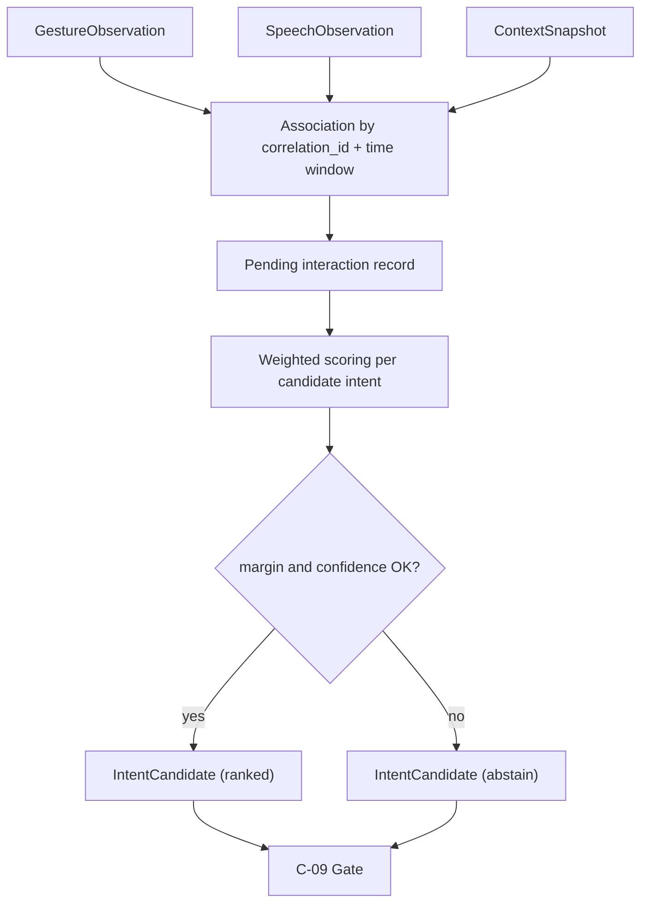
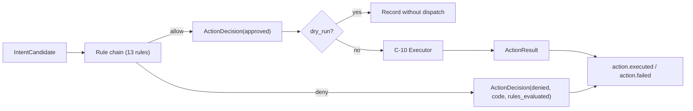
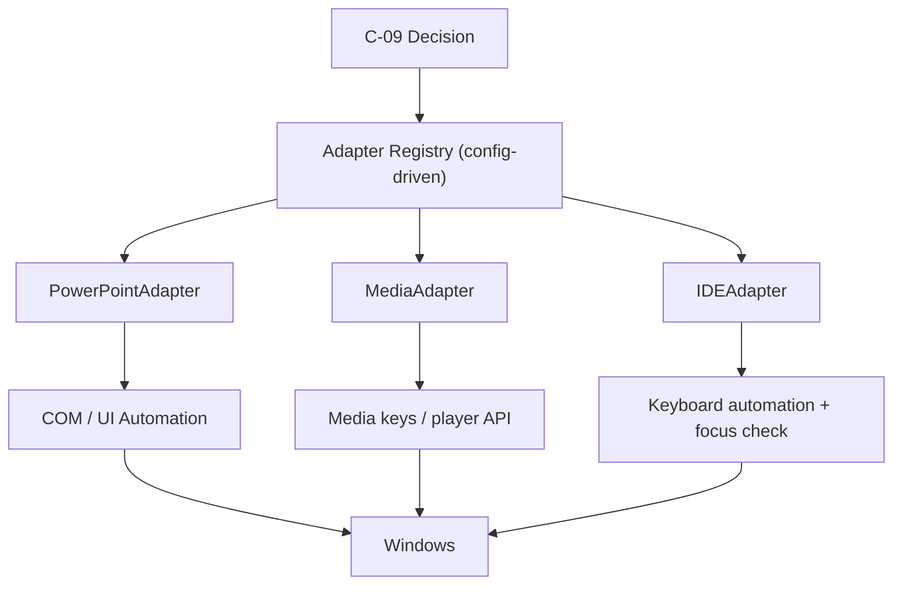
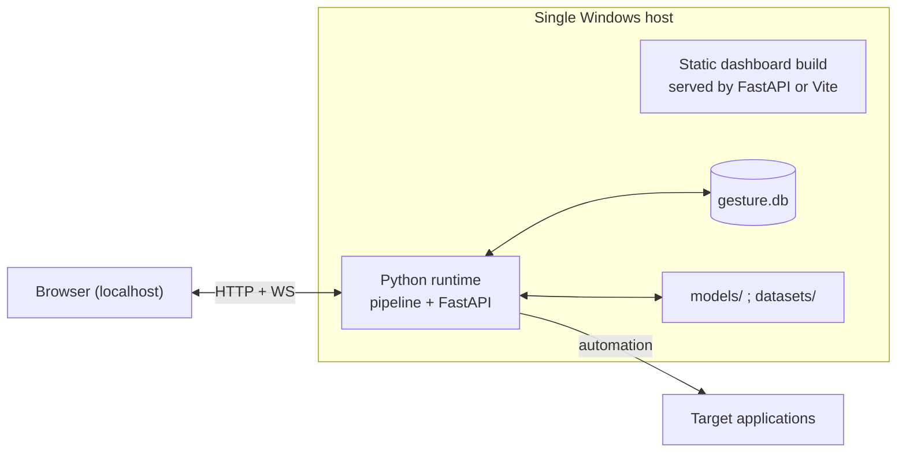

# Technical Requirements Document (TRD)

**Project:** Gesture-Controlled AI Computer Interface
**Document ID:** CORE-TRD
**Version:** 1.0.0
**Status:** Baseline
**Owner:** Team Lead (Architecture)
**Contributors:** All team members
**Last Updated:** 2026-11-06

---

## Document Control

| Field | Value |
|---|---|
| Source of truth for | Architectural style, component boundaries, technical requirements, module interfaces, runtime model, latency budget, deployment topology |
| Does not own | Product scope (`FR`/`NFR` — see [PRD](./PRD.md)), entity definitions (see [BACKEND_SCHEMA](./BACKEND_SCHEMA.md)), wire contracts (see [API_AND_INTEGRATION](./API_AND_INTEGRATION.md)), phase sequencing (see [IMPLEMENTATION_PLAN](./IMPLEMENTATION_PLAN.md)) |
| Requirement ID namespaces owned | `C-##` (components), `TR-###` (technical requirements), `ADR-####` (decision records, stored separately) |
| Change process | Structural changes require an ADR in [docs/architecture/adr](../architecture/adr/) before implementation |

**Conflict rule.** If this document contradicts the PRD on *what* the product must do, the PRD wins. If the PRD implies *how* the product is built, this document wins. Conflicts are recorded in §30 rather than silently resolved.

---

## 1. Technical Overview

The system is a **modular monolith** that runs on a single workstation. It is organised around an explicit pipeline of twelve components that exchange six typed data contracts over bounded queues and one event bus.

```
Camera ─┐
Mic ────┼─▶ Perception ─▶ Temporal Recognition ─▶ Fusion ─▶ Intent ─▶ Safety Gate ─▶ Adapters ─▶ OS
Context ┘                                              │
                                                       └─▶ Event Bus ─▶ API/WS ─▶ Dashboard
                                                                     └─▶ SQLite
```

Three properties drive every technical decision:

1. **The model proposes; the gate disposes.** Recognition produces evidence. Only a deterministic, rule-based gate can authorise execution. This makes behaviour auditable and keeps safety independent of model quality.
2. **Contracts before implementations.** Every module boundary is a typed structure defined in [API_AND_INTEGRATION](./API_AND_INTEGRATION.md). Five developers can work in parallel because no module imports another module's internals.
3. **The data plane never blocks the control plane.** Blocking inference and device I/O run on worker threads; the HTTP/WebSocket layer runs on an asyncio loop and only touches thread-safe queues and the event bus.

---

## 2. Architectural Style

### 2.1 Selected Style: Modular Monolith with Ports and Adapters

| Aspect | Decision |
|---|---|
| Deployment unit | One Python process for perception → execution; one static web client for the dashboard |
| Module boundaries | Packages with public interfaces; cross-package imports restricted to `contracts/` and published interfaces |
| Integration style | In-process typed calls for the data plane; async event bus for observation and telemetry |
| External integration | Adapter pattern (ports and adapters) for every OS-facing action |
| Persistence | Repository pattern over SQLAlchemy; SQLite default, PostgreSQL-compatible |
| Configuration | Layered: file defaults → environment overrides → runtime updates, all validated at the boundary |

### 2.2 Rejected Alternatives

| Alternative | Why rejected |
|---|---|
| Microservices | One machine, one user, sub-second latency budget. Network hops would add latency and operational cost with no benefit. |
| Client-server split with the browser doing inference | Browser cannot access MediaPipe Python landmarks or OS automation; would duplicate the pipeline. |
| Plugin architecture with dynamic module discovery | Unnecessary indirection for three adapters; static registration is auditable. |
| Message broker (Redis/RabbitMQ) | Adds an external dependency for an in-process event stream. A bounded in-memory bus satisfies v1 volume. |
| Server-rendered dashboard | Live event streaming and charts are better served by a client application; no server-render benefit. |

### 2.3 Architectural Principles

| ID | Principle | Enforcement |
|---|---|---|
| `AP-01` | Separation of inference, interpretation, authorisation, execution, and monitoring | Package boundary rules; no adapter import from recognition |
| `AP-02` | Explicit contracts at every boundary | `contracts/` package; contract tests |
| `AP-03` | Deterministic safety decisions | Gate has no model calls; rules are pure functions of input |
| `AP-04` | Local-only processing | No network egress in default configuration |
| `AP-05` | Fail closed | On doubt, deny execution and surface the reason |
| `AP-06` | Observable by default | Every stage emits a typed event |
| `AP-07` | Configuration over code | Mappings, thresholds, and model selection are data |
| `AP-08` | Reproducibility | Every artefact carries a version and provenance |
| `AP-09` | Bounded resources | Every queue, buffer, and cache is size-limited |
| `AP-10` | Extensible without modification | New adapters and models register; existing pipelines do not change |

---

## 3. System Context



**Trust boundary.** The user and the local machine are inside one trust domain. The network is outside it. The default configuration opens no inbound port beyond loopback.

---

## 4. Container View



---

## 5. Component Inventory

Each component has a stable identifier used across all documents. `Owns` lists persistent entities from [BACKEND_SCHEMA](./BACKEND_SCHEMA.md).

| ID | Component | Responsibility | Owns | Primary interface |
|---|---|---|---|---|
| `C-01` | Perception Layer | Owns pipeline lifecycle, activation state machine, device authorisation, and orchestration of capture workers | — | `PipelineController` |
| `C-02` | Camera Processing | Frame acquisition, buffering, FPS control, device recovery, optional preview | — | `FrameSource` |
| `C-03` | Hand Landmark Extraction | MediaPipe inference, landmark normalisation, sequence buffer | — | `LandmarkExtractor` |
| `C-04` | Speech Recognition | Audio capture, VAD, local transcription, command normalisation | — | `SpeechEngine` |
| `C-05` | Application Context | Foreground process/window detection, adapter mapping, state query | `Application`, `ApplicationContext` | `ContextProvider` |
| `C-06` | Temporal Gesture Recognition | Feature construction, window management, model inference, stability filtering | `Model`, `ModelVersion`, `GestureClass` | `GestureClassifier` |
| `C-07` | Multimodal Fusion | Temporal association of evidence, weighted combination, abstention | — | `FusionEngine` |
| `C-08` | Intent Classification | Per-application intent vocabulary, ranked resolution | `GestureMapping` | `IntentResolver` |
| `C-09` | Decision and Safety | Thresholds, stability, dedupe, cooldown, rate limit, allowlist, dry-run, emergency stop | `SystemConfiguration`, `UserConfiguration` | `DecisionGate` |
| `C-10` | Application Adapters | Capability discovery, execution, result reporting | — | `ApplicationAdapter` |
| `C-11` | Backend / API | REST, WebSocket, persistence, configuration, experiment queries | all remaining entities | `APIServer` |
| `C-12` | Dashboard and Monitoring | Live observation, control surface, experiment visualisation | — | Web client |

### 5.1 C-01 Perception Layer

**Responsibility.** Owns the lifecycle of all capture and inference workers, the activation state machine, and the mapping from user intent about privacy ("camera on") to device state.

**Activation state machine.** States: `IDLE`, `ARMED`, `LISTENING`, `EXECUTING`, `PAUSED`, `ERROR`. Transitions are defined in [PRD](./PRD.md) §13.2 and enforced in one place; no other component may change state.

**Activation modes.**

| Mode | Trigger to arm | Trigger to disarm | Default |
|---|---|---|---|
| `wake_gesture` | `open_palm` held for `hold_ms` (default 800 ms) | Inactivity timeout or explicit stop | Yes |
| `hold_pose` | Pose held while performing the command gesture | Pose released | No |
| `push_to_talk` | Explicit key press while camera tracking is live | Key released | No |

**Failure behaviour.** If a worker dies, the component transitions to `ERROR`, emits `system.status`, and attempts restart with backoff. It never silently continues with a missing modality.

**Rule.** `C-01` must not import `C-10`. Lifecycle and execution are independent.

### 5.2 C-02 Camera Processing

**Responsibility.** Acquire frames, timestamp them at capture, and publish them to a bounded queue. Owns reconnection policy and effective-FPS accounting.

| Parameter | Default | Constraint |
|---|---|---|
| Index | 0 | Configurable |
| Resolution | 640×480 | Must be even dimensions |
| Requested FPS | 30 | Backend may deliver less |
| Queue depth | 2 | Drop-oldest on overflow |
| Reconnect backoff | 0.5 s → 8 s, capped | Exponential, jittered |
| Preview | Enabled in dev, disabled in headless | Configurable |

**Timestamping rule.** `FramePacket.timestamp_ns` is taken at acquisition, not at processing, so latency measurement is not distorted by queueing.

### 5.3 C-03 Hand Landmark Extraction

**Responsibility.** Run MediaPipe hand landmark detection, normalise the result, and maintain the rolling sequence buffer.

| Parameter | Value |
|---|---|
| Landmarks per hand | 21 |
| Coordinates | `x`, `y` in normalised image space; `z` relative depth |
| Per-hand descriptor | 21 × 3 = 63 floats + handedness label + mean visibility |
| Max hands (v1) | 1 |
| Buffer length | 60 frames (2 × the classification window) |
| Detection confidence | 0.5 (configurable) |
| Tracking confidence | 0.5 (configurable) |

**Normalisation contract (must match training exactly).**

1. Translate so the wrist (`landmark[0]`) is the origin.
2. Scale by the maximum Euclidean distance from the wrist to any landmark in that frame; guard against zero.
3. Mirror horizontally when handedness is `Left` so that all samples are expressed right-handed.
4. Optionally include per-frame velocity as the first difference between consecutive normalised frames.
5. Emit `NaN`-free vectors; a frame with insufficient visibility is marked invalid and excluded from the window rather than zero-filled.

**Versioning rule.** The normalisation implementation carries a `feature_spec_version`. A model declares the version it was trained with (`FR-026`); mismatch is a hard load failure, not a warning.

### 5.4 C-04 Speech Recognition

**Responsibility.** Capture audio only while gated, transcribe locally, and normalise the result against the closed command vocabulary.

| Parameter | Default |
|---|---|
| Engine | `faster-whisper`, configurable through `SpeechEngine` |
| Model size | Smallest model that meets accuracy target on the vocabulary |
| Sample rate | 16 kHz mono |
| Max utterance | 5 s |
| Silence termination | 700 ms |
| VAD | Energy-based gate before transcription |
| Command vocabulary | Closed list per [API_AND_INTEGRATION](./API_AND_INTEGRATION.md) §7.3 |
| Fuzzy threshold | 0.80 similarity |

**Latency note.** Transcription occurs on `AUD`, never on the event loop. The fusion engine does not block on speech: it holds a pending-gesture record for the association window and proceeds if speech does not arrive.

**Privacy.** Audio buffers exist only in memory and are zeroed after transcription. Raw audio persistence requires both a configuration flag and a consent record.

### 5.5 C-05 Application Context

**Responsibility.** Determine which application is in focus and what it is doing, at a rate sufficient to prevent misdirected commands.

| Parameter | Default | Rationale |
|---|---|---|
| Poll interval | 200 ms | `NFR-005`; fast enough to catch alt-tab |
| Signal 1 | Foreground process executable name | Primary identifier |
| Signal 2 | Window title | Disambiguation and debug |
| Signal 3 | Adapter-reported state | Slideshow active, media playing |
| Unknown policy | Deny execution | `FR-045`, fail-closed |

**Mapping.** A configuration table maps process name patterns to adapter identifiers. Unmatched processes resolve to `unknown`, and `unknown` is denied by the gate.

**Change detection.** Emit `context.updated` only when the resolved adapter identifier, application identifier, or relevant state value changes — not on every poll. This prevents event flooding.

### 5.6 C-06 Temporal Gesture Recognition

**Responsibility.** Convert buffered landmarks into model input, run inference at a fixed cadence, and apply temporal stability filtering.

**Inference cadence.** Inference runs every `stride` frames (default 3) over the most recent `window` frames (default 30). This decouples model cost from capture cost.

**Feature contracts.** Three input contracts exist so the research comparison is explicit:

| Contract ID | Shape | Consumers | Purpose |
|---|---|---|---|
| `IC-FRAME` | `(126,)` — 63 position + 63 velocity | Frame-level baseline | Tests H1 (temporal information) |
| `IC-FLAT` | `(3780,)` — 30 × 126 flattened | Random Forest, MLP | Non-recurrent temporal window |
| `IC-SEQ` | `(30, 126)` | LSTM, GRU, Transformer | Recurrent/attention temporal models |

**Model interface.**

```text
Protocol GestureClassifier:
    model_id: str
    version: str
    feature_spec_version: str
    input_contract: IC_FRAME | IC_FLAT | IC_SEQ
    classes: list[str]
    predict(batch: ndarray) -> list[ClassScores]
    warmup() -> None
    metadata() -> ModelMetadata
```

**Stability filter (deterministic, outside the model).** A label becomes a *stable gesture* only if it appears in `stability_window` consecutive inferences (default 3) with per-inference confidence above the emission floor. Stability is computed in `C-06` but enforced in `C-09`; the two must agree on configuration.

### 5.7 C-07 Multimodal Fusion

**Responsibility.** Associate evidence that refers to the same user action, combine it, and decide whether to abstain.

**Association rule.** Evidence is associated by `correlation_id` and by temporal proximity: a gesture and a speech observation belong together if their intervals overlap or are within `association_window` (default 1500 ms). The gate opens a pending record when the first evidence arrives and closes it at the window boundary.

**Scoring (v1, configurable late fusion).**

```
score(intent) = Σ_s  w_s · conf_s · match_s(intent)
normalised by Σ_s w_s  for present sources s
```

Where `match_s(intent)` is 1 when source `s` supports the intent, 0 when it contradicts it, and omitted when absent. Sources are `gesture`, `speech`, `context`. Default weights: gesture 0.55, speech 0.30, context 0.15.

**Abstention.** The engine abstains when the best score is below `min_fused_confidence`, when the margin to the runner-up is below `min_margin`, or when only one source is present *and* that source's confidence is below its source threshold.

**Configuration sensitivity.** Weights are configuration, not constants, so the ablation study can disable a source without code changes (`FR-056`).

**Determinism.** No randomness, no wall-clock dependence in the score function. Given identical evidence and configuration, output is identical (`FR-057`).

### 5.8 C-08 Intent Classification

**Responsibility.** Resolve fused evidence into an intent from the vocabulary of the currently focused application.

**Resolution order.**

1. Look up the focused application's intent vocabulary.
2. Filter to intents reachable by the observed gesture class (from `GestureMapping`).
3. If speech is present, narrow to intents whose lexical triggers match.
4. If context state is present, narrow further using state predicates (for example, `next_slide` only when a slideshow is active).
5. Rank remaining candidates by fused score; emit the ranked list.

**Example vocabulary.**

| Application | Gesture | Speech | Context | Intent |
|---|---|---|---|---|
| PowerPoint | `swipe_right` | — | slideshow active | `next_slide` |
| PowerPoint | `swipe_left` | — | slideshow active | `previous_slide` |
| Media player | `swipe_right` | — | playing | `next_track` |
| Media player | `swipe_right` | "volume" | any | `volume_up` |
| IDE | `swipe_right` | — | editor focused | `next_editor` |
| IDE | `swipe_right` | "debug" | editor focused | `start_debug` |

**Rule.** `C-08` never invokes an adapter and never reads the filesystem. It is a pure function of evidence plus vocabulary plus configuration.

### 5.9 C-09 Decision and Safety Engine

**Responsibility.** The single authority that authorises execution. Every rule is deterministic and unit-testable.

**Gate evaluation order** (first failure short-circuits and is recorded):

| Order | Rule | Denial code | Configurable |
|---|---|---|---|
| 1 | System state is `ARMED` or `EXECUTING` and not `PAUSED`/`ERROR` | `E-7001` | No |
| 2 | Emergency stop not engaged | `E-7002` | No |
| 3 | Intent is not an abstention | `E-7003` | No |
| 4 | Fused confidence ≥ threshold | `E-7004` | Yes |
| 5 | Each present source confidence ≥ its threshold | `E-7005` | Yes |
| 6 | Gesture stable across the stability window | `E-7006` | Yes |
| 7 | Not a duplicate of the last action within cooldown | `E-7007` | Yes |
| 8 | Action rate under limit | `E-7008` | Yes |
| 9 | Adapter on allowlist | `E-7009` | Yes |
| 10 | Adapter health check passed | `E-7010` | No |
| 11 | Foreground application still matches the intent target | `E-7011` | No |
| 12 | Action class permitted (`safe`/`reversible`/`destructive` + confirmation) | `E-7012` | Yes |
| 13 | Dry-run mode → authorise and record, do not dispatch | `DRY_RUN` | Yes |

**Action classification.**

| Class | Examples | Policy |
|---|---|---|
| `safe` | Next slide, play/pause, volume | Execute on gate pass |
| `reversible` | Undo, toggle mute, close preview | Execute, record prior state where available |
| `destructive` | Delete file, close unsaved document, force quit | Require explicit confirmation; excluded from default mappings |

**Emergency stop.** A dedicated flag checked at rule 2 and again immediately before dispatch. Latency budget: 100 ms from invocation to no further dispatch (`FR-006`, `AC-020`). The flag is set by hotkey, API, and dashboard, and is monotonic: only an explicit re-arm clears it.

### 5.10 C-10 Application Adapters

**Responsibility.** Translate authorised actions into OS calls. The only component permitted to touch application APIs.

**Adapter interface.**

```text
Protocol ApplicationAdapter:
    adapter_id: str
    display_name: str
    supported_actions: list[str]
    action_classes: dict[str, Literal["safe","reversible","destructive"]]
    is_available() -> HealthStatus
    get_state() -> dict[str, Any]
    execute(command: str, params: dict, *, dry_run: bool) -> ActionResult
```

**Implementation rules.**

- Commands are enumerated. No string interpolation into shell or keystroke APIs (`NFR-032`).
- Execution occurs on `EXE`, a single-threaded worker, so actions are serialised and ordering is deterministic.
- A health check runs before dispatch and after failure.
- Every adapter returns `ActionResult`; it does not raise for expected failures.
- Adapters are registered in configuration, not discovered dynamically.

**Shipped adapters.**

| Adapter | Backend | Actions | Risk notes |
|---|---|---|---|
| `powerpoint` | Windows COM or UI automation | next/previous slide, start/end show, black screen | COM requires PowerPoint installed; UI automation is the fallback |
| `media` | Media key events or player API | play/pause, next/prev, volume, mute | Media keys are global; context check is the guard |
| `ide` | Keyboard automation with focus verification | next/prev editor, save, run, debug toggle, command palette | Focus verification required; modal dialogs can swallow input |

### 5.11 C-11 Backend / API

**Responsibility.** HTTP/WebSocket surface, configuration management, persistence, and experiment queries. It marshals; it does not contain business logic.

**Rules.**

- Request handlers validate input and delegate to a service function.
- No request handler performs inference or automation inline.
- WebSocket broadcasts are fan-out from the event bus; a slow client cannot block the bus (per-client bounded queue).
- All responses use the standard envelope or error format from [API_AND_INTEGRATION](./API_AND_INTEGRATION.md).
- Binds to `127.0.0.1` by default (`NFR-030`).

### 5.12 C-12 Dashboard and Monitoring

**Responsibility.** Read-mostly observation plus a small number of high-consequence controls.

**Rules.**

- The dashboard is a pure consumer of the event stream for observation; it never computes recognition results.
- It may issue control commands (start, stop, arm, disarm, emergency stop, configuration updates) through the REST API.
- It must render a persistent state indicator and must not rely on colour alone (`NFR-043`).
- It must degrade gracefully when the backend disconnects, showing `DISCONNECTED` rather than stale data presented as live.

---

## 6. Computer Vision Pipeline



**Stage budgets** (Tier A, proposed):

| Stage | Budget |
|---|---|
| Capture and copy | ≤ 3 ms |
| MediaPipe detect + track | ≤ 12 ms |
| Normalisation and buffering | ≤ 1 ms |
| Feature build | ≤ 2 ms |
| Model inference | ≤ 15 ms |
| Stability filter | ≤ 0.2 ms |

These sum to ≤ 33 ms per inference cycle, allowing ≥ 30 FPS capture with inference every 3 frames.

---

## 7. Landmark Extraction and Preprocessing

### 7.1 Representation

| Component | Dimensions | Notes |
|---|---|---|
| Positions | 63 | 21 landmarks × (x, y, z), wrist-relative, scale-normalised |
| Velocities | 63 | First difference between consecutive normalised frames |
| Handedness | categorical | Normalised to right-handed via mirroring |
| Validity mask | boolean per frame | False when detection confidence or visibility is insufficient |

Total per-frame feature width: **126**.

### 7.2 Window Construction

| Parameter | Default | Constraint |
|---|---|---|
| Window length | 30 frames | ~1 s at 30 FPS |
| Stride | 3 frames | Inference cadence |
| Minimum valid frames | 24 (80 %) | Below this, no prediction |
| Padding policy | None — emit no prediction | Avoids fabricating motion |

### 7.3 Invariance Requirements

| Invariance | Method | Failure mode if omitted |
|---|---|---|
| Translation | Wrist origin | Camera framing changes label |
| Scale | Max wrist-to-landmark distance | Distance from camera changes label |
| Handedness | Mirror left-hand samples | Left-handed users misclassified |
| Temporal alignment | Fixed window, fixed sampling | Speed changes label |

**Out-of-scope invariance (documented explicitly).** Rotation invariance is *not* applied in v1 because it would remove the directional signal required by swipe classes. Camera roll and user orientation must therefore be controlled in the capture protocol.

### 7.4 Replay

Recorded landmark sequences are stored as `(T, 126)` float32 arrays with metadata. `NFR-063` requires that the pipeline can be driven from these arrays without a camera, which makes CI testing and experiment reproduction possible.

---

## 8. Temporal Recognition Architecture

### 8.1 Model Families and Input Contracts

| Model | Contract | Rationale | Temporal capacity |
|---|---|---|---|
| Random Forest | `IC-FLAT` | Strong tabular baseline; no temporal inductive bias | Implicit, via flattened window |
| MLP | `IC-FLAT` | Non-linear baseline with same representation as RF | Implicit |
| LSTM | `IC-SEQ` | Explicit recurrence, long-range dependencies | Explicit |
| GRU | `IC-SEQ` | Fewer parameters than LSTM, comparable capacity | Explicit |
| Transformer Encoder | `IC-SEQ` | Attention over the whole window; parallel training | Explicit, global |

The frame-level baseline (`IC-FRAME`) exists only for the H1 ablation and is not a shipped interactive model.

### 8.2 Registry and Selection

```text
models/
  checkpoints/
    <model_id>/<version>/
      weights.pt | model.pkl
      model_card.json
  configs/
    <model_id>.yaml
```

`model_card.json` contains: `model_id`, `version`, `family`, `input_contract`, `feature_spec_version`, `classes`, `training_dataset_version`, `split_manifest_id`, `metrics` (from the recorded run), `created_at`, `git_revision`.

**Load-time validation.** The registry refuses to activate a model whose `feature_spec_version` or `classes` disagree with the runtime configuration, and reports `E-3002`.

### 8.3 Training and Evaluation Separation

Training code produces artefacts; the runtime only loads them. There is no training path inside the running application. This keeps the demo process deterministic and prevents accidental retraining during a session.

### 8.4 Determinism and Threading

Inference runs on one dedicated worker thread per loaded model. PyTorch is set to evaluation mode with gradient computation disabled. Random seeds are fixed for any operation that could introduce variance; the interactive path uses none.

---

## 9. Speech Recognition Architecture



| Concern | Decision |
|---|---|
| Engine abstraction | `SpeechEngine` protocol; `faster_whisper` implementation in v1 |
| Gating | Push-to-talk or explicit `LISTENING` state only (`FR-032`) |
| Vocabulary | Closed list; out-of-vocabulary utterances produce no observation |
| Confidence | Engine score, mapped to `[0,1]`; low-confidence utterances are dropped before fusion |
| Privacy | In-memory only; zeroed after transcription |
| Failure | Engine unavailable → speech source absent, pipeline continues (gesture-only) |

**Design consequence.** Because speech is optional at runtime, the exact same build evaluates all three research configurations (`FR-056`). No separate branches exist per configuration.

---

## 10. Application Context Acquisition

| Signal | Mechanism | Frequency | Failure handling |
|---|---|---|---|
| Foreground process | Win32 foreground window → process image name | 200 ms | Retry; after 3 failures mark context `unknown` |
| Window title | Same handle | 200 ms | Optional; absence is not fatal |
| Adapter state | Adapter `get_state()` | On change + 1 s heartbeat | Adapter unhealthy → state `unknown` |
| Display/session | Optional; used for multi-monitor demos | On change | Not required in v1 |

**Caching.** The context provider caches the last snapshot and emits only on change, keeping the event volume low and the dashboard readable.

**Security consideration.** Reading window titles is a broad capability. It is confined to `C-05`, is never transmitted off-device, and is redacted in logs by default (titles can contain document names).

---

## 11. Multimodal Fusion Architecture



**Why late fusion is the default.**

| Approach | Advantages | Disadvantages | Decision |
|---|---|---|---|
| Late (decision-level) fusion | Interpretable, configurable weights, works with missing sources, easy ablation | Cannot learn cross-modal interactions | **Selected for v1** |
| Early (feature-level) fusion | Can learn interactions | Requires synchronised, aligned features; fragile when a modality is missing | Deferred to experiment |
| Learned fusion (stacked) | Best potential accuracy | Needs more data; opaque; harder to audit | Deferred to experiment |

**Timing model.** The fusion engine opens a pending record on first evidence and closes it after `association_window`. If speech arrives after closure, it forms a new interaction. This bounds latency and prevents late audio from retroactively changing an executed action.

**Latency contribution.** Fusion adds no waiting when all expected sources are absent; it waits at most `association_window` only in `gesture_speech` and `gesture_speech_context` configurations where speech is expected. In `gesture_only`, closure is immediate.

---

## 12. Decision and Safety Engine — Data Flow



The gate returns a `Decision` object containing: outcome, denial code, the ordered list of rules evaluated, and the rule that determined the outcome. This object is persisted and streamed, which is what makes `FR-092` (decision trace) possible.

---

## 13. Computer-Action Execution

| Concern | Decision |
|---|---|
| Concurrency | Single executor thread; actions serialised |
| Timeout | 2000 ms default; timeout produces `E-8003` |
| Retry | At most one retry for idempotent actions; never for `reversible` toggles |
| Idempotency | Adapter declares `idempotent_actions`; gate uses this for dedupe logic |
| Focus verification | Re-read foreground context immediately before dispatch (`FR-044`) |
| Result | Always an `ActionResult`; exceptions are converted to failures, never propagated |
| Logging | Command, parameters (redacted), duration, outcome, correlation id |

---

## 14. Application Adapter Architecture



**Capability negotiation.** `supported_actions` and `action_classes` are queried at startup and on health-check recovery. The intent vocabulary is filtered to adapters present and healthy, so an unavailable application never produces a dead mapping.

**Extension procedure** (`FR-075`, `AC-022`):

1. Implement `ApplicationAdapter` in `src/execution/adapters/<name>/`.
2. Declare `adapter_id`, `supported_actions`, `action_classes`, and idempotency.
3. Add the process-name mapping and intent vocabulary entries to configuration.
4. Add contract tests using the shared adapter test harness.
5. No changes are permitted in `recognition/`, `fusion/`, or `intent/`.

---

## 15. Backend Architecture

| Layer | Responsibility | Rule |
|---|---|---|
| Routers | HTTP shape, validation, status codes | No business logic |
| Services | Orchestration, configuration application, queries | No direct SQL |
| Repositories | Persistence access | No HTTP knowledge |
| Models | SQLAlchemy ORM | No behaviour beyond mapping |
| Schemas | Pydantic request/response types | Mirror the contract definitions |

**Event bus.** An in-process publish/subscribe hub with three subscriber classes: WebSocket fan-out, persistence writer, and metrics aggregator. Each subscriber has a bounded queue; overflow drops oldest and increments a counter.

**Backpressure.** The persistence writer batches writes on a 250 ms interval or 50-event threshold, whichever comes first. This keeps database I/O off the inference path.

---

## 16. Frontend / Dashboard Architecture

| Concern | Decision |
|---|---|
| Stack | React + Vite + TypeScript |
| State | Local store for session state; server state from REST; live deltas over WebSocket |
| Transport | One WebSocket for events; REST for commands and queries |
| Reconnect | Exponential backoff with jitter; visible `DISCONNECTED` state |
| Rendering budget | Table and chart updates at ≤ 10 Hz; raw event feed may run faster |
| Safety UI | Emergency stop always visible, never behind a menu, requires no confirmation |
| Accessibility | Keyboard reachable, ARIA labels, non-colour state encoding |

**Data volume rule.** The dashboard never receives full landmark arrays. It receives counts, labels, confidences, and timings. Landmark overlay, when needed, is rendered inside the pipeline preview window, not streamed to the browser.

---

## 17. Data and Persistence Integration

| Data class | Storage | Owner | Lifetime |
|---|---|---|---|
| Configuration | SQLite + versioned file | C-11 | Persistent |
| Interaction events | SQLite, append-only | C-11 | Retained with session |
| Model metadata | SQLite + `model_card.json` | C-06 registry | Persistent |
| Experiment results | SQLite + exported JSON/CSV | Tooling | Persistent |
| Raw video/audio | Never by default | — | Not stored |
| Landmark sequences | Files under `datasets/` | Tooling | Versioned |
| Model checkpoints | Files under `models/` | Tooling | Versioned |
| Runtime state | In memory | C-01, C-07 | Session |

Entity definitions, keys, constraints, and retention rules live in [BACKEND_SCHEMA](./BACKEND_SCHEMA.md). This document defines only the boundary: **nothing binary is stored in the database, and nothing queried by the dashboard requires a file read.**

---

## 18. Inter-Process and Inter-Module Communication

### 18.1 Threading Model

| Thread | Owns | Blocking allowed | Queue policy |
|---|---|---|---|
| `CAP` | Camera read, timestamping | Yes (device) | Depth 2, drop-oldest |
| `INF` | Landmark + model inference | Yes (CPU) | Depth 1, drop-oldest |
| `AUD` | Audio capture + transcription | Yes (device, model) | Depth 1 |
| `CTX` | Foreground polling | Yes (OS call, short) | Depth 1 |
| `EXE` | Adapter dispatch | Yes (automation) | Depth 8, reject on full (never drop an authorised action) |
| `LOOP` | FastAPI, WebSocket, persistence scheduling | No | Async, non-blocking only |

**Rule.** An authorised action is never dropped. If `EXE` is full, the gate rejects at request time with `E-7013` (queue saturated) rather than accepting and losing it.

### 18.2 Communication Paths

| From → To | Mechanism | Contract |
|---|---|---|
| C-02 → C-03 | Bounded queue | `FramePacket` |
| C-03 → C-06 | Ring buffer read | `(T, 126)` array + validity mask |
| C-06 → C-07 | Direct call within `INF` | `GestureObservation` |
| C-04 → C-07 | Async handoff via thread-safe queue | `SpeechObservation` |
| C-05 → C-07 | Latest-value snapshot | `ContextSnapshot` |
| C-07 → C-08 | Direct call | Fused evidence |
| C-08 → C-09 | Direct call | `IntentCandidate` |
| C-09 → C-10 | Executor queue | `ActionRequest` |
| Any → C-11 | Event bus | Standard envelope |
| C-11 → C-12 | WebSocket | Standard envelope |
| C-12 → C-11 | REST | Request schemas |

**Import rule.** Direct calls are permitted only downward in the pipeline. No component calls back into a previous stage. Feedback flows only through the event bus.

### 18.3 Process Boundaries

| Deployment | Processes |
|---|---|
| Development | Python process (pipeline + API) + Vite dev server |
| Research | Training CLI (separate process, no camera) + optional evaluation CLI |
| Demo | Python process + built dashboard served statically |

No inter-process protocol is required in v1 beyond HTTP/WebSocket between browser and backend.

---

## 19. Error Handling

### 19.1 Taxonomy

| Range | Domain | Examples |
|---|---|---|
| `E-1xxx` | Configuration | Invalid value, unknown model, path violation |
| `E-2xxx` | Perception | Camera open failure, device lost, low FPS |
| `E-3xxx` | Model | Load failure, feature mismatch, unsupported class |
| `E-4xxx` | Speech | Device unavailable, transcription failure, empty utterance |
| `E-5xxx` | Context | Foreground query failed, unknown application |
| `E-6xxx` | Fusion | No evidence, association timeout |
| `E-7xxx` | Safety | Denials (see §5.9 rule table) |
| `E-8xxx` | Execution | Adapter unavailable, timeout, unsupported action |
| `E-9xxx` | Backend | Validation failure, persistence failure |

### 19.2 Handling Rules

| Rule | Requirement |
|---|---|
| Fail closed | Any uncertainty in authorisation results in denial |
| Degrade, do not crash | A missing modality disables its evidence, not the process |
| Structured errors | Every error carries code, component, correlation id, and human message |
| No silent catch | `except Exception: pass` is prohibited by review |
| User-visible reasons | Denials reach the dashboard in plain language |
| Retry only idempotent operations | Retries are declared, not assumed |

### 19.3 Subsystem Failure Matrix

| Failure | Effect | Recovery |
|---|---|---|
| Camera lost | No gestures; status `DEGRADED` | Automatic reconnect with backoff |
| Speech engine fails | Speech source absent | Gesture-only operation continues |
| Context query fails | Context `unknown` | Gate denies execution until restored |
| Model load fails | No recognition | Startup blocked with `E-3002` |
| Adapter unhealthy | Its intents filtered out | Health retry; user informed |
| Database unavailable | Events buffered, then dropped with counter | Reconnect; no action impact |
| Dashboard disconnects | Pipeline unaffected | Client reconnect |

---

## 20. Performance Requirements and Latency Budget

### 20.1 Hardware Tiers

| Tier | Definition | Implication |
|---|---|---|
| **A** | Commodity laptop, integrated GPU, 1080p webcam, 8 GB RAM | CPU-only inference; 640×480 capture; smallest viable models |
| **B** | Workstation with discrete GPU, 16 GB RAM, 1080p webcam | GPU inference allowed; 1280×720 capture |

No specific hardware model is assumed. Tier assignment is recorded with every experiment run.

### 20.2 Latency Budget (Tier A, proposed)

| Stage | p50 target | p95 target | Measured by |
|---|---|---|---|
| Capture → frame available | 3 ms | 6 ms | instrumented timestamps |
| Landmark extraction | 12 ms | 20 ms | stage timer |
| Normalisation + buffer | 1 ms | 2 ms | stage timer |
| Feature build | 2 ms | 4 ms | stage timer |
| Model inference | 15 ms | 30 ms | stage timer |
| Stability filter | 0.2 ms | 0.5 ms | stage timer |
| Fusion | 2 ms | 5 ms | stage timer |
| Gate evaluation | 0.5 ms | 1 ms | stage timer |
| Adapter dispatch | 80 ms | 200 ms | adapter timer |
| **Gesture completion → action result** | **≤ 400 ms** | **≤ 700 ms** | `FR-107` |

### 20.3 Latency Definitions (normative)

| Metric | Start | End | Excludes |
|---|---|---|---|
| Model inference latency | Model input tensor ready | Score vector produced | Capture, window fill, fusion, dispatch |
| End-to-end interaction latency | Last frame of the gesture (window close) | `ActionResult` received | Window fill before gesture completion |
| Time to commit | First frame of the gesture | `ActionResult` | Nothing |
| Speech latency | Utterance end (VAD) | `SpeechObservation` emitted | Gating delay |

**Reporting requirement.** Any latency figure must state which of these four definitions it uses. Reporting a single "latency" number without a definition is prohibited (`NFR-072`).

### 20.4 Window-Fill Cost

A 30-frame window at 30 FPS imposes up to **1000 ms** between gesture onset and the first prediction. This is a structural cost of temporal modelling and is reported separately as *time to commit*, never hidden inside *end-to-end latency*. Reducing it (shorter windows, stride tricks, early exit) is an experimental variable, not an implementation detail.

---

## 21. Scalability Considerations

| Dimension | v1 position | Structural readiness |
|---|---|---|
| Additional applications | Configure new adapter | Registry is config-driven |
| Additional model families | Implement one protocol | Registry + model card |
| Higher frame rate | Raise capture FPS, keep inference stride | Queues are decoupled |
| Two hands | Raise `max_hands`, widen feature vector to 126 per hand | Feature spec is versioned |
| Multiple users | Not supported | `User` entity exists; no session isolation |
| Longer sessions | Batched persistence, retention policy | Event store is append-only |
| Multiple camera sources | Not supported | `FrameSource` interface is single-source in v1 |
| Distributed deployment | Not supported | Would require promoting the event bus to a broker (ADR required) |

**Explicit non-goal.** The system is not designed for horizontal scale. One user, one machine, one interaction at a time.

---

## 22. Security Requirements

| ID | Requirement | Implementation boundary |
|---|---|---|
| `TR-001` | Bind HTTP and WebSocket servers to loopback unless `bind_public` is explicitly enabled. | C-11 |
| `TR-002` | Do not interpolate model or user strings into shell, keystroke, or automation calls. | C-10 |
| `TR-003` | Validate all filesystem paths against an allowlisted root. | C-11, tooling |
| `TR-004` | Redact window titles and document names in logs by default. | C-05, C-11 |
| `TR-005` | Zero audio buffers after transcription. | C-04 |
| `TR-006` | Never persist raw frames or audio in default configuration. | C-02, C-04 |
| `TR-007` | Require explicit consent records before dataset capture is enabled. | Tooling |
| `TR-008` | Load secrets only from environment or OS keyring. | C-11 |
| `TR-009` | Apply an adapter allowlist as the final execution gate. | C-09 |

Full policy, threat model, and consent procedure: [SECURITY_AND_PRIVACY](../supporting/SECURITY_AND_PRIVACY.md).

---

## 23. Deployment Requirements

### 23.1 Topology



### 23.2 Modes

| Mode | Entry point | Purpose |
|---|---|---|
| `dev` | `uvicorn` with reload + Vite dev server | Active development |
| `demo` | Single process, static dashboard, preview enabled | Live demonstration |
| `headless` | Single process, no preview, API only | Experiment runs and soak tests |
| `replay` | Recorded landmark fixtures, no devices | CI and deterministic evaluation |

### 23.3 Requirements

| Requirement | Value |
|---|---|
| OS | Windows 11 (reference). Non-adapter modules must run on Linux/macOS for CI. |
| Python | 3.11 or 3.12 (3.13 pending MediaPipe verification — `OQ-01`) |
| Node | Current LTS or newer, build-time only |
| Database | SQLite ≥ 3.35 bundled with Python; PostgreSQL optional |
| Permissions | Standard user; no elevation assumed |
| Network | Not required at runtime |

---

## 24. Hardware and Software Prerequisites

| Category | Minimum | Recommended |
|---|---|---|
| CPU | 4 cores | 8 cores |
| RAM | 8 GB | 16 GB |
| GPU | Not required | Discrete GPU with CUDA for training |
| Camera | 720p USB webcam | 1080p, 30 FPS, manual exposure |
| Microphone | Any working input | Directional or headset microphone |
| Disk | 5 GB for code, models, dataset | 20 GB |
| Display | Single 1080p | Dual (dashboard on second screen for demos) |

**Software.** Python 3.11/3.12, Git, Node (dashboard build only). All Python packages are declared at Phase 2; dependency installation is explicitly out of scope for the documentation milestone.

---

## 25. Architectural Trade-offs

| Decision | Chosen | Sacrificed | Rationale | Revisit when |
|---|---|---|---|---|
| Modular monolith | Single process, in-process bus | Independent scaling, fault isolation | Latency budget and single-user scope | Multi-user or remote deployment required |
| Late fusion | Interpretable weighted scoring | Possible accuracy from learned interactions | Ablation requires switchable sources | Dataset large enough for stacked fusion |
| SQLite default | Zero-configuration local store | Concurrent write throughput | Single user; writes are batched | Multi-session concurrent access |
| Landmarks only (no raw frames to model) | Small feature vectors, privacy | Potential accuracy from appearance cues | Generalisation and privacy priority | Two-hand or body-pose extension |
| Fixed 30-frame window | Simple, deterministic | Responsiveness at gesture onset | Reproducibility | Early-exit or spotting research |
| Deterministic gate | Auditable authorisation | Adaptive safety behaviour | Safety must not depend on model confidence alone | Calibrated risk model validated |
| CPU-first models | Runs on Tier A | Peak accuracy | Demo portability | Demo hardware confirmed as Tier B |
| Windows-first adapters | Direct automation | Cross-platform parity | Target applications are Windows-centric | Institutional Linux requirement |
| Single model per session | Simplicity | Per-user adaptation | No personalisation data in v1 | Calibration data collected |

---

## 26. Minor vs Major Architecture

| Aspect | Minor Project | Major Project |
|---|---|---|
| Components active | C-01, C-02, C-03, C-06, C-11 (minimal), C-12 (minimal) | All twelve |
| Evidence sources | Gesture only | Gesture + speech + context |
| Inference path | Landmarks → model → mapping → action | Landmarks + audio + context → fusion → intent → gate → action |
| Decision logic | Threshold + cooldown | Full thirteen-rule gate with dry-run and allowlist |
| Persistence | Model metadata and logs | Full entity model including experiments and interactions |
| Applications | PowerPoint only | PowerPoint + media + IDE |
| Evaluation | Model comparison on dataset | Model comparison + three configurations + ablations + latency + false activations |
| Dashboard | Preview window only | Full event feed, decision trace, controls, experiment views |

The minor architecture is a **strict subset**. No component is replaced between stages; components gain responsibilities. This is what allows the minor project to ship early without rework.

---

## 27. Module-to-Directory Mapping

Target layout (created progressively per [IMPLEMENTATION_PLAN](./IMPLEMENTATION_PLAN.md)):

| Component | Package path |
|---|---|
| C-01 | `src/perception/pipeline.py` |
| C-02 | `src/perception/camera/` |
| C-03 | `src/perception/hand_tracking/` |
| C-04 | `src/perception/speech/` |
| C-05 | `src/context/` |
| C-06 | `src/recognition/` (`classical/`, `mlp/`, `lstm/`, `gru/`, `transformer/`) |
| C-07 | `src/fusion/` |
| C-08 | `src/intent/` |
| C-09 | `src/execution/safety/` |
| C-10 | `src/execution/adapters/` |
| C-11 | `src/backend/` |
| C-12 | `src/dashboard/` |
| Contracts | `src/contracts/` |
| Preprocessing | `src/preprocessing/` |

The `src/` tree is intentionally not created during the documentation phase. Full rationale and creation order: [REPOSITORY_STRUCTURE](../supporting/REPOSITORY_STRUCTURE.md).

---

## 28. Technical Requirements Register

| ID | Requirement | Component | Verified by |
|---|---|---|---|
| `TR-001` | Servers bind to loopback by default | C-11 | Security test |
| `TR-002` | No dynamic command strings reach OS automation | C-10 | Static analysis + review |
| `TR-003` | Filesystem paths validated against allowlisted roots | C-11 | Unit test |
| `TR-004` | Window titles redacted in logs | C-05 | Log inspection |
| `TR-005` | Audio buffers zeroed after transcription | C-04 | Unit test |
| `TR-006` | No raw frame/audio persistence by default | C-02, C-04 | Config audit |
| `TR-007` | Consent required before dataset capture | Tooling | Integration test |
| `TR-008` | Secrets only from environment/keyring | C-11 | Review |
| `TR-009` | Adapter allowlist enforced at execution | C-09 | Safety test |
| `TR-010` | Feature spec version enforced at model load | C-06 | Unit test |
| `TR-011` | Queues bounded; overflow policy explicit per queue | All | Unit test |
| `TR-012` | Authorised actions never dropped | C-09, C-10 | Concurrency test |
| `TR-013` | Gate rules are pure functions of input | C-09 | Unit test |
| `TR-014` | Fusion deterministic for identical input | C-07 | Property test |
| `TR-015` | Pipeline replayable without devices | All | CI test |
| `TR-016` | Every stage emits a typed event | All | Event schema test |
| `TR-017` | Latency recorded per stage | All | Instrumentation test |
| `TR-018` | Adapter dispatch off the inference thread | C-10 | Thread test |
| `TR-019` | Emergency stop checked twice per action | C-09 | Timing test |
| `TR-020` | Dashboard never receives landmark arrays | C-11 | Payload test |
| `TR-021` | Configuration validated at load; invalid config blocks start | C-11 | Config test |
| `TR-022` | Model load failure blocks start with a specific code | C-06 | Startup test |
| `TR-023` | Context polling ≥ 5 Hz | C-05 | Timing test |
| `TR-024` | Persistence writes batched, never on the inference path | C-11 | Profiling test |
| `TR-025` | WebSocket clients isolated; slow client cannot stall the bus | C-11 | Load test |
| `TR-026` | No cross-stage backward calls; feedback only via bus | All | Import-graph test |
| `TR-027` | Adapter addition requires no change outside its package + config | C-10 | Diff review |
| `TR-028` | Test suite runs without camera, microphone, or GUI | All | CI test |
| `TR-029` | Single-frame baseline and temporal models share one evaluation harness | Tooling | Harness test |
| `TR-030` | Every experiment run records dataset, split, config, and revision | Tooling | Schema test |

---

## 29. Assumptions Specific to This Document

| ID | Assumption | Impact if false |
|---|---|---|
| `TA-01` | MediaPipe landmark extraction fits within 12 ms on Tier A at 640×480 | Budget must be rebalanced; inference cadence must drop |
| `TA-02` | `faster-whisper` transcribes a ≤5 s utterance in under 1 s | Speech association window must widen; responsiveness degrades |
| `TA-03` | Windows foreground-window queries require no elevation | Context layer needs a helper process and new threat analysis |
| `TA-04` | PowerPoint exposes an automation surface without paid dependencies | Adapter target changes (`OQ-03`) |
| `TA-05` | A single process can host four worker threads plus uvicorn within 8 GB | Split process deployment required |

---

## 30. Recorded Conflicts and Resolutions

| ID | Conflict | Resolution | Authority |
|---|---|---|---|
| `CF-01` | PRD §10.2 says "at least one hand"; `FR-030` says single-hand only in v1 | Resolved: v1 supports exactly one hand; two-hand is a structural extension (`FR-013` exposes the flag but it defaults to 1 and is untested) | PRD `FR-030` |
| `CF-02` | Project brief lists `API_&_Integration.md`; repository uses a sanitised name | Resolved: `docs/core/API_AND_INTEGRATION.md`; all links use the sanitised name | Repository convention, [REPOSITORY_STRUCTURE](../supporting/REPOSITORY_STRUCTURE.md) §7 |
| `CF-03` | Brief suggests PostgreSQL; project requires zero-setup demos | Resolved: SQLite default with PostgreSQL-compatible schema | ADR-0005 |
| `CF-04` | "Real-time" implies low latency, but a 30-frame window imposes ~1 s to commit | Resolved: both metrics reported separately and labelled; no single "latency" claim | TRD §20.3 |

## Appendix — Related Documents

- [PRD](./PRD.md) · [Backend Schema](./BACKEND_SCHEMA.md) · [Implementation Plan](./IMPLEMENTATION_PLAN.md) · [API and Integration](./API_AND_INTEGRATION.md)
- [System Architecture](../architecture/SYSTEM_ARCHITECTURE.md) · [ADRs](../architecture/adr/) · [Tech Stack](../supporting/TECH_STACK.md)
