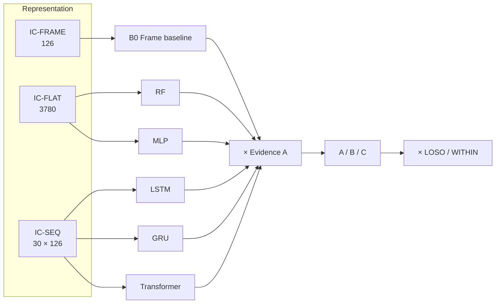

# Experiment Design

**Project:** Gesture-Controlled AI Computer Interface
**Version:** 1.0.0
**Owner:** Team Lead, executed by Member 3
**Last Updated:** 2026-11-06

---

## 1. Purpose

A concrete, executable plan for the experiments described in [RESEARCH_METHODOLOGY](../supporting/RESEARCH_METHODOLOGY.md). Where that document explains *why*, this one specifies *what runs*.

**No results exist yet.** Nothing here is a finding, and no number below is a measurement.

---

## 2. Factors and Levels

| Factor | Symbol | Levels | Type |
|---|---|---|---|
| Temporal representation | `REP` | `FRAME`, `FLAT`, `SEQ` | Categorical |
| Model family | `MODEL` | `RF`, `MLP`, `LSTM`, `GRU`, `TRANSFORMER` | Categorical |
| Evidence configuration | `EVID` | `A`, `B`, `C` | Categorical |
| Evaluation protocol | `PROTO` | `LOSO`, `WITHIN` | Categorical |
| Window length | `WIN` | 10, 20, 30, 45 frames | Ordinal |

**Primary factors:** `MODEL` and `EVID`. Everything else is a control or an ablation.

---

## 3. Design Matrix

### 3.1 Primary Study — Model × Evidence

| Cell | Model | Representation | Evidence | Protocol |
|---|---|---|---|---|
| `M1` | RF | `FLAT` | A, B, C | LOSO + WITHIN |
| `M2` | MLP | `FLAT` | A, B, C | LOSO + WITHIN |
| `M3` | LSTM | `SEQ` | A, B, C | LOSO + WITHIN |
| `M4` | GRU | `SEQ` | A, B, C | LOSO + WITHIN |
| `M5` | Transformer | `SEQ` | A, B, C | LOSO + WITHIN |
| `B0` | Frame baseline | `FRAME` | A | LOSO + WITHIN |

15 model×evidence cells + 1 baseline cell = **16 primary cells**, each run under two protocols.



**Note.** The frame baseline is evaluated under evidence configuration A only. It has no meaningful speech or context interaction because it is not a deployed model — its purpose is the H1 comparison.

### 3.2 Evidence Configurations

| ID | Sources | Weights | Code path |
|---|---|---|---|
| `A` | Gesture | gesture 1.0 | Same |
| `B` | Gesture + speech | gesture 0.55, speech 0.45 | Same |
| `C` | Gesture + speech + context | gesture 0.55, speech 0.30, context 0.15 | Same |

**Invariant.** All three run the same binary. Only configuration differs (`FR-056`). If any cell requires a code branch, the design is broken and must be fixed before running.

### 3.3 Ablations

| ID | Varies | Fixed | Cells |
|---|---|---|---|
| `AB-01` | `REP` | Best model per family | 3 |
| `AB-02` | `WIN` = 10/20/30/45 | LSTM and GRU | 8 |
| `AB-03` | Speech removed from B | Gesture + context | 5 |
| `AB-04` | Context removed from C | Gesture + speech | 5 |
| `AB-05` | Both removed | Gesture only | 5 (replicates A) |
| `AB-06` | Stability window 1/2/3/5 | Best model, config A | 4 |
| `AB-07` | Confidence threshold sweep 0.5–0.95 | Best model, config C | 10 |
| `AB-08` | Association window 500–3000 ms | Config B and C | 12 |

**Rule.** Ablations use the same frozen splits as the primary study. An ablation on different data is not comparable and will not be reported.

---

## 4. Run Plan

### 4.1 Run Identity

```
run-YYYYMMDD-NNNN
```

Assigned at creation by the harness, never by hand. The identifier appears in every artefact and every reported figure.

### 4.2 Run Sequence

| Stage | Runs | Depends on |
|---|---|---|
| 1. Harness smoke test | 1 per family on synthetic data | `PH-05` start |
| 2. Within-subject primary | 16 cells × folds | Dataset v1 |
| 3. LOSO primary | 16 cells × folds | Stage 2 complete |
| 4. Ablations | `AB-01`–`AB-08` | Stage 3 complete |
| 5. Interaction study | 3 configurations × participants | `PH-11` complete |
| 6. Latency study | Per model, per config | Stage 5 complete |
| 7. False-activation study | 3 configurations × participants | Stage 5 complete |

### 4.3 Per-Run Checklist

| # | Step | Verified by |
|---|---|---|
| 1 | Dataset version pinned and checksum verified | Manifest check |
| 2 | Split manifest validated (no leakage) | Validator |
| 3 | Configuration frozen and recorded | `config_json` |
| 4 | Seed set | `seed` column |
| 5 | Environment recorded | `environment_json` |
| 6 | Git revision recorded | `git_revision` |
| 7 | Model trained on training folds only | Loader assertion |
| 8 | Hyperparameters selected on validation only | Harness log |
| 9 | Test fold evaluated exactly once | Run counter |
| 10 | Metrics and confusion matrix persisted | `ENT-07` |
| 11 | Latency measured separately | `TC-061` |
| 12 | Export produced | `EP-052` |

A run missing any checklist item is marked invalid and is not reported.

---

## 5. Controls and Fixed Parameters

| Parameter | Value | Rationale |
|---|---|---|
| Window length (primary) | 30 frames | Matches product configuration |
| Stride (evaluation) | 1 during training, 3 at inference | Training uses all windows; inference matches runtime |
| Batch size | Family-specific, recorded | Not a comparison factor |
| Optimiser | AdamW for neural models | Standard, recorded |
| Early stopping | Validation macro F1, patience 10 | Prevents overfitting |
| Max epochs | 100 | Computed budget |
| Seeds | 3 per cell where cheap; 1 where not, recorded | Variance estimate |
| Hardware | One designated benchmark machine | Latency comparability |
| Python | Pinned minor version | Reproducibility |

**Hyperparameter budget parity.** Each family gets 12 pre-registered configurations. The search space is declared before any run and recorded in the experiment config. A family that uses fewer configurations does not get extra runs later.

---

## 6. Interactive Study Design

### 6.1 Scripted Task Set

Each participant performs the same task list under each evidence configuration.

| Task | Repetitions | Success criterion |
|---|---|---|
| Advance one slide | 10 | Slide index +1 |
| Reverse one slide | 5 | Slide index −1 |
| Toggle black screen | 5 | State toggles |
| Begin slideshow | 2 | Slideshow active |
| End slideshow | 2 | Slideshow inactive |
| Play/pause media | 6 | Playback state toggles |
| Next track | 4 | Track changes |
| Next editor tab | 4 | Active tab changes |
| Save file | 3 | Save event observed |

Total: 41 commanded interactions per configuration per participant.

### 6.2 Non-Command Protocol

| Element | Specification |
|---|---|
| Duration | 10 minutes per configuration |
| Activity | Talk while gesturing, reach for objects, type, adjust posture, walk past the camera |
| Instruction | "Do not attempt to control the computer" |
| System state | `ARMED` |
| Counted | Any dispatched action |

### 6.3 Order

Configurations are presented in randomised order per participant to control learning effects. The randomisation is recorded.

### 6.4 Counterbalancing Note

With 8–12 participants, full counterbalancing is impossible. Randomisation is the practical substitute, and the limitation is stated in the report.

---

## 7. Measurement Plan

| Measurement | Instrument | Sample size |
|---|---|---|
| Inference latency | Stage timer, fixture input | 1 000 iterations |
| End-to-end latency | Interaction trace timestamps | All commanded interactions |
| Association delay | Fusion timestamps | All B and C interactions |
| False activations | Interaction log, `decision=executed` during protocol | All protocol minutes |
| Action success | Adapter result | All dispatches |
| Abstention | `abstained` flag | All interactions |
| Usability (optional) | Short post-session questionnaire | All participants |

**Latency definition reminder.** Four distinct latencies exist ([TRD](../core/TRD.md) §20.3). Every reported figure names which one it is. Mixing them is the most common way a responsive system is made to look slow or a slow one fast.

---

## 8. Exclusions and Invalid Runs

| Condition | Action |
|---|---|
| Subject with < 10 usable samples per class | Excluded from LOSO folds; reported |
| Capture session with < 24 FPS effective | Excluded; reported |
| Run with a missing checklist item | Invalid; re-run |
| Model that fails contract validation | Invalid; not reported |
| Test fold evaluated more than once | Invalid; re-run with a fresh fold assignment |
| Hardware change mid-study | Split the results by hardware; do not pool |

**Rule.** Exclusions are listed with reasons in the report. A silent exclusion is a form of fabrication.

---

## 9. Compute and Time Budget

| Stage | Relative cost | Notes |
|---|---|---|
| RF training | Low | Minutes per fold |
| MLP training | Low–medium | CPU-feasible |
| LSTM/GRU training | Medium–high | Slowest on CPU; GPU preferred |
| Transformer training | Medium | Parallel over time |
| LOSO × 16 cells | High | Dominant cost |
| Ablations | Medium | Fewer cells |
| Interaction study | High in human time, low in compute | Scheduling is the constraint |

**Practical guidance.** Run ablations only after the primary study is complete and only on the selected models. Running everything at maximum breadth is the most reliable way to finish nothing.

---

## 10. Deliverables

| Artefact | Format | Location |
|---|---|---|
| Run records | Database rows + JSON export | `experiments/results/` |
| Comparison tables | Markdown + CSV | `docs/reports/` |
| Confusion matrices | PNG + source data | `experiments/results/` |
| Latency distributions | CSV + summary | `experiments/results/` |
| False-activation log | CSV | `experiments/results/` |
| Analysis notebook | Jupyter | `experiments/notebooks/` |

---

## 11. Related Documents

- [RESEARCH_METHODOLOGY](../supporting/RESEARCH_METHODOLOGY.md) — hypotheses and statistics
- [EVALUATION_METRICS](./EVALUATION_METRICS.md) — metric definitions
- [EXPERIMENT_LOG_TEMPLATE](./EXPERIMENT_LOG_TEMPLATE.md) — recording format
- [DATASET_SPECIFICATION](../supporting/DATASET_SPECIFICATION.md) — data and splits
