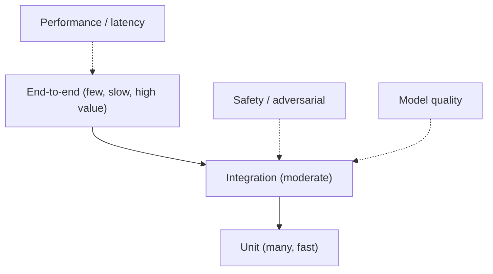

# Testing Strategy

**Project:** Gesture-Controlled AI Computer Interface
**Version:** 1.0.0
**Owner:** Member 5 (Testing) with Team Lead
**Last Updated:** 2026-11-06

---

## 1. Testing Philosophy

Three principles govern every test decision.

1. **Tests must run without hardware.** A test that needs a camera cannot run in CI and will not run before a demo. All hardware interaction is behind an interface with a recorded-fixture implementation (`TR-028`).
2. **The safety gate is tested more heavily than the model.** A model error produces a wrong action; a gate error produces an unauthorised action. The second is unacceptable.
3. **A test that never fails is documentation, not a test.** Every test in the safety and contract areas is verified by deliberately breaking the code once.

**Coverage position.** Line coverage targets are secondary. The requirement is that every `FR` has at least one test case and every gate rule has a denial test. Coverage is reported but not gamed.

---

## 2. Test Pyramid

| Level | Count target | Runtime target | Runs |
|---|---|---|---|
| Unit | 150+ | < 30 s | Every commit |
| Integration | 40+ | < 5 min | Every pull request |
| End-to-end | 10+ | < 15 min | Nightly and pre-demo |
| Performance | 8+ | < 20 min | Nightly and pre-release |
| Model quality | 6+ | < 60 min | On dataset or model change |

---

## 3. Unit Testing

### 3.1 Scope

Pure functions and single components with all dependencies replaced by fakes.

| Area | What is tested |
|---|---|
| Preprocessing | Normalisation invariances, window construction, validity masking |
| Feature builder | Exact shapes for `IC-FRAME`, `IC-FLAT`, `IC-SEQ` |
| Stability filter | Consecutive-agreement logic, reset behaviour |
| Fusion scoring | Hand-computed expected scores, weight normalisation, abstention conditions |
| Intent resolution | Specificity ordering, speech narrowing, context predicates |
| Decision gate | One test per rule, one per denial code, rule ordering |
| Contracts | Serialisation round-trip, schema version, required fields |
| Configuration | Bounds, cross-field sums, unknown keys, clamping |

### 3.2 Required Invariance Tests

| Test | Property |
|---|---|
| `TC-010` | Translation by any offset leaves features unchanged |
| `TC-011` | Uniform scaling of landmarks leaves features unchanged (within tolerance) |
| `TC-012` | A left-hand sample mirrored equals its right-hand equivalent |
| `TC-013` | Window with < 80 % valid frames produces no prediction |

### 3.3 Gate Rule Tests

Every rule in [TRD](../core/TRD.md) §5.9 has a positive and negative test. A rule without both is considered untested.

| Rule | Test ID | Cases |
|---|---|---|
| State active | `TC-020` | ARMED passes; IDLE, PAUSED, ERROR deny |
| Emergency stop | `TC-021` | Clear passes; engaged denies |
| Not abstained | `TC-022` | Confident passes; abstained denies |
| Fused confidence | `TC-023` | At threshold passes; below denies |
| Source confidence | `TC-024` | Each source independently below threshold denies |
| Stability | `TC-025` | Stable passes; flicker denies |
| Duplicate | `TC-026` | Outside cooldown passes; inside denies |
| Rate limit | `TC-027` | Under limit passes; at limit denies |
| Allowlist | `TC-028` | Listed passes; unlisted denies |
| Adapter health | `TC-029` | Healthy passes; unhealthy denies |
| Focus match | `TC-030` | Match passes; mismatch denies |
| Action class | `TC-031` | Safe passes; destructive without confirmation denies |
| Dry run | `TC-032` | Records without dispatch |

---

## 4. Integration Testing

### 4.1 Boundaries Tested

| Boundary | Test approach |
|---|---|
| Camera → landmarks | Recorded frames replayed through the extractor |
| Landmarks → features → model | Recorded sequences through the real model |
| Model → stability → gate | Composed pipeline with a mock adapter |
| Context → intent | Simulated foreground changes |
| Gate → executor → adapter | Mock adapter recording calls |
| Event bus → WebSocket | In-process client receiving envelopes |
| API → service → database | Test database with migrations applied |

### 4.2 Contract Tests

| Test | Verifies |
|---|---|
| `TC-040` | Every WebSocket event validates against its declared payload schema |
| `TC-041` | Every REST response matches the OpenAPI schema |
| `TC-042` | `correlation_id` is identical across all events in one interaction |
| `TC-043` | No event payload contains a landmark array (`TR-020`) |
| `TC-044` | Repository field names match `BACKEND_SCHEMA` column names |
| `TC-045` | Model with mismatched `feature_spec_version` is rejected at load (`E-3002`) |

### 4.3 Failure Injection

| Scenario | Expected behaviour |
|---|---|
| Camera disappears mid-session | Reconnect with backoff; status `DEGRADED`; no crash |
| Speech engine unavailable | Speech source absent; pipeline continues |
| Foreground query fails | Context `unknown`; execution denied |
| Adapter throws | `ActionFailed` result; no exception escapes |
| Database unavailable | Events buffered then dropped with counter; actions unaffected |
| Executor queue full | Gate denies with `E-7013`; no authorised action lost |
| Slow WebSocket client | Other clients unaffected; slow client sees `client_lagged` |

---

## 5. End-to-End Testing

### 5.1 Scenarios

| ID | Scenario | Assertion |
|---|---|---|
| `TC-050` | Arm with wake pose, perform `swipe_right`, PowerPoint advances | Exactly one slide change; `action.executed` emitted |
| `TC-051` | Same gesture in media player | `next_track` intent, not `next_slide` |
| `TC-052` | Gesture plus spoken "next" | Single intent with two evidence sources |
| `TC-053` | Ambiguous motion | Abstention; no action; reason visible |
| `TC-054` | Emergency stop during dispatch | No further dispatch; state `PAUSED` |
| `TC-055` | Alt-tab between prediction and dispatch | Action aborted with `E-7011` |
| `TC-056` | Dry-run mode | Trace recorded; application unchanged |
| `TC-057` | Dashboard disconnect and reconnect | No stale data; state resyncs |
| `TC-058` | Configuration change via API | Behaviour changes without restart |
| `TC-059` | Invalid configuration | Rejected; previous configuration still active |

### 5.2 Demonstration Rehearsal Test

A scripted 12-step sequence executed three times consecutively on the demo machine. Pass condition: all three runs complete without manual recovery. This is the acceptance test for `SM-011` and the closest proxy for the real demonstration.

---

## 6. Model Testing

| Test | What it verifies | Failure response |
|---|---|---|
| Training smoke test | Pipeline runs end-to-end on a tiny synthetic dataset | Block merge |
| Metric correctness | Precision/recall/F1 match hand-computed values on a known confusion matrix | Block merge |
| Leakage assertion | Training loader never sees test participants | Block experiment creation |
| Split validator | No participant appears in two sides under LOSO | Block experiment creation |
| Determinism | Same seed and data produce the same metrics within tolerance | Investigate before reporting |
| Contract conformance | Model input shape matches its declared contract | Block model registration |
| Class-set conformance | Model classes equal active vocabulary | Block activation (`INV-01`) |
| Regression guard | New model version does not fall below a recorded floor on the same split | Warn; require justification to activate |

**Model quality is not asserted by unit tests.** The harness reports metrics; a human decides whether they are acceptable. Tests assert *process* correctness, not *quality*.

---

## 7. Performance and Latency Testing

### 7.1 Instrumentation Points

| Point | Timestamp source |
|---|---|
| Frame acquired | `FramePacket.timestamp_ns` |
| Landmarks produced | stage timer |
| Window closed | buffer timestamp |
| Inference started / finished | stage timer |
| Intent produced | stage timer |
| Gate finished | stage timer |
| Action result | adapter timer |

### 7.2 Measurements

| ID | Measurement | Method |
|---|---|---|
| `TC-060` | Per-stage latency | 1 000 inferences on fixture input |
| `TC-061` | Inference p50 / p95 per model family | Same fixtures, same machine |
| `TC-062` | End-to-end p50 / p95 | Scripted interactions, wall clock |
| `TC-063` | Sustained FPS | 10-minute capture, drop counting |
| `TC-064` | Memory growth | RSS sampled every 10 s for 60 minutes |
| `TC-065` | Emergency stop latency | 100 trials, measured halt time |
| `TC-066` | WebSocket propagation | Emission timestamp vs client receipt |

### 7.3 Rules

- Latency is measured on one designated machine; tier recorded with every result.
- Warm-up iterations are discarded and the count is documented.
- p95 requires at least 100 samples; below that, the maximum is reported instead and labelled as such.
- Wall-clock latency claims never mix the four definitions in [TRD](../core/TRD.md) §20.3.

---

## 8. False Activation Testing

The metric users feel most directly, and the one most often omitted from gesture papers.

### 8.1 Protocol

| Element | Specification |
|---|---|
| Duration | 10 minutes per participant per configuration |
| Activity | Natural conversation, gesturing while talking, reaching for objects, typing, adjusting posture |
| Instruction | "Do not attempt to control the computer" |
| System state | `ARMED` (worst case; the system believes it is listening) |
| Counting | Any dispatched action counts as a false activation |
| Recording | Timestamped log, reviewed by two team members |

### 8.2 Reporting

| Output | Definition |
|---|---|
| Raw count | Number of unintended actions |
| Rate | Count / minutes |
| By denial code | Which gate rules were *not* sufficient |
| By gesture class | Which movements were misread |
| By configuration | A, B, C compared |

**Rule.** A false activation is counted even if the gate rejected it **only** when reporting "unsafe proposals"; the headline metric counts only dispatched actions. Both numbers are reported, clearly labelled.

---

## 9. Cross-User Testing

| Test | Design |
|---|---|
| LOSO evaluation | Every participant held out once; report per-subject |
| Cold-start check | A participant absent from training uses the system live; record success rate |
| Left-handed check | At least one left-handed participant; verify mirroring works |
| Distance robustness | 1.0 m and 3.0 m subset; report degradation |
| Experience effect | Compare first-time vs practiced performance |

**Minimum claim.** With fewer than 8 participants, results are labelled preliminary.

---

## 10. Application Adapter Testing

### 10.1 Shared Contract Harness

Every adapter must pass the same suite, which is the enforcement mechanism for `AC-022`.

| Test | Assertion |
|---|---|
| Capability declaration | `supported_actions` is non-empty and matches `action_classes` keys |
| Unknown action | Returns unsupported error, does not raise |
| Dry run | Returns `dry_run` status; no side effect |
| Health check | Reports a valid status without throwing |
| State query | Returns a JSON-serialisable dict |
| Timeout | A hung call produces `E-8003` |
| Result shape | Always returns `ActionResult` |

### 10.2 Per-Adapter Tests

| Adapter | Specific checks |
|---|---|
| PowerPoint | Slide index changes by exactly one; no change when not in slideshow; modal dialog produces a failure, not a hang |
| Media | Correct key sequence; no effect on unrelated applications |
| IDE | Focus verified before keystroke; modal dialog detected; unsupported action reported |

### 10.3 Extension Test

`TC-070`: add a trivial adapter (for example a text file appender), register it, and exercise it end-to-end. Then diff the change set and assert that no file under `recognition/`, `fusion/`, or `intent/` was modified.

---

## 11. Safety Testing

Adversarial tests, run before every demonstration.

| ID | Scenario | Expected |
|---|---|---|
| `TC-080` | Forge an `IntentCandidate` bypassing fusion | Gate still evaluates all rules |
| `TC-081` | Set dry-run, attempt a destructive action | No dispatch |
| `TC-082` | Unlisted adapter in an intent | Denied `E-7009` |
| `TC-083` | Change focus during dispatch | Aborted `E-7011` |
| `TC-084` | Burst of 50 identical gestures | Only one action within cooldown |
| `TC-085` | Trigger emergency stop mid-dispatch | No further dispatch; in-flight may complete but is reported |
| `TC-086` | Clear emergency stop without confirmation | Rejected |
| `TC-087` | Inject a shell metacharacter into a command name | Rejected; nothing executed |
| `TC-088` | Path traversal in a dataset path parameter | Rejected `E-1003` |
| `TC-089` | Open the API from another host on the LAN | Connection refused by default |

**Review requirement.** Safety tests are reviewed by someone other than the author of the gate. Self-review of safety code is not accepted.

---

## 12. Test Data and Fixtures

| Fixture | Location | Purpose |
|---|---|---|
| Synthetic landmarks | Generated in-test | Invariance and shape tests |
| Recorded landmark sequences | `tests/fixtures/sequences/` | Model and pipeline tests |
| Recorded frames | `tests/fixtures/frames/` | Extractor tests |
| Audio utterances | `tests/fixtures/audio/` | Speech tests |
| Golden event payloads | `tests/fixtures/events/` | Contract tests |
| Known confusion matrix | Generated in-test | Metric correctness |

**Rules.**

- Fixtures contain no personal data; recorded sequences are pseudonymised and consented.
- Fixtures are small enough for git (each < 1 MB total).
- A fixture is never regenerated silently; changing one requires a note in the PR.

---

## 13. CI Pipeline

| Stage | Trigger | Content | Blocking |
|---|---|---|---|
| Lint + types | Every push | Ruff, mypy | Yes |
| Unit | Every push | `pytest tests/unit` | Yes |
| Contract | Every push | Schema and OpenAPI validation | Yes |
| Integration | Pull request | `pytest tests/integration` | Yes |
| Docs | Pull request | Link check, Mermaid parse | Yes |
| Performance | Nightly | Latency and soak | No (report only) |
| End-to-end | Nightly / pre-demo | Full scenarios | No (report), Yes before demo |
| Leakage | Dataset or model change | Manifest validator | Yes |

---

## 14. Test Case Register

| ID | Level | Area | Requirement |
|---|---|---|---|
| `TC-010`–`TC-013` | Unit | Preprocessing invariance | `FR-014`, `TR-010` |
| `TC-020`–`TC-032` | Unit | Gate rules | `FR-060`–`FR-068` |
| `TC-040`–`TC-045` | Integration | Contracts | `FR-081`, `FR-083`, `TR-016` |
| `TC-050`–`TC-059` | E2E | User scenarios | `FR-090`–`FR-096` |
| `TC-060`–`TC-066` | Performance | Latency and reliability | `NFR-001`–`NFR-007`, `FR-106`, `FR-107` |
| `TC-070` | Integration | Adapter extensibility | `FR-075`, `AC-022` |
| `TC-080`–`TC-089` | Safety | Adversarial | `FR-060`–`FR-068`, `NFR-020` |
| `TC-090`–`TC-095` | Model | Harness and leakage | `FR-102`–`FR-105`, `FR-111` |

The requirement → test mapping is maintained in [TRACEABILITY_MATRIX](./TRACEABILITY_MATRIX.md).

---

## 15. Related Documents

- [IMPLEMENTATION_PLAN](../core/IMPLEMENTATION_PLAN.md) — phase-level testing requirements
- [TRD](../core/TRD.md) §19 — error handling
- [SECURITY_AND_PRIVACY](./SECURITY_AND_PRIVACY.md) — security test basis
- [EVALUATION_METRICS](../research/EVALUATION_METRICS.md) — metric instrumentation
